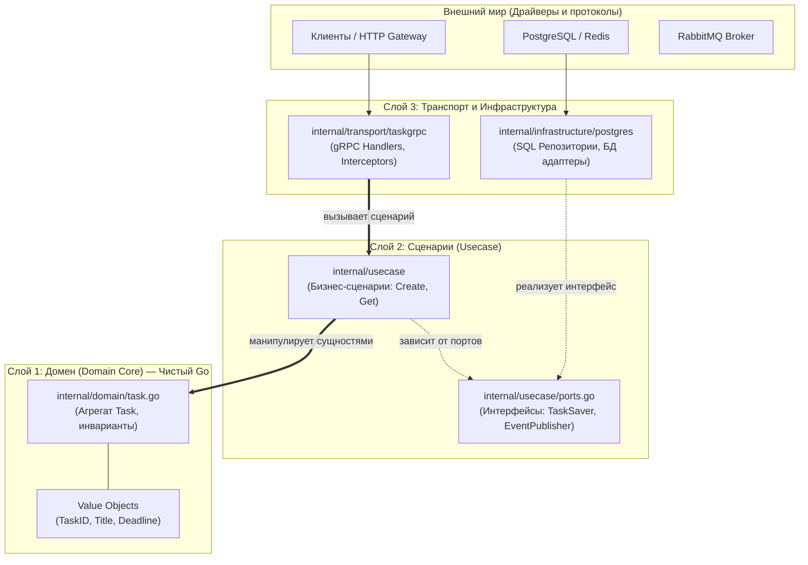

# Чистая архитектура и Domain-Driven Design (DDD)

В этом разделе подробно и простыми словами объясняется, почему сервисы Orbit AI строятся по принципам **Чистой архитектуры (Clean Architecture)** и **Domain-Driven Design (DDD)**, а не в виде прямолинейного монолитного скрипта.

---

## 1. Зачем нам Чистая архитектура?

Обычный код без слоёв выглядит так: в обработчике HTTP/gRPC напрямую парсится JSON, тут же пишется SQL-запрос `SELECT * FROM ...`, здесь же отправляется письмо или вызывается внешний API.

**В чём беда такого подхода?**
1. **Невозможно протестировать**: чтобы проверить простую логику «дедлайн должен быть в будущем», приходится поднимать тестовый PostgreSQL и gRPC-клиент.
2. **Взрывной рост багов при изменениях**: смена схемы БД или переход на другую библиотеку ломает сразу весь код.
3. **«God-файлы»**: один файл разрастается до 2000 строк, где перемешаны парсинг заголовков, бизнес-правила и SQL.

**Чистая архитектура решает это разделением на независимые слои:**



---

## 2. Слой Domain: Сердце системы

Домен — это чистые правила предметной области вашего сервиса (задачи, расписание, маршруты). 

Главное правило: **Домен не зависит ни от кого**. В нём нет импортов сторонних пакетов, работы с сетью или БД.

### Сущности и Агрегаты (Entities & Aggregates)
* Сущность обладает уникальным идентификатором (`TaskID`) и жизненным циклом. Два объекта с одинаковыми полями, но разными ID — это разные сущности.
* Агрегат — это кластер связанных объектов, рассматриваемый как единое целое. Все изменения данных агрегата происходят строго через его методы (например, `task.Complete()` или `task.Reschedule()`), которые охраняют **бизнес-инварианты**.

### Объекты-значения (Value Objects)
В отличие от сущностей, Value Object не имеет идентификатора. Он определяется исключительно своим значением и **неизменяем (immutable)**:

```go
// Title — Value Object с самовалидацией при создании
type Title struct {
    value string
}

func NewTitle(raw string) (Title, error) {
    trimmed := strings.TrimSpace(raw)
    count := utf8.RuneCountInString(trimmed)
    if count == 0 {
        return Title{}, ErrEmptyTitle
    }
    if count < 3 {
        return Title{}, ErrTitleTooShort
    }
    if count > 200 {
        return Title{}, ErrTitleTooLong
    }
    return Title{value: trimmed}, nil
}
```

Благодаря Value Objects в коде невозможно создать сущность с невалидным названием — проверка выполняется при создании, и бизнес-логика гарантированно работает с корректными данными.

---

## 3. Слой App: Сценарии использования (Use Cases)

Слой `app` (или `usecase`) реализует пользовательские сценарии системы: «Создать задачу», «Завершить задачу», «Получить список дедлайнов студента».

Сценарий координирует процесс:
1. Проверяет авторизованного пользователя (`actor`).
2. Проверяет права доступа и владение ресурсом (защита от IDOR).
3. Создает или загружает агрегат через интерфейс порта.
4. Вызывает методы агрегата для применения изменений.
5. Сохраняет агрегат обратно в репозиторий.
6. Извлекает доменные события (`task.PullEvents()`) и передает их в шину сообщений.

```go
func (uc *CompleteTaskUseCase) Execute(ctx context.Context, actor domain.OwnerID, taskID domain.TaskID) (*domain.Task, error) {
    // 1. Загрузка через порт
    task, err := uc.finder.FindByID(ctx, taskID)
    if err != nil {
        return nil, err
    }

    // 2. Проверка владения ресурсом
    if !task.IsOwnedBy(actor) {
        return nil, domain.ErrTaskNotFound // Отдаем 404, чтобы не раскрывать существование чужой задачи
    }

    // 3. Бизнес-действие агрегата
    if err := task.Complete(); err != nil {
        return nil, err
    }

    // 4. Сохранение
    if err := uc.saver.Save(ctx, task); err != nil {
        return nil, err
    }

    return task, nil
}
```

---

## 4. Порты и Адаптеры (Гексагональная архитектура)

Принцип инверсии зависимостей (DIP):
* **Порт (Port)** — это интерфейс Go, объявленный в слое `app/ports.go`. Он формулирует, *что* нужно сценарию (`TaskSaver`, `Clock`, `IdempotencyStore`).
* **Адаптер (Adapter)** — это реализация порта под конкретную технологию в каталоге `adapters/postgres`, `adapters/redis` и т.д.

Сценарий ничего не знает о том, как реализован порт: данные могут писаться в PostgreSQL, сохраняться в памяти во время тестов или передаваться в Redis. Замена технологии базы данных не требует изменения ни единой строчки кода в сценариях и домене!
