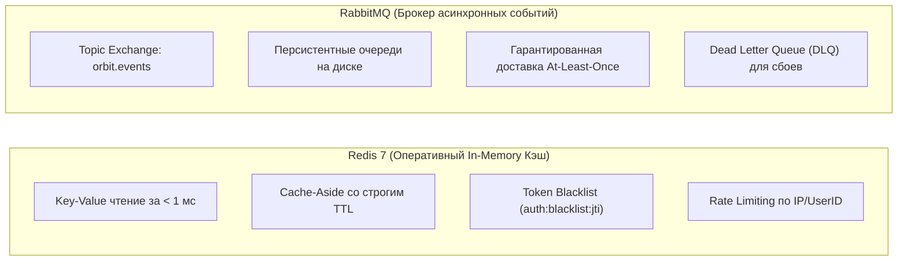

# ADR-006: Разделение ролей Redis (кэш/токены) и RabbitMQ (события)

## Статус
**Принято (Accepted)** — Октябрь 2026 г.

---

!!! info "Дополнение: текущая реализация Schedule"
    Исходное решение ниже описывает разделение кэша и целевой межсервисной шины. Оно уточнено: Schedule уже использует Redis Streams для внутренней очереди обновления расписания, а Redis также обеспечивает дедупликацию, lease и общий rate limiter. RabbitMQ пока не входит в текущий Compose. Это не замена будущей шины доменных событий на Redis.

## Контекст
При проектировании промежуточных слоев данных часто возникает искушение использовать один инструмент для решения всех задач:
- Использовать Redis Pub/Sub или Redis Streams в качестве шины сообщений вместо развертывания отдельного брокера RabbitMQ.
- Либо использовать RabbitMQ для временного хранения данных и кэширования.

Это создает следующие архитектурные риски:
1. **Redis Pub/Sub не персистентен:** Если сервис-подписчик перезагружается или временно отключен, все сообщения, отправленные в этот момент через Redis Pub/Sub, **безвозвратно теряются (Fire-and-Forget)**.
2. **Отсутствие гибкой маршрутизации в Redis:** В Redis Streams сложно реализовать динамическую маршрутизацию по сложным паттернам ключей (Topic Exchanges с wildcard-масками `#` и `*`).
3. **RabbitMQ не предназначен для произвольного чтения по ключу:** RabbitMQ — это очередь FIFO, из нее нельзя за 1 миллисекунду прочитать расписание конкретной группы по ключу `schedule:group:261-334`.

---

## Решение
Принято четкое архитектурное разделение ответственности между двумя инструментами:

1. **Redis в исходном решении предназначался для:**
   - Быстрый кэш со строгим временем жизни (TTL) и fallback на базу данных PostgreSQL;
   - Быстрое in-memory хранилище токенов и лимитеров.
2. **RabbitMQ в целевой архитектуре предназначен для:**
   - Брокер асинхронных бизнес-событий с персистентным хранением на диске;
   - Очереди гарантированной обработки задач между сервисами.
3. **Запрещено:**
   - Использовать Redis Pub/Sub для критических бизнес-событий, потеря которых нарушает консистентность системы.
   - Использовать RabbitMQ как хранилище состояния (State Store).

---

## Последствия

### Позитивные последствия:
- **Надёжность доставки:** для будущих доменных событий нужны durable-очереди, persistent-сообщения, publisher confirms, подтверждения потребителя и обработка повторов. Нельзя обещать отсутствие потерь только по наличию RabbitMQ.
- **Быстрое чтение:** Redis обслуживает кэш в памяти; текущий Compose включает AOF. Задержка зависит от среды, а кэш и очередь делят ресурсы Redis.
- **Чистота ответственности компонентов:** Разработчику очевидно, какой инструмент выбирать под конкретную задачу.

### Негативные последствия и компромиссы:
- **Усложнение инфраструктуры:** Локально в `infra` требуется поднимать два отдельных контейнера (`redis` и `rabbitmq`), потребляющих около 150–200 МБ оперативной памяти.

## Дополнение: внутренняя очередь Schedule

Задания обновления расписания — восстанавливаемая работа: периодический обход и запросы пользователей могут поставить их снова. Используются Streams `sync:v1:stream:priority` / `sync:v1:stream:periodic`, consumer group, дедупликация, lease, отложенные повторы и восстановление зависших заданий. Это не Redis Pub/Sub.

Обработка должна выдерживать повторную доставку. Lease дополняется проверкой поколения при записи PostgreSQL; один lock не обеспечивает exactly-once. Сохранность очереди зависит от персистентности и эксплуатации Redis; AOF не является обещанием нулевых потерь. PostgreSQL хранит расписание независимо от кэша.

Для критических межсервисных событий сохраняется целевой выбор RabbitMQ с Outbox и идемпотентными потребителями. Его подключение оформляется отдельным этапом. См. [паспорт Schedule](../../reference/services/schedule.md) и [диагностику](../../how-to/schedule-sync-diagnostics.md).
