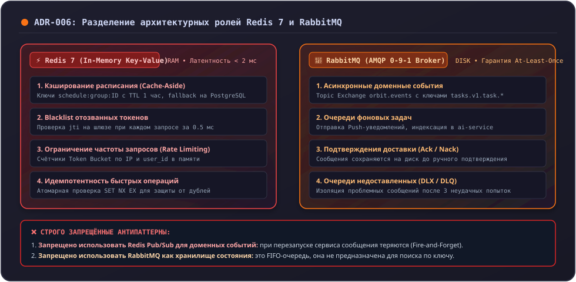

# ADR-006: Разделение ролей Redis (кэш/токены) и RabbitMQ (события)

## Статус
**Принято (Accepted)** — Октябрь 2026 г.

---

## Контекст
При проектировании промежуточных слоев данных часто возникает искушение использовать один инструмент для решения всех задач:
- Использовать Redis Pub/Sub или Redis Streams в качестве шины сообщений вместо развертывания отдельного брокера RabbitMQ.
- Либо использовать RabbitMQ для временного хранения данных и кэширования.

Это создает следующие архитектурные риски:
1. **Redis Pub/Sub не персистентен:** Если сервис-подписчик перезагружается или временно отключен, все сообщения, отправленные в этот момент через Redis Pub/Sub, **безвозвратно теряются (Fire-and-Forget)**.
2. **Отсутствие гибкой маршрутизации в Redis:** В Redis Streams сложно реализовать динамическую маршрутизацию по сложным паттернам ключей (Topic Exchanges с wildcard-масками `#` и `*`).
3. **RabbitMQ не предназначен для произвольного чтения по ключу:** RabbitMQ — это очередь FIFO, из нее нельзя за 1 миллисекунду прочитать расписание конкретной группы по ключу `schedule:group:261-334`.

---

## Решение
Принято четкое архитектурное разделение ответственности между двумя инструментами:

1. **Redis используется ТОЛЬКО как:**
   - Быстрый кэш со строгим временем жизни (TTL) и fallback на базу данных PostgreSQL;
   - Быстрое in-memory хранилище токенов и лимитеров.
2. **RabbitMQ используется ТОЛЬКО как:**
   - Брокер асинхронных бизнес-событий с персистентным хранением на диске;
   - Очереди гарантированной обработки задач между сервисами.
3. **Запрещено:**
   - Использовать Redis Pub/Sub для критических бизнес-событий, потеря которых нарушает консистентность системы.
   - Использовать RabbitMQ как хранилище состояния (State Store).

---

## Последствия

### Позитивные последствия:
- **Надежность и сохранность данных:** Доменные события никогда не теряются при падении сервисов-подписчиков благодаря персистентным очередям RabbitMQ.
- **Высокая скорость кэширования:** Redis работает исключительно в оперативной памяти с субмиллисекундным временем отклика, не перегружаясь очередями.
- **Чистота ответственности компонентов:** Разработчику очевидно, какой инструмент выбирать под конкретную задачу.

### Негативные последствия и компромиссы:
- **Усложнение инфраструктуры:** Локально в `infra` требуется поднимать два отдельных контейнера (`redis` и `rabbitmq`), потребляющих около 150–200 МБ оперативной памяти.
