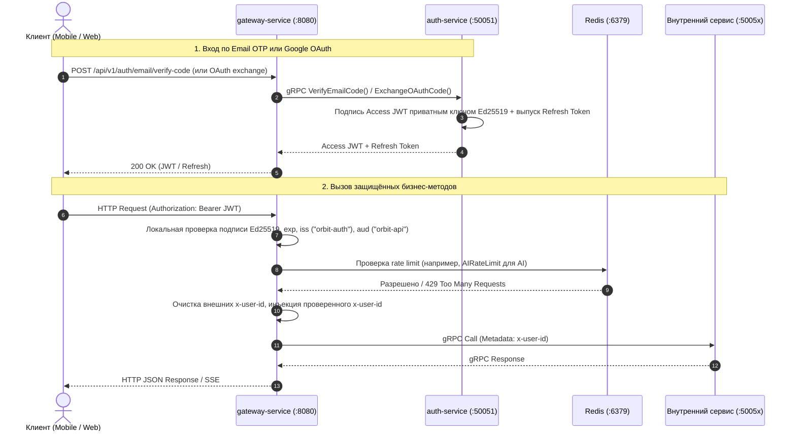

# Архитектура аутентификации и авторизации

Безопасность распределенной системы Orbit AI построена на модели **локальной проверки JWT на периметре (Edge Authentication)** и **доверенной передачи контекста пользователя во внутреннем контуре (Context Propagation)**.

---



---

## 2. Криптографическая основа: JWT на базе Ed25519

Для цифровой подписи токенов доступа (Access Token) используется асимметричный алгоритм **Ed25519 (EdDSA)**:

- **Приватный ключ (Private Key):** хранится **строго в одном сервисе — `auth-service`**. Только он генерирует и подписывает Access JWT при успешном входе (через **Email OTP** или **Google OAuth + PKCE**) или при обновлении сессии (`/api/v1/auth/refresh`).
- **Публичный ключ (Public Key):** монтируется в `gateway-service`. Шлюз проверяет подпись токена, срок действия (`exp`), `iss: "orbit-auth"`, `aud: "orbit-api"` и UUID в `sub` **полностью локально в памяти** без сетевых запросов к `auth-service` или Redis.
- **Роль Redis в Gateway:** в шлюзе Redis используется для распределённого **rate limiting** (`AIRateLimit`, `SupportIssueRateLimit`), а не для проверки JWT blacklist на каждый запрос. Отзыв сессий и ротация refresh-токенов выполняются в `auth-service`.

---

## 3. Граница доверия и gRPC-метаданные

### Почему внутренние сервисы доверяют заголовку `x-user-id`?
1. **Изоляция сети:** Внутренние gRPC-порты (50051..50057) слушают внутри закрытой Docker-сети **`orbit-infra_default`** (на хост они привязываются только к `127.0.0.1` для локальной диагностики и не публикуются наружу).
2. **Очистка внешних заголовков на шлюзе:** При передаче вызова в gRPC `gateway-service` перезаписывает метаданные `x-user-id` идентификатором пользователя, извлечённым из проверенного JWT. Клиентский заголовок не может подменить `x-user-id`.
3. **Валидация во внутреннем контуре:** Доменные gRPC-сервисы и `ai-service` считывают `x-user-id` из incoming gRPC metadata для проверки владения данными и изоляции пользовательских ресурсов.

### Исключения для системных вызовов
Методы проверки работоспособности оркестратора (gRPC Healthcheck):
```text
/grpc.health.v1.Health/Check
/grpc.health.v1.Health/Watch
```
вызываются Docker-демоном без контекста пользователя и не требуют `x-user-id`.

---

## 4. Жизненный цикл сессии и отзыв Refresh-токенов

Access Token является короткоживущим stateless-токеном. При выходе из аккаунта (`POST /api/v1/auth/logout`) или смене учётных данных отзыв выполняется на уровне refresh-сессий в `auth-service` (PostgreSQL + Redis), поэтому клиент не может перевыпустить новый Access Token после logout.

---

## 5. Сравнение: Как нельзя и Как правильно

<div class="grid" markdown>

<div class="card" markdown>
### :x: Как нельзя

- **Передавать `owner_id` или `user_id` в теле запроса клиента.** Любой пользователь сможет подставить идентификатор другого студента (уязвимость BOLA / IDOR).
- **Раздавать приватный ключ подписи токенов другим микросервисам.** При компрометации любого сервиса злоумышленник сможет выпускать валидные токены.
- **Делать сетевой gRPC-запрос в `auth-service` при каждом HTTP-запросе.** Это превратит `auth-service` в критическое «бутылочное горлышко».
</div>

<div class="card" markdown>
### :white_check_mark: Как правильно

- **Проверять JWT локально в `gateway-service`** по публичному ключу Ed25519 с валидацией `alg=EdDSA`, `exp`, `iss` и `aud="orbit-api"`.
- **Транслировать проверенный ID пользователя во внутренний контур через метаданные gRPC (`x-user-id`).**
- **Использовать проверку владельца в доменных сценариях и хранилищах** (например, в `ai-service` при чтении и удалении диалогов).
- **Отзывать refresh-сессии на стороне `auth-service`** и ограничивать частоту дорогих запросов через Redis rate limiter на шлюзе.
</div>

</div>
