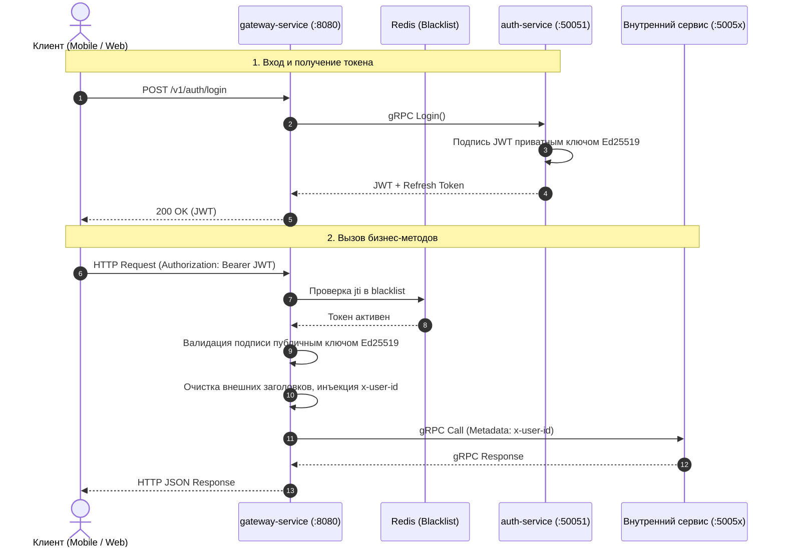

# Архитектура аутентификации и авторизации

Безопасность распределенной системы Orbit AI построена на модели **централизованной проверки токенов на периметре (Edge Authentication)** и **доверенной передачи контекста пользователя во внутреннем контуре (Context Propagation)**.

---




---

## 2. Криптографическая основа: JWT на базе Ed25519

Для цифровой подписи токенов доступа (Access Token) используется асимметричный алгоритм **Ed25519 (EdDSA)**:

- **Приватный ключ (Private Key):** хранится **строго в одном сервисе — `auth-service`**. Только он имеет право генерировать и подписывать JWT при успешном входе или обновлении сессии.
- **Публичный ключ (Public Key):** распространяется на `gateway-service`. Шлюз мгновенно проверяет подлинность любого токена в памяти за доли микросекунды без сетевых обращений к базе данных или другим сервисам.

---

## 3. Граница доверия и gRPC-метаданные

### Почему внутренние сервисы доверяют заголовку `x-user-id`?
1. **Изоляция сети:** Внутренние gRPC-порты (50051..50059) **не проброшены во внешний интернет**. Они доступны исключительно внутри закрытой Docker-сети `orbit-net`.
2. **Очистка внешних заголовков на шлюзе:** При получении входящего HTTP-запроса `gateway-service` принудительно удаляет любые клиентские заголовки `x-user-id` и перезаписывает значение только тем идентификатором, который был извлечен из проверенного криптографического токена.
3. **Строгая валидация в перехватчике:** Внутренний gRPC `AuthInterceptor` проверяет, что заголовок не пуст, его длина не превышает 64 байт, и он не содержит управляющих ASCII-символов.

### Исключения для системных вызовов
Методы проверки работоспособности оркестратора (Healthcheck):
```text
/grpc.health.v1.Health/Check
/grpc.health.v1.Health/Watch
```
вызываются Docker-демоном или Kubernetes Kubelet без контекста пользователя. `AuthInterceptor` содержит явное исключение, пропуская запросы с префиксом `/grpc.health.v1.Health/` без заголовка `x-user-id`.

---

## 4. Мгновенный отзыв токенов (Token Blacklist)

Поскольку JWT по своей природе самодостаточен (stateless), при смене пароля или выходе со всех устройств (Logout) токен должен быть немедленно аннулирован до истечения его времени жизни (`exp`).

Для этого используется оперативный кэш **Redis**:
1. Каждый выданный JWT содержит уникальный идентификатор `jti` (JWT ID).
2. При выходе из системы `auth-service` сохраняет ключ `auth:blacklist:<jti>` в Redis со временем жизни, равным оставшемуся времени жизни токена (`TTL = exp - now`).
3. `gateway-service` проверяет наличие ключа в Redis при каждом запросе. Если ключ найден — возвращается `401 Unauthorized`.

---

## 5. Сравнение: Как нельзя и Как правильно

<div class="grid" markdown>

<div class="card" markdown>
### :x: Как нельзя

- **Передавать `owner_id` в теле запроса клиента (`CreateTaskRequest.owner_id`).** Любой пользователь сможет передать идентификатор сокурсника и создать задачу от его имени (уязвимость BOLA / IDOR).
- **Раздавать приватный ключ подписи токенов всем микросервисам.** При компрометации любого сервиса злоумышленник сможет выпускать валидные токены администратора.
- **Делать сетевой gRPC-запрос в `auth-service` при каждом запросе к любому сервису.** Это превратит `auth-service` в критическое «бутылочное горлышко» и сведет на нет отказоустойчивость системы.
</div>

<div class="card" markdown>
### :white_check_mark: Как правильно

- **Проверять JWT строго на шлюзе `gateway-service` по публичному ключу Ed25519.**
- **Транслировать проверенный ID пользователя во внутренний контур через метаданные gRPC (`x-user-id`).**
- **Использовать проверку владельца в доменных сценариях (`task.IsOwnedBy(actor)`).**
- **Хранить блэклист отозванных `jti` в Redis с автоматическим истечением TTL.**
</div>

</div>
