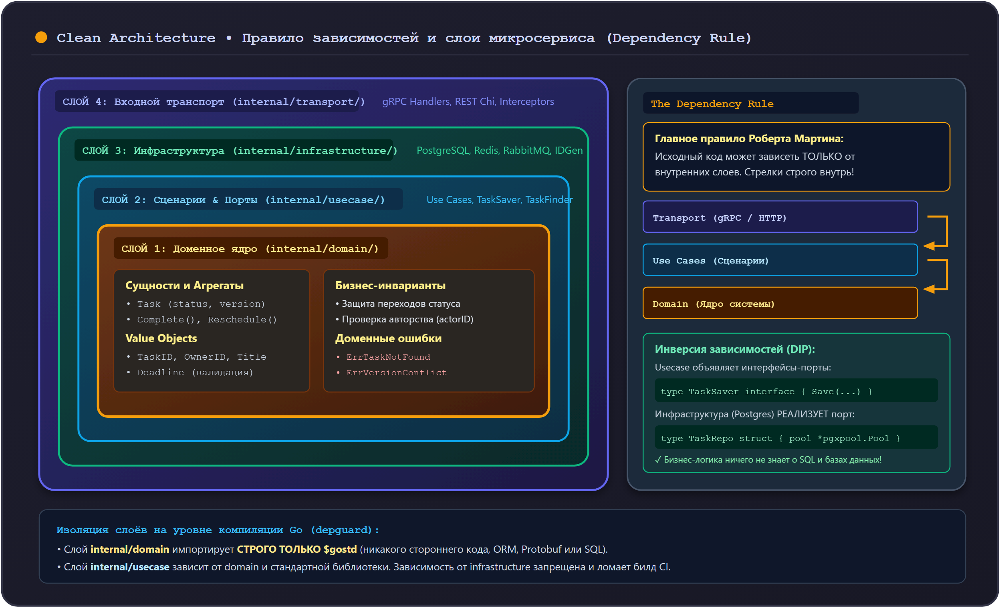

# Clean Architecture в микросервисах Orbit AI

Архитектура микросервисов Orbit AI базируется на принципах **Чистой архитектуры (Clean Architecture)** Роберта Мартина (Дядюшки Боба) и концепции **Гексагональной архитектуры (Ports & Adapters)** Алистера Кокберна.

Главная цель этого подхода — сделать бизнес-логику независимой от фреймворков, баз данных, транспортных протоколов и сторонних библиотек.

---

## 1. Фундаментальное правило зависимостей (The Dependency Rule)

В чистой архитектуре код разделен на концентрические слои. Основное правило гласит:

> **Исходный код может зависеть только от внутренних слоев и никогда не зависит от внешних.**  
> Внутренний слой ничего не знает о существовании внешнего.



---

## 2. Разбор слоев на примере `tasks-service`

### Слой 1. Домен (Domain) — Ядро системы
- **Расположение:** `internal/domain/`
- **От чего зависит:** **Строго ни от чего**, кроме стандартной библиотеки Go (`$gostd`).
- **Что содержит:**
  * **Агрегаты и сущности (`Task`):** содержат состояние и методы изменения состояния (`Complete()`, `Reschedule()`), защищающие бизнес-инварианты.
  * **Value Objects (`TaskID`, `Title`, `Deadline`):** неизменяемые типы с валидацией при создании.
  * **Доменные ошибки:** `ErrTaskNotFound`, `ErrInvalidStatusTransition`, `ErrVersionConflict`.
  * **Доменные события:** `TaskCreated`.

### Слой 2. Сценарии (Usecase / Application)
- **Расположение:** `internal/usecase/`
- **От чего зависит:** Только от слоя `domain` и стандартной библиотеки Go.
- **Что содержит:**
  * **Интерфейсы-порты (`ports.go`):** разделенные по принципу ISP (`TaskSaver`, `TaskFinder`, `EventPublisher`, `IdempotencyStore`).
  * **Случаи использования (`create_task.go`, `get_task.go`):** оркестрируют загрузку данных через порты, вызов методов сущности и сохранение результата. Сценарий не знает, пишется задача в PostgreSQL или в память.

### Слой 3. Инфраструктура (Infrastructure)
- **Расположение:** `internal/infrastructure/`
- **От чего зависит:** От слоев `usecase` (реализует порты) и `domain` (манипулирует сущностями).
- **Что содержит:**
  * Адаптеры баз данных (`postgres/task_repository.go` с SQL-запросами).
  * Реализации кэша (`redis/cached_repository.go`).
  * Адаптеры брокеров сообщений (`rabbitmq/event_publisher.go`).
  * In-memory реализации для легковесного тестирования.

### Слой 4. Транспорт (Transport)
- **Расположение:** `internal/transport/taskgrpc/`
- **От чего зависит:** От слоя `usecase` (вызывает сценарии) и внешних сгенерированных контрактов Protobuf.
- **Что содержит:**
  * `handler.go`: обработчики gRPC-запросов, преобразование Protobuf DTO в параметры UseCase, маппинг доменных ошибок в статусные коды gRPC (`codes.NotFound`, `codes.InvalidArgument`).
  * `interceptors.go`: промежуточные слои (Auth, Logging, Recovery).

### Точка сборки: Composition Root (`main.go`)
- **Расположение:** `cmd/tasks-service/main.go`
- **Роль:** Единственное место в сервисе, которое имеет право импортировать все слои сразу. Здесь создаются экземпляры репозиториев, прокидываются в конструкторы сценариев, связываются с хендлерами gRPC и запускается Graceful Shutdown.

---

## 3. Автоматический контроль границ архитектуры

Чтобы предотвратить случайное нарушение Чистой архитектуры разработчиками, в проекте включен строгий анализатор **`depguard`** в `golangci-lint`:

```yaml
# .golangci.yml
linters-settings:
  depguard:
    rules:
      domain:
        files:
          - "**/internal/domain/**"
        allow:
          - "$gostd"
        deny:
          - pkg: "**"
            desc: "Слой domain не имеет права зависеть от внешних пакетов или слоев infrastructure/transport"
      usecase:
        files:
          - "**/internal/usecase/**"
        allow:
          - "$gostd"
          - "github.com/orbit-polytech/tasks-service/internal/domain"
```

Если кто-то попытается импортировать SQL-драйвер или gRPC в `internal/domain`, CI немедленно завершится ошибкой.

---

## 4. Сравнение: Как нельзя и Как правильно

<div class="grid" markdown>

<div class="card" markdown>
### :x: Как нельзя

- **Импортировать пакет базы данных (`database/sql` или `pgx`) внутри сущности домена.** Сущность перестает быть чистой и не может тестироваться без базы данных.
- **Возвращать сгенерированные Protobuf-структуры напрямую из репозитория.** Это намертво связывает схему базы данных с транспортным протоколом API.
- **Писать бизнес-логику проверки статуса задачи внутри gRPC-обработчика.** Если позже появится фоновый воркер или CLI, логику придется дублировать.
</div>

<div class="card" markdown>
### :white_check_mark: Как правильно

- **Инвертировать зависимости через интерфейсы (порты).** Слой Usecase объявляет, что ему нужно (`TaskSaver`), а Infrastructure предоставляет реализацию.
- **Держать домен изолированным от внешнего мира.** Тестировать его 100% быстрыми юнит-тестами без внешних процессов.
- **Собирать граф зависимостей строго в `cmd/.../main.go`.**
</div>

</div>
