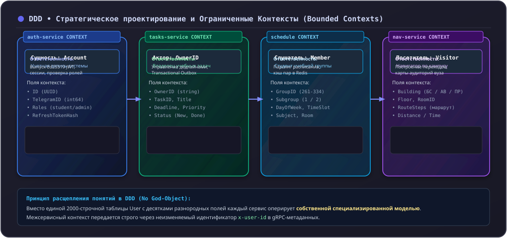

# Domain-Driven Design для микросервисов

Предметно-ориентированное проектирование (**Domain-Driven Design, DDD**), сформулированное Эриком Эвансом и развитое Воном Верноном, лежит в основе разбиения системы Orbit AI на микросервисы и проектирования внутренней логики каждого сервиса.

---

## 1. Стратегический уровень: Ограниченные контексты (Bounded Contexts)

Микросервисная архитектура без четких границ предметных областей превращается в «распределенный монолит». В Orbit AI границы микросервисов совпадают с **Ограниченными контекстами (Bounded Contexts)**.



### Принцип расщепления понятий
В монолитах часто пытаются создать одну гигантскую универсальную сущность `User` с сотней полей (логин, пароль, номер группы, задачи, средний балл, домашний адрес).  
В DDD у каждого ограниченного контекста **своя собственная модель понятия**:
- Для `auth-service` пользователь — это `Account` с хэшем пароля и правами доступа.
- Для `tasks-service` пользователь — это просто непрозрачный `OwnerID` (владелец задачи).
- Для `schedule-service` пользователь — это член учебной группы `GroupMember`.

---

## 2. Тактический уровень: Паттерны предметной области

Внутри каждого сервиса бизнес-логика реализуется с помощью тактических паттернов DDD.

### 1. Объекты-значения (Value Objects)
Неизменяемые объекты без идентификатора, характеризующиеся своими атрибутами. Два объекта равны, если равны их значения.

```go
// Title — Value Object, защищающий инвариант длины (1..120 символов)
type Title struct {
	value string
}

func NewTitle(raw string) (Title, error) {
	trimmed := strings.TrimSpace(raw)
	if trimmed == "" {
		return Title{}, ErrEmptyTitle
	}
	if utf8.RuneCountInString(trimmed) > 120 {
		return Title{}, ErrTitleTooLong
	}
	return Title{value: trimmed}, nil
}
```

### 2. Сущности и Агрегаты (Entities & Aggregates)
- **Сущность (Entity):** объект, обладающий уникальной идентичностью во времени (`TaskID`). Даже если все поля задачи изменятся, это остается та же самая задача.
- **Агрегат (Aggregate):** кластер связанных объектов и сущностей, рассматриваемый как единое целое с точки зрения изменения данных.
- **Корень агрегата (Aggregate Root):** входная сущность агрегата (`Task`). Внешний мир не может напрямую менять внутренние поля агрегата — любые изменения происходят **строго через методы корня**, гарантирующие соблюдение бизнес-правил.

```go
// Метод агрегата, защищающий правила перехода состояний
func (t *Task) Complete() error {
	if t.status == StatusCompleted {
		return ErrAlreadyCompleted
	}
	if t.status == StatusCanceled {
		return ErrCannotCompleteCanceled
	}
	t.status = StatusCompleted
	t.version++
	return nil
}
```

### 3. Доменные события (Domain Events)
Фиксация значимого факта, произошедшего в предметной области в прошлом. Именуются в прошедшем времени: `TaskCreated`, `ScheduleUpdated`, `RoomBlocked`.
События неизменяемы и содержат данные, необходимые другим контекстам для асинхронной реакции.

---

## 3. Сравнение: Анемичная модель vs Богатая доменная модель

<div class="grid" markdown>

<div class="card" markdown>
### :x: Анемичная модель (Anti-pattern)

```go
// Сущность превращена в глупую структуру с геттерами/сеттерами
type Task struct {
    ID     string
    Status string
}

// Вся бизнес-логика размазана по сервисам и контроллерам
func (s *Service) Complete(t *Task) {
    if t.Status != "COMPLETED" {
        t.Status = "COMPLETED" // Прямое изменение состояния
    }
}
```
*Минусы:* Инварианты не защищены. Любой разработчик может в любом месте кода установить `t.Status = "BROKEN"` в обход всех правил.
</div>

<div class="card" markdown>
### :white_check_mark: Богатая доменная модель (DDD в Orbit AI)

```go
// Поля сущности приватны (инкапсуляция)
type Task struct {
    id     TaskID
    status TaskStatus
    version int64
}

// Изменение состояния возможно ТОЛЬКО через публичные методы
func (t *Task) Complete() error {
    if t.status == StatusCanceled {
        return ErrInvalidStatusTransition
    }
    t.status = StatusCompleted
    t.version++
    return nil
}
```
*Плюсы:* Невозможно перевести задачу в некорректное состояние. Бизнес-правила сконцентрированы в одном месте и легко тестируются.
</div>

</div>
