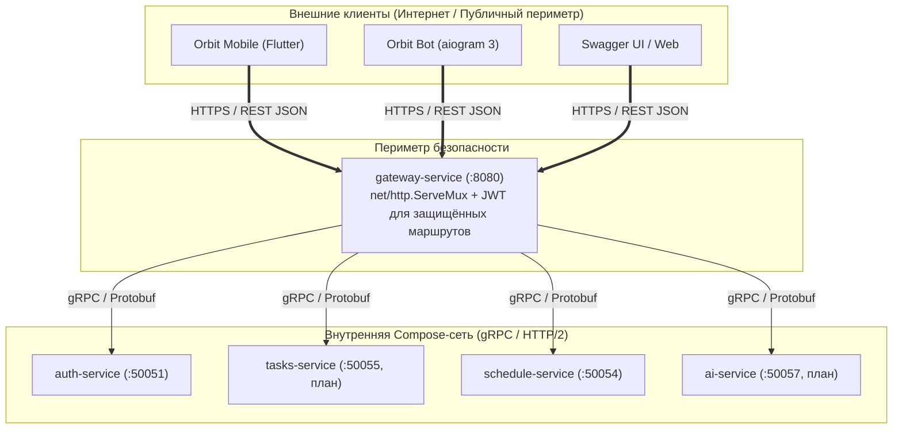

# Почему gRPC внутри контура и REST снаружи

Архитектура распределенной системы Orbit AI использует гибридную модель взаимодействия: **REST/JSON на внешней границе** (для мобильного приложения, Telegram-бота и внешних веб-клиентов) и **gRPC/Protobuf во внутреннем контуре** межсервисного взаимодействия.

---

---

## 2. Почему REST на внешней границе (Clients $\rightarrow$ Gateway)

1. **Максимальная совместимость с клиентами:**
   Мобильные сети (4G/5G/Wi-Fi) и корпоративные прокси-серверы вузов часто плохо поддерживают долгоживущие стримы HTTP/2 и gRPC-трейлеры (`grpc-status`). REST поверх стандартного HTTP работает везде без специфических сетевых настроек.
2. **Простота интеграции и документация (OpenAPI / Swagger):**
   Разработчики мобильного приложения на Flutter и ботов на Python получают единую интерактивную страницу Swagger UI, где можно протестировать любой метод в браузере за один клик.
3. **Стандартная JWT-аутентификация:**
   Стандарт `Authorization: Bearer <token>` является общепринятым для веб- и мобильной разработки.
4. **Кэширование HTTP:**
   Ответы публичных эндпоинтов (например, список факультетов и корпусов) могут легко кэшироваться браузерами, Nginx и CDN с помощью стандартных заголовков `Cache-Control` и `ETag`.

---

## 3. Почему gRPC во внутреннем контуре (Gateway $\rightarrow$ Microservices)

Текущий Compose создаёт общую default-сеть проекта `orbit-infra` (обычно `orbit-infra_default`). Бизнес-сервисы будущих этапов на схеме помечены как план. Здесь ключевую роль играют производительность, строгая типизация и низкие накладные расходы.

### 1. Бинарная сериализация Protobuf v3
JSON — текстовый формат, требующий значительных затрат CPU на парсинг строк, экранирование кавычек и преобразование типов. Protocol Buffers упаковывает данные в компактный бинарный поток:

| Параметр | JSON | Protocol Buffers v3 | Преимущество Protobuf |
| :--- | :--- | :--- | :--- |
| **Размер полезной нагрузки** | ~450 байт | ~95 байт | **В 4.7 раза компактнее** |
| **Скорость парсинга (Go)** | ~1200 нс/запрос | ~180 нс/запрос | **В 6.5 раз быстрее** |
| **Аллокации памяти** | Множество heap-аллокаций | Минимальные аллокации | **Меньше нагрузка на GC** |

### 2. Мультиплексирование HTTP/2
В отличие от HTTP/1.1, где для каждого одновременного запроса требуется открывать отдельное TCP-соединение, gRPC работает поверх постоянного мультиплексированного HTTP/2 соединения. Сотни параллельных запросов от `gateway-service` к `tasks-service` передаются по **одному TCP-сокету** в разных потоках (streams) без накладных расходов на TLS/TCP handshakes.

### 3. Строгий контракт и проверка несовместимости (Buf)
Все изменения контрактов проверяются компилятором `buf breaking`. Разработчик не может случайно переименовать поле или изменить его тип в сервисе-поставщике, не предупредив об этом сервисы-потребители на этапе компиляции.

---

## 4. Сравнение: Как нельзя и Как правильно

### :x: Как нельзя

- **Открывать gRPC-порты сервисов (50051..50059) наружу в интернет.** Внешние клиенты получат прямой доступ к внутренним методам в обход аутентификации и рейт-лимитеров шлюза.
- **Использовать REST/JSON между внутренними сервисами Go и Python.** Потеря типизации, высокий оверхед на парсинг JSON и необходимость вручную писать клиенты вместо автогенерации через Buf.
- **Генерировать gRPC-клиенты во Flutter напрямую к внутренним портам бэкенда.** Мобильное приложение будет ломаться на нестабильных прокси-серверах с разрывом HTTP/2 фреймов.

### :white_check_mark: Как правильно

- **Выставлять в публичный контур только один порт шлюза (HTTP/8080)** с единой точкой проверки JWT и CORS.
- **Внутри Docker-сети общаться строго по gRPC** с сгенерированными строго типизированными клиентами.
- **Поддерживать актуальную схему API:** текущий Gateway генерирует Swagger из HTTP-аннотаций Swag в `api/docs`; генерация OpenAPI из proto — отдельный возможный подход, не текущий пайплайн.

