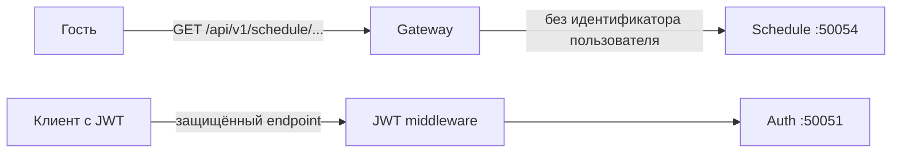

# HTTP Gateway: единый входной шлюз

[`gateway-service`](https://github.com/orbit-polytech/gateway-service) принимает HTTP/JSON-запросы и вызывает внутренние gRPC-сервисы. Текущие интеграции в `main` — **Auth, Schedule и AI**. Внешние приложения не подключаются к их PostgreSQL или gRPC напрямую.

## Текущие обязанности

- Маршрутизация через стандартный `net/http.ServeMux`.
- Публичные Auth-сценарии (OTP, OAuth и управление сессией согласно соответствующему endpoint).
- Проверка Ed25519 JWT на защищённых маршрутах: `/auth/me`, начало linking, список и отвязка identities.
- **Публичный поиск групп и чтение расписания без JWT**.
- JSON DTO, CORS, request ID, logging, recovery и преобразование gRPC status в HTTP.
- Health endpoints `/healthz`, `/readyz`, Swagger UI.

Gateway не выпускает токены, не хранит профиль и не подключается к базе сервисов. Вычисление недели, проверка интервала до 93 дней и расчёт сетки звонков выполняются в Schedule. Запрос может инициировать постановку фонового задания в Schedule, но не ждёт скачивания с `rasp.dmami.ru`. Gateway передаёт `READY` / `PENDING_SYNC`, актуальность и известный период публикации; бизнес-логику кэша он не дублирует.

## Текущая структура

```text
gateway-service/
├── cmd/gateway/                # запуск и сборка приложения
├── internal/
│   ├── config/                 # env, адреса RPC, таймауты
│   ├── infrastructure/
│   │   ├── authclient/         # адаптер вызовов Auth
│   │   ├── aiclient/           # gRPC streaming AI
│   │   └── scheduleclient/     # адаптер вызовов Schedule
│   └── transport/http/
│       ├── router.go          # net/http.ServeMux
│       ├── health/            # liveness/readiness
│       ├── httputil/          # JSON и gRPC → HTTP ошибки
│       ├── middleware/        # JWT, CORS, request ID, recovery, logging
│       └── v1/
│           ├── auth/          # handlers и DTO Auth
│           ├── ai/            # SSE и отмена
│           └── schedule/      # handlers и DTO Schedule
├── api/docs/                  # генерируемая Swagger-документация
├── Dockerfile
└── go.mod
```

## Публичный и защищённый пути



Регистрация нужна для персональных действий, а не для просмотра открытого расписания. Нельзя автоматически навешивать JWT middleware на весь `/api/v1`. Передача проверенного actor в будущие Tasks/Users должна проектироваться отдельно: параметры и заголовки клиента не становятся доверенной идентичностью сами по себе.

## Текущая сеть и будущие компоненты

В локальном Compose gRPC опубликован только на loopback для диагностики: Auth `127.0.0.1:50051`, Schedule `127.0.0.1:50054`. Это не публичные production-порты. Gateway не получает Redis credentials; Redis rate limiter/blacklist на шлюзе не следует считать реализованным на основании учебных примеров.

Учебный REST-слой Tasks, Telegram-вход, новые rate limits и маршруты будущих сервисов сохранены в [подробном гайде](../tutorial/backend/11-gateway-rest.md) и концептуальных разделах. Они не являются текущим списком endpoint.

Далее: [обработчики](handlers-and-middleware.md), [gRPC-клиенты](grpc-clients.md), [API расписания](schedule-api.md), [паспорт Gateway](../reference/services/gateway.md).


## AI-интеграция

Защищённые JWT маршруты `POST /api/v1/ai/chat/stream` и `POST /api/v1/ai/chat/cancel` вызывают `ai-service:50057`. `AI_GRPC_ADDR` задаёт адрес, `AI_RPC_TIMEOUT` — общий deadline (в Compose `60s`). SSE использует отдельные ограниченные сроки записи событий; обычный короткий unary timeout нельзя переносить на весь поток. Проверенная идентичность передаётся в metadata `x-user-id`.

Чтение первого чанка выполняется до открытия SSE, поэтому ранние ошибки сохраняют HTTP status. После начала потока ошибки передаются событиями. Полная спецификация — [AI API](ai-api.md). Проверка Gateway `/healthz` или `/readyz` не подтверждает готовность AI.
