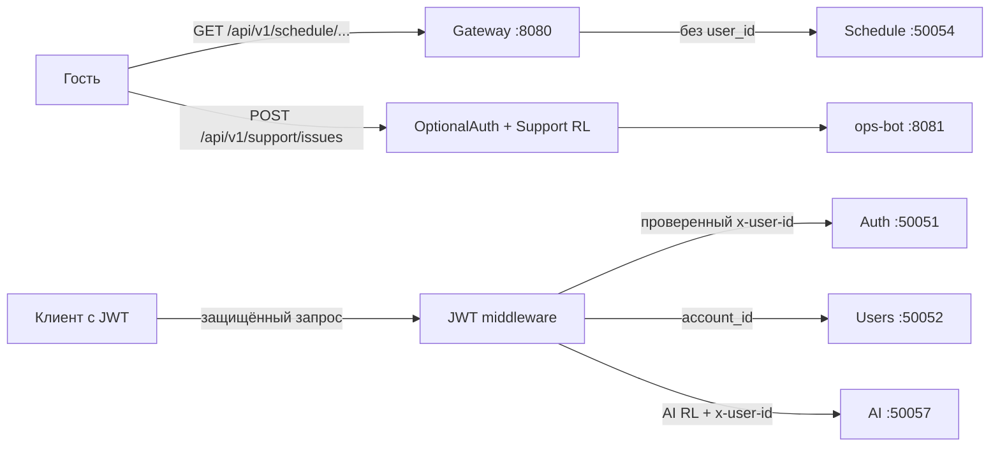

# HTTP Gateway: единый входной шлюз

[`gateway-service`](https://github.com/orbit-polytech/gateway-service) принимает внешние HTTP/JSON-запросы и проксирует их во внутренние gRPC-сервисы (**Auth, Users, Schedule и AI**), а также в операционный бот **`ops-bot`** (HTTP webhook для обращений из приложения). Внешние клиенты (Android-приложение и Web/PWA через Nginx-прокси `web`) общаются только со шлюзом и не подключаются напрямую к БД или gRPC.

## За что отвечает Gateway

- Маршрутизация на базе стандартного `net/http.ServeMux` (префикс `/api/v1`).
- Публичные Auth-сценарии: Email OTP, refresh, logout, Google OAuth (включая мобильный PKCE `POST /api/v1/auth/oauth/exchange`), а также редирект мобильного callback привязки Google на `ru.mospolytech.orbit://auth/callback`.
- Проверка Ed25519 access JWT (`middleware.Auth` и `middleware.OptionalAuth`):
  - `/api/v1/auth/me`, `PATCH /api/v1/auth/preferences` (обновление `primary_group` и `favorite_groups`), смена email (`POST /api/v1/auth/email/change/begin`, `POST /api/v1/auth/email/change/confirm`);
  - привязка, список и отвязка внешних identities (`/api/v1/auth/identities/...`);
  - профиль пользователя (`GET /api/v1/users/profile`, `PUT /api/v1/users/profile`);
  - весь блок AI (`/api/v1/ai/...`) с пробросом проверенного `x-user-id` в gRPC metadata и Redis rate limiting на `POST /api/v1/ai/chat/stream`;
  - обращения и баг-репорты (`POST /api/v1/support/issues` с `OptionalAuth` и `SupportIssueRateLimit` в Redis).
- **Публичный поиск групп и расписание без JWT**.
- Middleware: `RequestID`, `Logger` (структурированный JSON `log/slog` с полем `service="gateway-service"`), `Metrics` (HTTP RED-метрики Prometheus), `Recovery`, `CORS`, `AIRateLimit`, `SupportIssueRateLimit`.
- Health endpoints `/healthz` и `/readyz`, Swagger UI (`/swagger/index.html`) и изолированный внутренний HTTP-сервер метрик `:9094` (`/metrics`, `/livez`).

Gateway не выпускает JWT, не хранит профиль и не лезет в PostgreSQL сервисов. Бизнес-логика профилей, расчёта недели, кэша расписания, генерации ответов и хранения сессий живёт в соответствующих сервисах.

## Структура `gateway-service`

```text
gateway-service/
├── cmd/gateway/                    # точка входа
├── internal/
│   ├── app/                        # сборка (dialClients, buildRouter), HTTP-сервер и сервер метрик :9094
│   ├── config/                     # env, адреса RPC, таймауты, AI_RATE_LIMIT_*, OPS_BOT_WEBHOOK_*, METRICS_ADDR
│   ├── infrastructure/
│   │   ├── aiclient/               # gRPC-клиент AI (unary и streaming)
│   │   ├── authclient/             # gRPC-клиент Auth
│   │   ├── opsbotclient/           # HTTP webhook клиент ops-bot (/issues/webhook)
│   │   ├── ratelimit/              # Redis (Lua sliding window + cooldown) и in-memory fallback
│   │   ├── scheduleclient/         # gRPC-клиент Schedule
│   │   └── usersclient/            # gRPC-клиент Users
│   └── transport/http/
│       ├── router.go               # net/http.ServeMux
│       ├── swagger.go              # Swagger UI
│       ├── health/                 # /healthz и /readyz
│       ├── httputil/               # JSON (16 KiB / 64 KiB), ErrorDetail + retry_after_sec, маппинг gRPC -> HTTP
│       ├── middleware/             # Auth, OptionalAuth, AIRateLimit, SupportIssueRateLimit, CORS, RequestID, Recovery, Logger, Metrics
│       ├── sse/                    # запись и heartbeat SSE-потока
│       └── v1/
│           ├── ai/                 # stream, cancel, conversations, history, delete, feedback
│           ├── auth/               # session, account (/me, /preferences, /email/change/*), oauth, identity
│           ├── schedule/           # search groups и get group schedule
│           ├── support/            # POST /support/issues
│           └── users/              # GET/PUT /users/profile
├── api/docs/                       # Swagger 2.0 (может отставать от router.go до перегенерации)
└── go.mod                          # github.com/orbit-polytech/contracts v0.5.12
```

## Публичный и защищённый пути



На расписании JWT не требуется, чтобы студент сразу видел пары в гостевом режиме. На `POST /api/v1/support/issues` авторизация опциональна (`OptionalAuth`): если токен передан, в тикет подставляются `user_id` и email. Для персональных действий (профиль, настройки групп, смена email, привязка аккаунта, история и запросы к ИИ) Gateway проверяет подпись JWT и передаёт во внутренние сервисы доверенный `x-user-id` (или `account_id`).

## Внутренние порты, Web-прокси и метрики

Порт `:8080` обслуживает клиентский HTTP API напрямую, а в `infra` контейнер `web` (Flutter Web/PWA + Nginx на `:8088` → `:80`, куда также направляется `ngrok`) проксирует `/api/`, `/healthz` и `/swagger/` на `gateway-service:8080`. Сервер метрик слушает отдельно на `METRICS_ADDR` (по умолчанию `:9094`) и открыт только внутри сети Compose для Prometheus — на `:8080` маршрут `/metrics` не зарегистрирован и отдаёт `404`.

## AI-интеграция

Маршруты AI требуют Bearer JWT и закрыты `middleware.Auth` (а `POST /api/v1/ai/chat/stream` ещё и `middleware.AIRateLimit` через Redis `orbit:ai:rl:*`):
- `POST /api/v1/ai/chat/stream` (SSE-поток)
- `POST /api/v1/ai/chat/cancel`
- `GET /api/v1/ai/conversations`
- `GET /api/v1/ai/conversations/{id}`
- `DELETE /api/v1/ai/conversations/{id}`
- `PUT /api/v1/ai/conversations/{id}/messages/{message_id}/feedback`

Дефолтный таймаут AI в Compose — `AI_RPC_TIMEOUT=120s` (у SSE-писателя отдельный таймаут записи `defaultWriteWait = 15s` и heartbeat). Перед открытием потока SSE Gateway читает первый чанк ответа от `ai-service`, чтобы ранние ошибки (`400`, `403`, `409`, `429`, `503`) вернулись нормальным HTTP-статусом.

Дальше: [обработчики и middleware](handlers-and-middleware.md), [gRPC-клиенты](grpc-clients.md), [API расписания](schedule-api.md), [AI API](ai-api.md), [паспорт Gateway](../reference/services/gateway.md).
