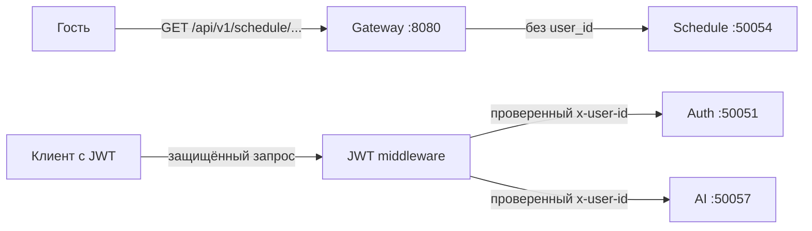

# HTTP Gateway: единый входной шлюз

[`gateway-service`](https://github.com/orbit-polytech/gateway-service) принимает внешние HTTP/JSON-запросы и проксирует их во внутренние gRPC-сервисы (**Auth, Schedule и AI**). Внешние клиенты (включая мобильное приложение) общаются только со шлюзом и не подключаются напрямую к БД или gRPC.

## За что отвечает Gateway

- Маршрутизация на базе стандартного `net/http.ServeMux` (префикс `/api/v1`).
- Публичные Auth-сценарии: Email OTP, refresh, logout, Google OAuth (включая мобильный PKCE `POST /api/v1/auth/oauth/exchange`), а также редирект мобильного callback привязки Google на `ru.mospolytech.orbit://auth/callback`.
- Проверка Ed25519 access JWT (`middleware.Auth`) на защищённых маршрутах:
  - `/api/v1/auth/me`, `PATCH /api/v1/auth/preferences` (обновление `primary_group` и `favorite_groups`);
  - привязка, список и отвязка внешних identities (`/api/v1/auth/identities/...`);
  - весь блок AI (`/api/v1/ai/...`) с пробросом проверенного `x-user-id` в gRPC metadata.
- **Публичный поиск групп и расписание без JWT**.
- Middleware: `RequestID`, `Logger` (структурированный JSON `log/slog` с полем `service="gateway-service"`), `Metrics` (HTTP RED-метрики Prometheus), `Recovery`, `CORS`.
- Health endpoints `/healthz` и `/readyz`, Swagger UI (`/swagger/index.html`) и изолированный внутренний HTTP-сервер метрик `:9094` (`/metrics`, `/livez`).

Gateway не выпускает JWT, не хранит профиль и не лезет в PostgreSQL сервисов. Бизнес-логика расчёта недели, кэша расписания, генерации ответов и хранения сессий живёт в соответствующих сервисах.

## Структура `gateway-service`

```text
gateway-service/
├── cmd/gateway/                    # точка входа
├── internal/
│   ├── app/                        # сборка, HTTP-сервер и отдельный сервер метрик :9094
│   ├── config/                     # env, адреса RPC, таймауты, METRICS_ADDR, MOBILE_AUTH_REDIRECT_URI
│   ├── infrastructure/
│   │   ├── authclient/             # gRPC-клиент Auth
│   │   ├── aiclient/               # gRPC-клиент AI (unary и streaming)
│   │   └── scheduleclient/         # gRPC-клиент Schedule
│   └── transport/http/
│       ├── router.go               # net/http.ServeMux
│       ├── swagger.go              # Swagger UI
│       ├── health/                 # /healthz и /readyz
│       ├── httputil/               # JSON и маппинг gRPC -> HTTP ошибок
│       ├── middleware/             # Auth, CORS, RequestID, Recovery, Logger, Metrics
│       ├── sse/                    # запись и heartbeat SSE-потока
│       └── v1/
│           ├── auth/               # session, account (/me, /preferences), oauth (web + mobile), identity
│           ├── ai/                 # stream, cancel, conversations, history, delete, feedback
│           └── schedule/           # search groups и get group schedule
├── api/docs/                       # сгенерированный Swagger 2.0
└── go.mod                          # github.com/orbit-polytech/contracts v0.5.9
```

## Публичный и защищённый пути



На расписании JWT не требуется, чтобы студент сразу видел пары в гостевом режиме. Для персональных действий (настройки групп, привязка аккаунта, история и запросы к ИИ) Gateway проверяет подпись JWT и передаёт во внутренние сервисы доверенный `x-user-id`.

## Внутренние порты и метрики

Порт `:8080` обслуживает клиентский трафик (и пробрасывается в Ngrok при включённом профиле `tunnel`). Сервер метрик слушает отдельно на `METRICS_ADDR` (по умолчанию `:9094`) и открыт только внутри сети Compose для Prometheus — на `:8080` маршрут `/metrics` не зарегистрирован и отдаёт `404`.

## AI-интеграция

Маршруты AI требуют Bearer JWT и закрыты `middleware.Auth`:
- `POST /api/v1/ai/chat/stream` (SSE-поток)
- `POST /api/v1/ai/chat/cancel`
- `GET /api/v1/ai/conversations`
- `GET /api/v1/ai/conversations/{id}`
- `DELETE /api/v1/ai/conversations/{id}`
- `PUT /api/v1/ai/conversations/{id}/messages/{message_id}/feedback`

Дефолтный таймаут AI в Compose — `AI_RPC_TIMEOUT=120s` (у SSE-писателя отдельный таймаут записи `defaultWriteWait = 15s` и heartbeat). Перед открытием потока SSE Gateway читает первый чанк ответа от `ai-service`, чтобы ранние ошибки (`400`, `403`, `409`, `503`) вернулись нормальным HTTP-статусом.

Дальше: [обработчики и middleware](handlers-and-middleware.md), [gRPC-клиенты](grpc-clients.md), [API расписания](schedule-api.md), [AI API](ai-api.md), [паспорт Gateway](../reference/services/gateway.md).
