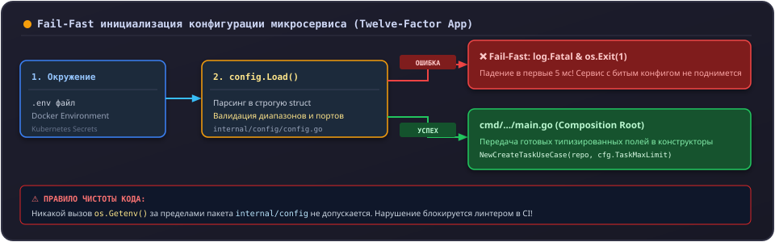

# Как добавить новую переменную окружения

Все сервисы Orbit AI следуют III фактору методологии [Twelve-Factor App](https://12factor.net/ru/config): **Конфигурация хранится в переменных окружения**. Конфигурация должна быть строго типизирована, валидироваться по принципу **Fail-Fast** при старте процесса и никогда не считываться напрямую из середины бизнес-логики.

---

## 1. Архитектурное правило



> [!CAUTION] Запрет прямого чтения
> Ни один слой (`domain`, `usecase`, `repository`, `transport`) не имеет права вызывать `os.Getenv()`. Вся конфигурация считывается и проверяется **исключительно в пакете `internal/config`** и передается в компоненты через параметры конструкторов.

---

## 2. Пошаговая инструкция

Предположим, сервису `tasks-service` требуется переменная `TASK_MAX_LIMIT` для ограничения максимального количества задач в одном ответе пагинации.

---

### Шаг 1. Фиксация переменной в `.env.example`

Откройте файл `.env.example` в корне репозитория сервиса и добавьте переменную с комментарием:

```ini
# Максимальное количество задач при запросе списка (1..500)
TASK_MAX_LIMIT=100
```

Добавьте рабочее значение в ваш локальный рабочий файл `.env`.

---

### Шаг 2. Добавление поля в структуру `Config`

Откройте `internal/config/config.go` и расширьте структуру конфигурации:

```go
type Config struct {
	Env          string
	LogLevel     string
	GRPCPort     int
	DBHost       string
	DBPort       int
	TaskMaxLimit int // Новое типизированное поле
}
```

---

### Шаг 3. Чтение и строгая валидация (Fail-Fast)

В функции `Load()` реализуйте чтение переменной и валидацию допустимых границ:

```go
func Load() (*Config, error) {
	// Существующая инициализация...
	
	// Чтение новой переменной с безопасным значением по умолчанию
	maxLimitStr := getEnvOrDefault("TASK_MAX_LIMIT", "100")
	maxLimit, err := strconv.Atoi(maxLimitStr)
	if err != nil {
		return nil, fmt.Errorf("TASK_MAX_LIMIT должна быть числом: %w", err)
	}

	// Строгая валидация бизнес-диапазона
	if maxLimit < 1 || maxLimit > 500 {
		return nil, fmt.Errorf("TASK_MAX_LIMIT вне допустимого диапазона [1, 500]: получено %d", maxLimit)
	}

	cfg := &Config{
		// ...
		TaskMaxLimit: maxLimit,
	}

	return cfg, nil
}
```

---

### Шаг 4. Написание юнит-тестов конфигурации

В файле `internal/config/config_test.go` добавьте сценарии на корректный парсинг и защиту от невалидных значений:

```go
func TestLoad_TaskMaxLimit_Validation(t *testing.T) {
	tests := []struct {
		name        string
		envVal      string
		expectError bool
	}{
		{name: "Валидное значение 50", envVal: "50", expectError: false},
		{name: "Значение меньше минимума (0)", envVal: "0", expectError: true},
		{name: "Значение больше максимума (1000)", envVal: "1000", expectError: true},
		{name: "Не числовая строка", envVal: "сто", expectError: true},
	}

	for _, tt := range tests {
		t.Run(tt.name, func(t *testing.T) {
			t.Setenv("TASK_MAX_LIMIT", tt.envVal)
			// Устанавливаем минимально необходимые обязательные переменные
			t.Setenv("APP_ENV", "local")
			t.Setenv("LOG_LEVEL", "info")
			t.Setenv("GRPC_PORT", "50051")

			cfg, err := Load()
			if tt.expectError {
				if err == nil {
					t.Fatalf("ожидалась ошибка валидации, но получено nil")
				}
			} else {
				if err != nil {
					t.Fatalf("неожиданная ошибка: %v", err)
				}
				if cfg.TaskMaxLimit != 50 {
					t.Errorf("ожидался лимит 50, получено %d", cfg.TaskMaxLimit)
				}
			}
		})
	}
}
```

Запустите тесты:

```bash
go test -v ./internal/config/...
```

---

### Шаг 5. Проброс переменной в Docker Compose

Если переменная нужна сервису в общем стенде, обновите секцию сервиса в `infra/docker-compose.yml`:

```yaml
  tasks-service:
    environment:
      - APP_ENV=production
      - LOG_LEVEL=info
      - GRPC_PORT=50051
      - TASK_MAX_LIMIT=100
```

---

## 3. Сравнение: Как нельзя и Как правильно

<div class="grid" markdown>

<div class="card" markdown>
### :x: Как нельзя

- **Вызывать `os.Getenv("SECRET_KEY")` внутри usecase или gRPC-хендлера.** Код становится нетестируемым без загрязнения глобальных переменных среды ОС.
- **Использовать тихие умолчания на секреты и хосты (например, `if dbPassword == "" { dbPassword = "password" }`).** Если в продакшене забудут прописать пароль, сервис молча запустится с тестовым паролем, открыв уязвимость.
- **Игнорировать ошибки парсинга (`limit, _ := strconv.Atoi(...)`).** При передаче некорректного значения переменная молча превратится в 0, порождая трудноуловимые баги.
- **Коммитить реальные секреты и пароли в `.env.example` или git-репозиторий.**
</div>

<div class="card" markdown>
### :white_check_mark: Как правильно

- **Собирать всю конфигурацию в одном месте (`internal/config`)** при старте приложения.
- **Падать немедленно (Fail-Fast) при старте `main.go`**, если критическая переменная отсутствует или невалидна.
- **Строго типизировать поля:** порты — `int`, таймауты — `time.Duration`, булевы флаги — `bool`.
- **Писать юнит-тесты на функцию `config.Load()`** с использованием безопасного `t.Setenv()`.
</div>

</div>
