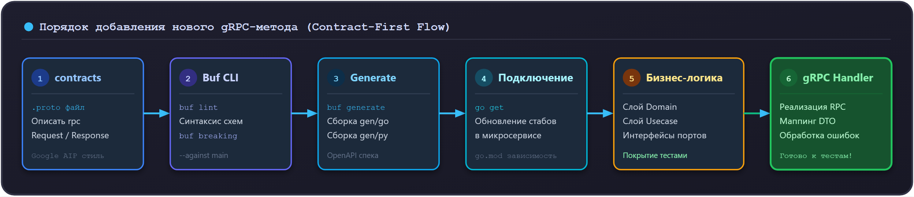

# Как добавить новый gRPC-метод

В проекте Orbit AI разработка межсервисного взаимодействия ведётся по принципу **Schema-First (Контракт прежде всего)**. Вы не пишете код на Go или Python, пока новый метод не описан и не верифицирован в Protobuf-репозитории `contracts`.

---

## 1. Схема движения изменений



---

## 2. Пошаговая инструкция

### Шаг 1. Описание метода в репозитории `contracts`

Перейдите в репозиторий `contracts` и откройте целевой файл (например, `proto/orbit/tasks/v1/task.proto`).

Добавьте сигнатуру нового RPC в интерфейс сервиса и опишите структуры запроса и ответа:

```protobuf
syntax = "proto3";

package orbit.tasks.v1;

import "google/protobuf/timestamp.proto";

service TaskService {
  // Существующие методы...
  rpc CreateTask(CreateTaskRequest) returns (CreateTaskResponse);

  // Новый метод: завершение задачи
  rpc CompleteTask(CompleteTaskRequest) returns (CompleteTaskResponse);
}

message CompleteTaskRequest {
  // Уникальный идентификатор задачи в формате UUID
  string id = 1;
}

message CompleteTaskResponse {
  // Обновленная задача
  Task task = 1;
}
```

> [!IMPORTANT] Правила оформления Protobuf:
> - **Именование:** Имя запроса строго `<MethodName>Request`, ответа — `<MethodName>Response`.
> - **Идентификация пользователя:** Поле `user_id` **не добавляется** в тело запроса. Идентификатор актора передаётся доверенно через метаданные gRPC `x-user-id` (см. [ADR-004](../explanation/adr/004-jwt-gateway-metadata.md)).
> - **Теги полей:** Номера тегов строго уникальны и никогда не изменяются задним числом.

---

### Шаг 2. Проверка качества контракта утилитой Buf

В корне репозитория `contracts` запустите проверки линтера и обратной совместимости:

```bash
# Проверка стиля и оформления proto-файлов
buf lint

# Проверка на отсутствие ломающих изменений относительно ветки main
buf breaking --against ".git#branch=main"
```

Если проверки прошли без ошибок, запустите локальную генерацию:

```bash
buf generate
```

Закоммитьте изменения и откройте Pull Request в `contracts`. После вливания PR в `main` зафиксируйте коммит или git-тег.

---

### Шаг 3. Обновление зависимости в микросервисе

В репозитории вашего сервиса (например, `tasks-service`) обновите зависимость контрактов:

```bash
go get github.com/orbit-polytech/contracts/gen/go/orbit/tasks/v1@main
go mod tidy
```

---

### Шаг 4. Добавление сценария в слой Usecase

В соответствии с Чистой архитектурой, бизнес-логика не зависит от Protobuf. Создайте сценарий в `internal/usecase/complete_task.go`:

```go
package usecase

import (
	"context"
	"fmt"

	"github.com/orbit-polytech/tasks-service/internal/domain"
)

type CompleteTaskUseCase struct {
	finder TaskFinder
	saver  TaskSaver
}

func NewCompleteTaskUseCase(f TaskFinder, s TaskSaver) *CompleteTaskUseCase {
	return &CompleteTaskUseCase{finder: f, saver: s}
}

func (uc *CompleteTaskUseCase) Execute(ctx context.Context, actor domain.OwnerID, rawID string) (*domain.Task, error) {
	// 1. Загрузка сущности с валидацией прав владения
	task, err := loadOwned(ctx, uc.finder, actor, rawID)
	if err != nil {
		return nil, err
	}

	// 2. Выполнение доменного перехода состояния
	if err := task.Complete(); err != nil {
		return nil, fmt.Errorf("сбой завершения задачи: %w", err)
	}

	// 3. Сохранение обновленного агрегата с контролем версии
	if err := uc.saver.Save(ctx, task); err != nil {
		return nil, fmt.Errorf("ошибка сохранения задачи: %w", err)
	}

	return task, nil
}
```

---

### Шаг 5. Реализация обработчика в слое Transport (gRPC Handler)

В файле `internal/transport/taskgrpc/handler.go` добавьте реализацию сгенерированного метода:

```go
func (h *TaskHandler) CompleteTask(
	ctx context.Context,
	req *taskv1.CompleteTaskRequest,
) (*taskv1.CompleteTaskResponse, error) {
	// 1. Извлечение аутентифицированного пользователя из контекста (перехватчик)
	actorID, err := actorFromContext(ctx)
	if err != nil {
		return nil, status.Error(codes.Unauthenticated, "требуется аутентификация")
	}

	// 2. Валидация входных данных
	if req.GetId() == "" {
		return nil, status.Error(codes.InvalidArgument, "поле id обязательно для заполнения")
	}

	// 3. Вызов сценария
	task, err := h.completeUC.Execute(ctx, actorID, req.GetId())
	if err != nil {
		return nil, h.mapError(err)
	}

	// 4. Маппинг доменной сущности в Protobuf DTO
	return &taskv1.CompleteTaskResponse{
		Task: domainToProtoTask(task),
	}, nil
}
```

---

### Шаг 6. Маппинг ошибок в статусные коды gRPC

Убедитесь, что все доменные ошибки трансформируются в канонические gRPC коды в функции `mapError`:

```go
func (h *TaskHandler) mapError(err error) error {
	switch {
	case errors.Is(err, domain.ErrTaskNotFound):
		return status.Error(codes.NotFound, "задача не найдена")
	case errors.Is(err, domain.ErrInvalidStatusTransition):
		return status.Error(codes.FailedPrecondition, err.Error())
	case errors.Is(err, domain.ErrVersionConflict):
		return status.Error(codes.Aborted, "конфликт версий: запись была изменена параллельным процессом")
	default:
		h.logger.Error("необработанная внутренняя ошибка", "error", err)
		return status.Error(codes.Internal, "внутренняя ошибка сервиса")
	}
}
```

---

### Шаг 7. Ручное тестирование метода с помощью `grpcurl`

Запустите сервис локально и вызовите метод с помощью CLI-инструмента `grpcurl`:

```bash
# Вызов CompleteTask с передачей тестового заголовка пользователя x-user-id
grpcurl -plaintext \
  -H "x-user-id: 018f2345-6789-7abc-def0-123456789abc" \
  -d '{"id": "018f9876-5432-7cba-fed0-987654321cba"}' \
  localhost:50051 \
  orbit.tasks.v1.TaskService/CompleteTask
```

Ожидаемый ответ:

```json
{
  "task": {
    "id": "018f9876-5432-7cba-fed0-987654321cba",
    "title": "Сдать лабораторную работу №2",
    "status": "TASK_STATUS_COMPLETED",
    "version": "2"
  }
}
```

---

## 3. Сравнение: Как нельзя и Как правильно

<div class="grid" markdown>

<div class="card" markdown>
### :x: Как нельзя

- **Добавлять `user_id` в тело `CompleteTaskRequest`.** Клиент сможет передать чужой идентификатор и завершить задачу другого студента (уязвимость IDOR / BOLA).
- **Использовать proto-структуры напрямую в слое Usecase или Репозитория.** Если изменится Protobuf-схема, поломается вся внутренняя архитектура.
- **Возвращать `return nil, err` без оборачивания в `status.Error(codes.X)`.** gRPC клиент получит статус `UNKNOWN`, а в логах не будет информации о типе ошибки.
- **Изменять номер тега существующего поля (например, с `= 1` на `= 2`).** Это сломает сериализацию у всех ранее скомпилированных клиентов.
</div>

<div class="card" markdown>
### :white_check_mark: Как правильно

- **Извлекать ID актора исключительно из контекста (`x-user-id`),** установленного перехватчиком `AuthInterceptor`.
- **Использовать чистые структуры Go в домене и сценариях**, маппинг в Protobuf делать только на границе `internal/transport/taskgrpc`.
- **Явно маппить доменные ошибки в коды gRPC:** `ErrTaskNotFound` -> `codes.NotFound`, ошибки бизнес-правил -> `codes.FailedPrecondition`.
- **Всегда запускать `buf breaking` перед коммитом в репозиторий контрактов.**
</div>

</div>
