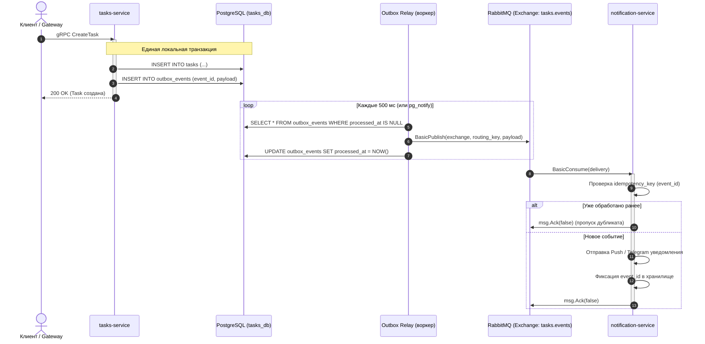

# Как опубликовать и прослушать событие (RabbitMQ и Outbox)

Асинхронное взаимодействие микросервисов Orbit AI построено на протоколе AMQP 0-9-1 через брокер сообщений **RabbitMQ**. Чтобы гарантировать доставку сообщений без потерь при сетевых сбоях и падениях сервисов, используется паттерн **Transactional Outbox**, а со стороны подписчика — **Идемпотентный потребитель (Idempotent Consumer)**.

---

## 1. Архитектурная схема доставки событий



---

## 2. Шаг 1. Таблица Outbox в PostgreSQL

В сервисе-издателе создайте миграцию с таблицей исходящих сообщений:

```sql
-- +goose Up
-- +goose StatementBegin
CREATE TABLE IF NOT EXISTS outbox_events (
    id UUID PRIMARY KEY,
    event_type VARCHAR(64) NOT NULL,
    aggregate_id VARCHAR(64) NOT NULL,
    payload JSONB NOT NULL,
    created_at TIMESTAMPTZ NOT NULL DEFAULT NOW(),
    processed_at TIMESTAMPTZ
);

CREATE INDEX IF NOT EXISTS idx_outbox_unprocessed 
ON outbox_events(created_at) 
WHERE processed_at IS NULL;
-- +goose StatementEnd

-- +goose Down
DROP TABLE IF EXISTS outbox_events;
```

---

## 3. Шаг 2. Атомарное сохранение сущности и события

В репозитории сущность и событие сохраняются в рамках **одной транзакции базы данных**:

```go
func (r *PostgresTaskRepository) SaveWithEvent(
	ctx context.Context, 
	task *domain.Task, 
	evt *domain.TaskCreated,
) error {
	tx, err := r.pool.Begin(ctx)
	if err != nil {
		return fmt.Errorf("ошибка старта транзакции: %w", err)
	}
	defer tx.Rollback(ctx)

	// 1. Сохранение агрегата Task
	const queryTask = `
		INSERT INTO tasks (id, owner_id, title, status, priority, deadline, version)
		VALUES ($1, $2, $3, $4, $5, $6, $7)
		ON CONFLICT (id) DO UPDATE SET
			title = EXCLUDED.title,
			status = EXCLUDED.status,
			version = tasks.version + 1
		WHERE tasks.version = $7 - 1;
	`
	tag, err := tx.Exec(ctx, queryTask, 
		task.ID().String(), task.OwnerID().String(), task.Title().String(),
		task.Status().String(), task.Priority().String(), task.Deadline().Time(), task.Version(),
	)
	if err != nil {
		return fmt.Errorf("ошибка сохранения задачи: %w", err)
	}
	if tag.RowsAffected() == 0 {
		return domain.ErrVersionConflict
	}

	// 2. Запись события в Outbox
	if evt != nil {
		payloadBytes, err := json.Marshal(evt)
		if err != nil {
			return fmt.Errorf("ошибка маршалинга события: %w", err)
		}

		const queryOutbox = `
			INSERT INTO outbox_events (id, event_type, aggregate_id, payload)
			VALUES ($1, $2, $3, $4);
		`
		_, err = tx.Exec(ctx, queryOutbox, evt.EventID, "task.created", evt.TaskID.String(), payloadBytes)
		if err != nil {
			return fmt.Errorf("ошибка записи в outbox: %w", err)
		}
	}

	return tx.Commit(ctx)
}
```

---

## 4. Шаг 3. Публикация из Outbox в RabbitMQ (Relay Worker)

Фоновый процесс читает пачку событий и отправляет их в RabbitMQ с подтверждением публикации (`Publisher Confirms`):

```go
func (w *OutboxRelay) ProcessBatch(ctx context.Context) error {
	rows, err := w.db.Query(ctx, `
		SELECT id, event_type, payload 
		FROM outbox_events 
		WHERE processed_at IS NULL 
		ORDER BY created_at ASC 
		LIMIT 50 FOR UPDATE SKIP LOCKED
	`)
	if err != nil {
		return err
	}
	defer rows.Close()

	for rows.Next() {
		var id, eventType string
		var payload []byte
		if err := rows.Scan(&id, &eventType, &payload); err != nil {
			return err
		}

		// Публикация в Exchange tasks.events с Persistent доставкой (DeliveryMode = 2)
		err = w.channel.PublishWithContext(ctx,
			"tasks.events", // exchange
			eventType,      // routing key: "task.created"
			false,          // mandatory
			false,          // immediate
			amqp091.Publishing{
				DeliveryMode: amqp091.Persistent,
				ContentType:  "application/json",
				MessageId:    id,
				Timestamp:    time.Now().UTC(),
				Body:         payload,
			},
		)
		if err != nil {
			return fmt.Errorf("сбой публикации в RabbitMQ: %w", err)
		}

		// Помечаем событие как обработанное
		_, err = w.db.Exec(ctx, "UPDATE outbox_events SET processed_at = NOW() WHERE id = $1", id)
		if err != nil {
			return err
		}
	}
	return nil
}
```

---

## 5. Шаг 4. Подписка и идемпотентная обработка (Consumer)

В сервисе-подписчике (`notification-service`) обработчик обязан перепроверять `MessageId` (или поле `event_id` в теле) перед выполнением полезного действия:

```go
func (c *NotificationConsumer) HandleDelivery(ctx context.Context, msg amqp091.Delivery) {
	eventID := msg.MessageId

	// 1. Проверка дубликата через Redis или SQL
	isDuplicate, err := c.idempotencyStore.CheckAndSet(ctx, eventID, 24*time.Hour)
	if err != nil {
		// Ошибка хранилища: возвращаем в очередь с requeue=true
		msg.Nack(false, true)
		return
	}
	if isDuplicate {
		// Сообщение уже обрабатывалось: подтверждаем и пропускаем
		c.logger.Info("дубликат события пропущен", "event_id", eventID)
		msg.Ack(false)
		return
	}

	// 2. Бизнес-логика (например, отправка Telegram-уведомления)
	var event TaskCreatedPayload
	if err := json.Unmarshal(msg.Body, &event); err != nil {
		c.logger.Error("невалидный JSON в сообщении, отправка в DLQ", "error", err)
		msg.Nack(false, false) // requeue = false (уходит в Dead Letter Queue)
		return
	}

	if err := c.notifier.SendNotification(ctx, event.OwnerID, event.Title); err != nil {
		c.logger.Error("ошибка отправки уведомления", "error", err)
		msg.Nack(false, true) // повторяем попытку позже
		return
	}

	// 3. Успешное завершение: ручное подтверждение
	msg.Ack(false)
}
```

---

## 6. Сравнение: Как нельзя и Как правильно

<div class="grid" markdown>

<div class="card" markdown>
### :x: Как нельзя

- **Публиковать в RabbitMQ напрямую из Usecase до или после `repo.Save()` (Dual-Write).** Если брокер упадет или сеть моргнет сразу после записи в БД, событие потеряется навсегда, и подписчики не узнают о создании задачи.
- **Использовать автоматическое подтверждение (`autoAck: true`).** Если контейнер консьюмера упадет посреди обработки, сообщение сотрется из очереди и будет безвозвратно утеряно.
- **Обрабатывать сообщение без проверки дедупликации (`event_id`).** RabbitMQ гарантирует доставку *At-Least-Once (как минимум один раз)*. При рестарте брокера студент получит 2 или 3 одинаковых уведомления.
- **Делать `msg.Nack(false, true)` при синтаксической ошибке JSON (Invalid JSON).** Сообщение зациклится в бесконечном шторме повторов (Poison Message), забив 100% CPU.
</div>

<div class="card" markdown>
### :white_check_mark: Как правильно

- **Использовать Transactional Outbox:** агрегат и исходящее событие записываются в одной транзакции PostgreSQL.
- **Публиковать сообщения с флагом `DeliveryMode: amqp091.Persistent`.**
- **Использовать ручной `Ack/Nack`** только после фактического завершения операции.
- **Проверять `event_id` через Idempotency Store** перед выполнением побочных эффектов.
- **Ошибки формата отбрасывать в Dead Letter Queue (DLQ)** с `requeue = false`.
</div>

</div>
