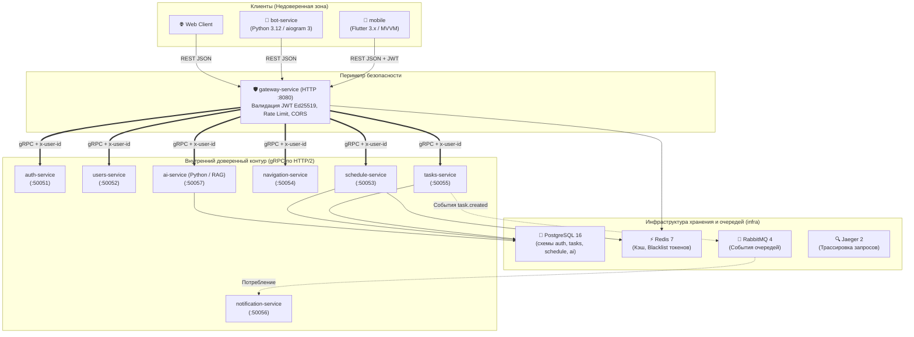

# Orbit AI — Инженерная база знаний и архитектурный стандарт

Добро пожаловать в официальную инженерную базу знаний и руководство разработчика распределенной системы **Orbit AI** — цифрового ассистента для студентов и преподавателей Московского Политеха.

Здесь собраны правила командной разработки, стандарты архитектуры микросервисов, пошаговые руководства и справочники по всем технологиям проекта.

---

## 1. Архитектурная схема экосистемы

Система Orbit AI состоит из 13 специализированных репозиториев в организации [**github.com/orbit-polytech**](https://github.com/orbit-polytech):

---

## 2. Разделы инженерной базы знаний

-   :material-rocket-launch: __[Быстрый старт](quickstart/overview.md)__
    
    ---
    
    Всё, что нужно для входа в проект:
    - Правила организации репозиториев `orbit-polytech`;
    - [Запуск с нуля на ноутбуке (Docker Compose)](quickstart/local-setup.md);
    - [Git, ветки и GitHub Flow](quickstart/git-workflow.md);
    - [Чек-лист код-ревью и чистый код](quickstart/review-checklist.md).

-   :simple-go: __[Go-бэкенд](backend-go/overview.md)__
    
    ---
    
    Стандарт микросервисов на Go 1.25+:
    - [Официальная структура модулей Go](backend-go/overview.md);
    - [Создание микросервиса с нуля (Tutorial)](backend-go/tutorial.md);
    - [«Хочу добавить X, куда писать» (How-to)](backend-go/how-to.md);
    - [Чистая архитектура и DDD](backend-go/clean-architecture.md);
    - [Справочник слоев и линтер depguard](backend-go/reference.md).

-   :material-shield-check: __[HTTP Gateway](gateway/overview.md)__
    
    ---
    
    Публичный периметр системы (`gateway-service`):
    - Роутер Chi, санитизация входящих заголовков;
    - [Обработчики и Middleware](gateway/handlers-and-middleware.md);
    - [gRPC-клиенты и маппинг ошибок](gateway/grpc-clients.md).

-   :simple-python: __[Python & AI](python-ai/overview.md)__
    
    ---
    
    Сервисы искусственного интеллекта и Telegram-бот:
    - Пакетный менеджер `uv` и стиль Python 3.12;
    - [RAG, Gemini API и pgvector (Tutorial)](python-ai/rag-tutorial.md);
    - [Telegram-бот на aiogram 3 (How-to)](python-ai/bot-guide.md);
    - [Изоляция и границы Python-стека](python-ai/explanation.md).

-   :simple-flutter: __[Flutter & Мобилка](mobile-flutter/overview.md)__
    
    ---
    
    Мобильное приложение Orbit Mobile:
    - Стандарт Google Compass App и архитектура MVVM;
    - [Управление состоянием: Command + Result](mobile-flutter/mvvm-architecture.md);
    - [Вёрстка адаптивных виджетов и темы Политеха](mobile-flutter/widgets-tutorial.md);
    - [Безопасное хранение токенов в Keychain/KeyStore](mobile-flutter/network-and-storage.md).

-   :material-transit-connection-variant: __[Контракты и Инфра](contracts-infra/overview.md)__
    
    ---
    
    Принцип API-First и локальное окружение:
    - [contracts: proto-схемы и Buf CLI](contracts-infra/contracts.md);
    - [infra: Docker Compose и базы данных](contracts-infra/infra.md);
    - [Справочник контейнеров и очередей RabbitMQ](contracts-infra/reference.md).

-   :material-lock-check: __[Безопасность и Auth](security/overview.md)__
    
    ---
    
    Архитектура безопасности и авторизации:
    - [JWT и асимметричная подпись Ed25519](security/jwt-ed25519.md);
    - [Сессии, Refresh Tokens и Token Reuse Detection](security/sessions-refresh.md);
    - [Защита от IDOR, инъекций и подмены ролей](security/validation-defense.md).

-   :material-bug-check: __[Разбор ошибок tasks-service (Post-Mortem)](tasks-service-postmortem/overview.md)__
    
    ---
    
    6 практических уроков из аудита реального кода:
    - [Гонка в идемпотентности (Check-then-act)](tasks-service-postmortem/01-idempotency-race.md);
    - [Сломанная оптимистичная блокировка](tasks-service-postmortem/02-optimistic-locking.md);
    - [Нарушение DIP в gRPC-транспорте](tasks-service-postmortem/03-transport-dip.md);
    - [Хрупкий switch ошибок (OCP)](tasks-service-postmortem/04-error-handling-ocp.md);
    - [Декомпозиция сценариев (SRP)](tasks-service-postmortem/05-usecase-srp.md);
    - [Скрытые паники в генераторах ID](tasks-service-postmortem/06-runtime-panics.md).

-   :material-book-open-page-variant: __[Справочник](reference/canonical-values.md)__
    
    ---
    
    Единый источник правды:
    - [Канонические порты, env-переменные и версии](reference/canonical-values.md);
    - [Карта 13 репозиториев организации](reference/polyrepo-map.md);
    - [Соглашения об именовании кода, веток и коммитов](reference/naming-conventions.md).

-   :material-robot: __[Для ИИ-агентов](ai/agents.md)__
    
    ---
    
    Руководство для автономных LLM-инструментов:
    - [Правила кодогенерации MUST / MUST NOT](ai/agents.md);
    - [Машиночитаемый индекс llms.txt](ai/llms-guide.md).

