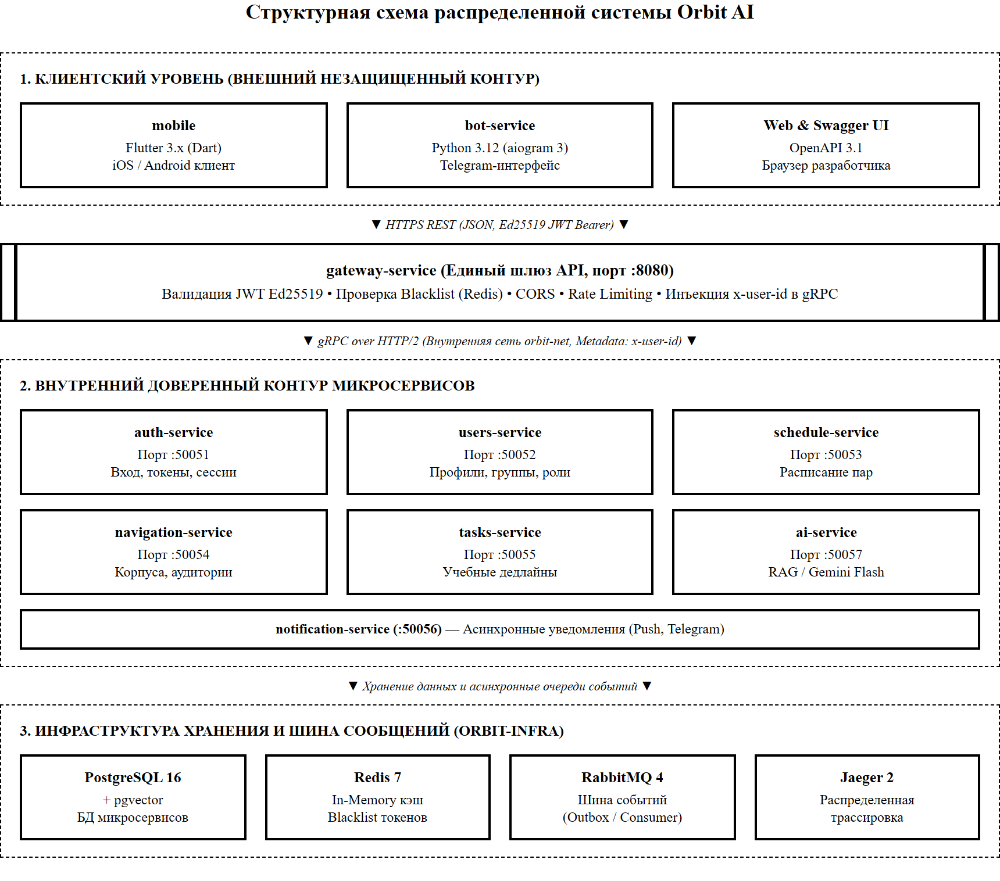

# Orbit AI — инженерная база знаний

Orbit AI — экосистема сервисов для студентов Московского Политеха: авторизация, профиль пользователя (`users-service`), расписание, AI-помощник, Web/PWA и будущие модули навигации, уведомлений и задач.

!!! info "Как читать эту документацию"
    Здесь описаны **текущая реализация в `main`**, **запланированные компоненты** и **учебные примеры**. То, что ещё в планах, не нужно считать уже работающим. Актуальный срез — на странице [«Текущее состояние»](project/current-state.md), а черновик ролевой структуры и RACI — в разделе [«Роли и зоны ответственности»](project/roles.md).

-   :material-play-circle: __[Запустить актуальный стенд](quickstart/local-setup.md)__

    ---

    Поднять базовый стек (`apps`: Auth, Users, Schedule, Gateway и `web` на `:8088`), а при необходимости добавить AI, мониторинг, `ops-bot` и туннель через профиль `all`.

-   :material-progress-check: __[Узнать текущее состояние](project/current-state.md)__

    ---

    Что уже работает в `main`, что находится в бете, а что остаётся на следующие этапы.

-   :material-sitemap: __[Изучить карту репозиториев](reference/polyrepo-map.md)__

    ---

    Карта 12 репозиториев на GitHub и 4 запланированных сервисов, связи между компонентами и план развития.

## Расписание уже доступно

Публичный [поиск групп и просмотр расписания](gateway/schedule-api.md) работают без аккаунта: запрос только с названием группы возвращает текущую неделю по Москве. Чтобы поднять стенд локально, достаточно клонировать `infra` — исходники всех сервисов для старта не нужны.

## Архитектура экосистемы

В организации на GitHub сейчас **12 репозиториев**: работающие сервисы (`auth-service`, `users-service`, `schedule-service`, `ai-service`, `gateway-service`), контракты (`contracts`), оркестрация и мониторинг (`infra`), ETL базы знаний (`knowledge-pipeline`), операционный бот (`ops-bot`), клиент Android и Web/PWA (`mobile`), база знаний (`orbit-docs`) и служебный `.github`. Ещё **4 сервиса** (`tasks-service`, `navigation-service`, `notification-service`, `bot-service`) запланированы на следующие этапы (для `tasks-service` уже есть учебный эталон в `orbit-docs/examples/tasks-service`). Целевая структура команд и зон ответственности описана как черновик на странице [«Роли и зоны ответственности»](project/roles.md).

Схема выше отражает **целевое состояние**, а не текущую таблицу портов: старые подписи на картинке могут расходиться с [каноническим справочником](reference/canonical-values.md) (например, фактический порт Schedule — `50054`, а не `50053`). Текущий срез расписан на странице [«Текущее состояние»](project/current-state.md).

## Разделы базы знаний

-   :material-rocket-launch: __[Быстрый старт](quickstart/overview.md)__

    Запуск стенда, правила команды, GitHub Flow и чек-лист для Pull Request.

-   :simple-go: __[Go-бэкенд](backend-go/overview.md)__

    Clean Architecture, DDD, gRPC, PostgreSQL, тестирование и CI/CD.

-   :material-shield-check: __[HTTP Gateway](gateway/overview.md)__

    Внешний HTTP-периметр: авторизация, профиль (`users-service`), расписание, AI SSE/история/оценки, лимиты, обращения в поддержку (`support/issues`) и метрики.

-   :simple-python: __[Python & AI](python-ai/overview.md)__

    Мультипровайдерный LLM-роутер, FastEmbed, гибридный RAG, `knowledge-pipeline` и учебные примеры.

-   :simple-flutter: __[Flutter & Мобилка](mobile-flutter/overview.md)__

    Рабочая бета клиента (`v0.1.27-beta+28`, Android APK и Web/PWA на `:8088`): Clean Architecture, BLoC, кэш Hive, Google OAuth, профиль, поддержка и AI-чат.

-   :material-transit-connection-variant: __[Контракты и инфраструктура](contracts-infra/overview.md)__

    API-first, Buf, Docker Compose, мониторинг (Prometheus/Loki/Grafana) и туннель Ngrok.

-   :material-lock-check: __[Безопасность и Auth](security/overview.md)__

    Email OTP, Google OAuth и deep link, привязка аккаунтов, JWT Ed25519 и refresh-сессии.

-   :material-book-open-page-variant: __[Справочник](reference/canonical-values.md)__

    Порты, переменные окружения, паспорта сервисов (включая `knowledge-pipeline` и `ops-bot`) и ADR.

-   :material-robot: __[Для ИИ-агентов](ai/agents.md)__

    Правила работы с кодом и машиночитаемый индекс `llms.txt`.

## AI и наблюдаемость

AI-ассистент доступен авторизованным пользователям через [AI API](gateway/ai-api.md): поддерживаются потоковая генерация, список и история диалогов, удаление чатов и оценки ответов (лайк/дизлайк). Корпус базы знаний готовится в [`knowledge-pipeline`](reference/services/knowledge-pipeline.md) и загружается по манифесту. См. также [текущие ограничения](python-ai/current-limitations.md).

Состояние сервисов, расход токенов и логи собираются в контур [мониторинга и алертов](contracts-infra/observability.md), а инциденты, сообщения формы поддержки (`POST /api/v1/support/issues`) и проблемные вопросы уходят в топики [`ops-bot`](reference/services/ops-bot.md).
