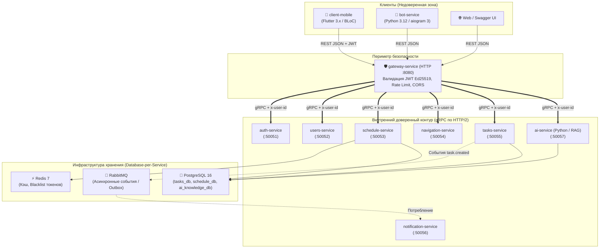

# Orbit AI — Инженерная база знаний и руководство разработчика

Добро пожаловать в официальную техническую документацию и обучающий портал распределенной системы **Orbit AI** — цифрового ассистента для студентов и преподавателей Московского Политеха.

Документация построена по международному архитектурному стандарту технической документации **[Diátaxis](https://diataxis.fr/)** и разделена на четыре взаимодополняющие части: обучающий курс, практические рецепты, архитектурные концепции и справочник.

---

## 1. Архитектурная схема экосистемы

Система Orbit AI состоит из 14 специализированных репозиториев, объединенных в единую организацию на GitHub: [`https://github.com/orbit-polytech`](https://github.com/orbit-polytech).

---

## 2. Структура документации (Diátaxis Framework)

-   :mortar_board: __[Часть I. Учебный курс (Tutorial)](tutorial/common/00-setup.md)__
    
    ---
    
    Пошаговое практическое погружение с нуля. 4 специализированных трека:
    - **Общий:** Git, командный workflow, запуск `orbit-infra`, Protobuf Buf.
    - **Go Backend:** 13 глав от основ Go 1.24 до Clean Architecture, PostgreSQL, RabbitMQ и Docker.
    - **AI & Python:** gRPC-стек, RAG-поиск в `pgvector` по регламентам Политеха, Google Gemini 2.0.
    - **Mobile (Flutter):** Feature-First архитектура, BLoC, защищенный JWT-клиент.

-   :wrench: __[Часть II. Рецепты (How-to Guides)](how-to/create-service-from-template.md)__
    
    ---
    
    Пошаговые алгоритмы решения типовых инженерных задач:
    - Создание микросервиса из шаблона;
    - Добавление нового gRPC-метода и миграции базы данных;
    - Transactional Outbox в RabbitMQ и кэширование в Redis;
    - Интерактивная отладка в VS Code и решение конфликтов слияния в Git.

-   :bulb: __[Часть III. Архитектура и концепции (Explanation)](explanation/clean-architecture.md)__
    
    ---
    
    Глубокий теоретический разбор архитектурных решений:
    - Принципы Clean Architecture и Domain-Driven Design (DDD);
    - Почему gRPC внутри контура и REST снаружи;
    - Архитектура безопасности (JWT Ed25519 и метаданные);
    - 6 официальных архитектурных решений (**ADR-001 .. ADR-006**).

-   :books: __[Часть IV. Справочник (Reference)](reference/polyrepo-map.md)__
    
    ---
    
    Точные технические спецификации и таблицы:
    - Карта 14 репозиториев организации;
    - Сводная таблица портов и переменных окружения;
    - Спецификация кодов ошибок и маппинга HTTP/gRPC;
    - Документация REST API шлюза (OpenAPI / Swagger);
    - Паспорта и спецификации всех микросервисов.

---

## 3. Быстрый старт для нового разработчика

Если вы только присоединились к разработке Orbit AI, выполните следующие три шага:

1. **Подготовьте рабочее окружение:**  
   Изучите главу [**00. Подготовка рабочего места**](tutorial/common/00-setup.md) и установите компиляторы, Docker и расширения редактора.
2. **Запустите локальную инфраструктуру:**  
   Склонируйте репозиторий [`orbit-infra`](https://github.com/orbit-polytech/orbit-infra) и поднимите базы данных, Redis и RabbitMQ по руководству [**02. Запуск локального окружения**](tutorial/common/02-local-infra.md).
3. **Выберите свой трек разработки:**  
   Переходите к профильному треку ([Go Backend](tutorial/backend/01-go-essentials.md), [AI & Python](tutorial/ai/01-ai-grpc-stack.md) или [Mobile Flutter](tutorial/mobile/01-flutter-basics.md)).
