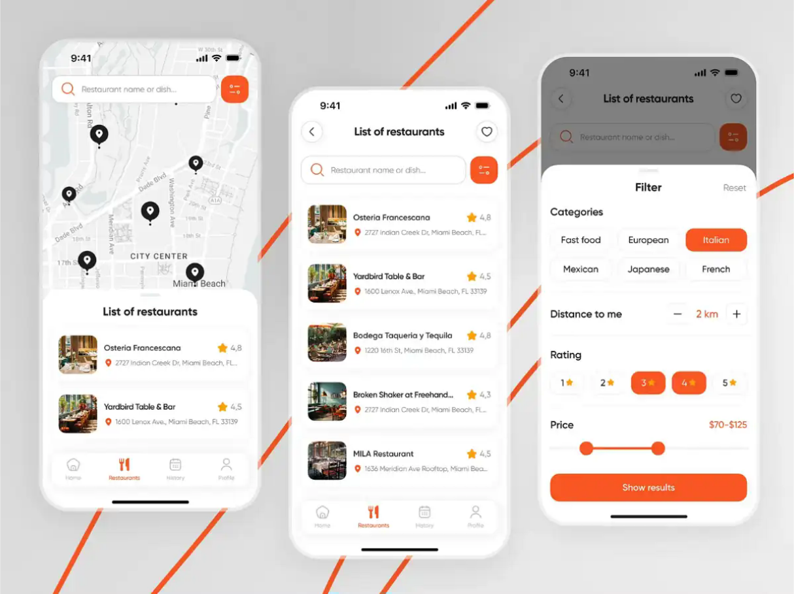
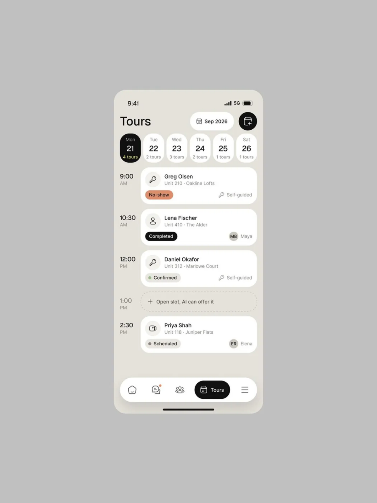
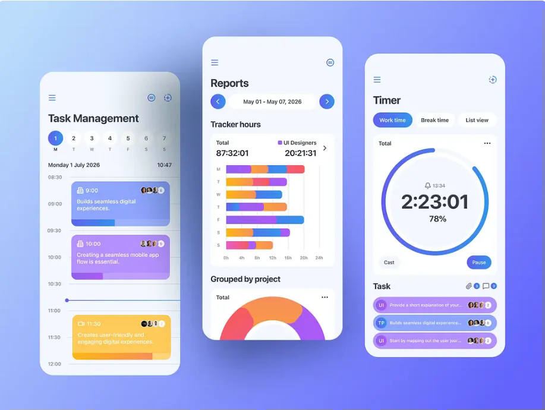
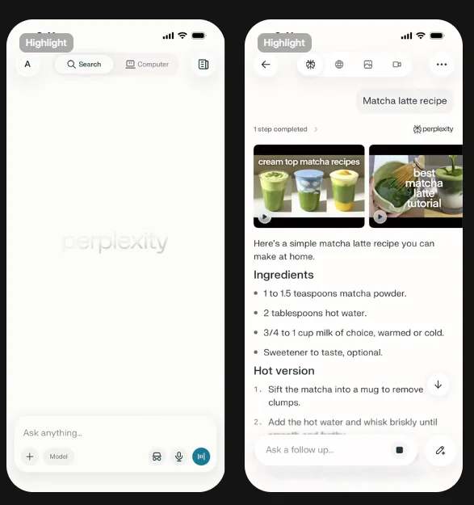
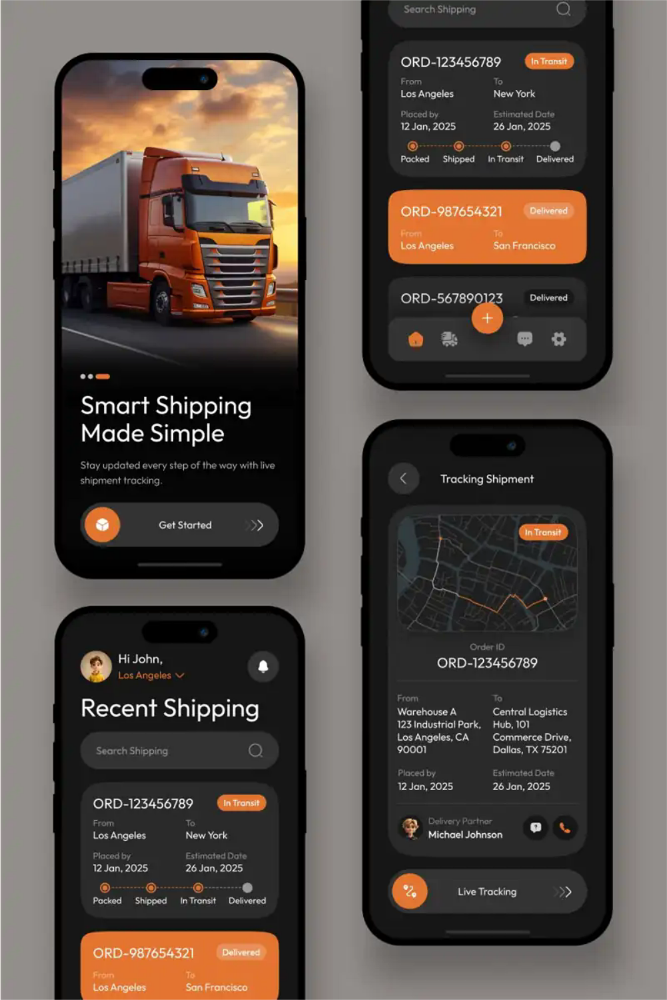
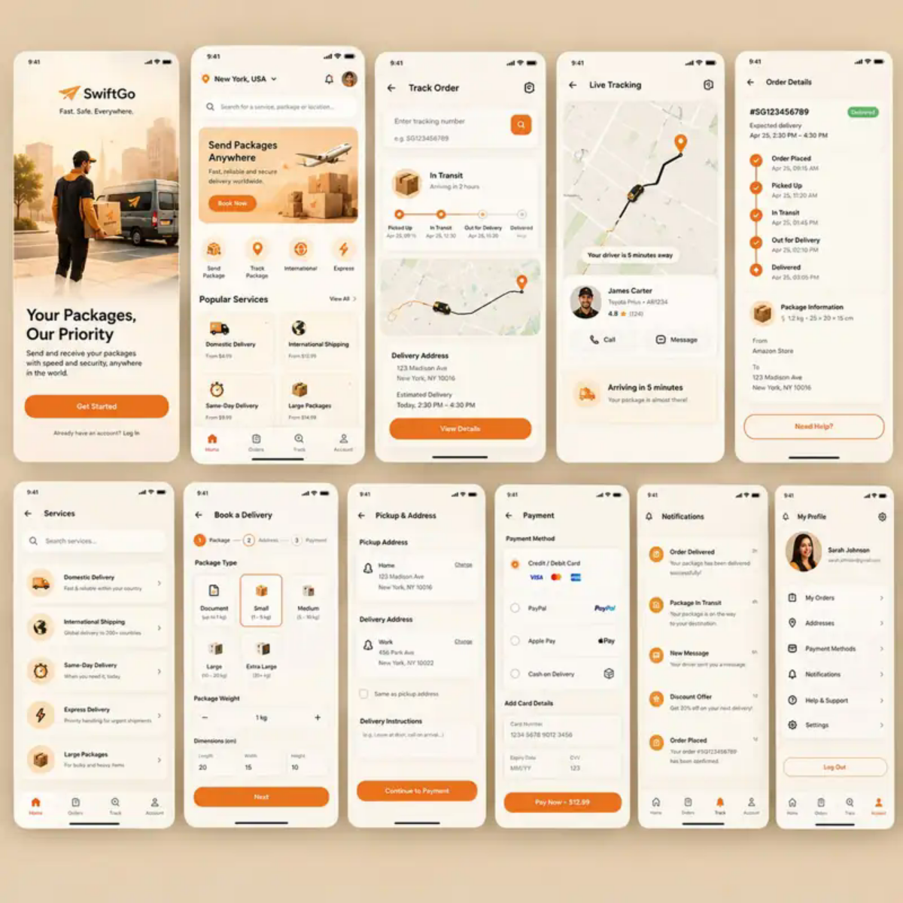
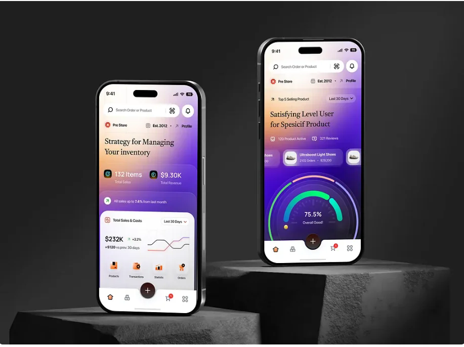

# Дизайн Orbit: направления и референсы

**Статус:** обсуждение и подготовка макетов, не утверждённый интерфейс и не отчёт о реализации.

Нужно сравнить несколько вариантов оформления на одних и тех же экранах. Не требуется реализовывать все варианты во Flutter: сначала каркасы и визуальные макеты, затем выбор направления и настройка темы.

## 1. Что уже решено, а что выбираем

| Уже решено | Пока выбираем |
|---|---|
| Светлая тема по умолчанию при первом запуске | Точные цвета, градиент, шрифты и скругления |
| Гостевой просмотр расписания без регистрации | Оформление карточек и плотность списка |
| Пять разделов: Расписание → Задачи → AI → Заметки → Профиль | Обычная нижняя панель или Floating Dock |
| AI — центральная вкладка, а не действие «создать» | Насколько выделять AI цветом и формой |
| Читаемость и доступность важнее декоративных эффектов | Нужна ли прозрачность и где она уместна |

Тёмная палитра Cron Dark из прежней версии документации больше не является обязательным оформлением. Тёмную тему можно спроектировать позже; она не должна определять первый светлый макет. Режим «Как в системе» и сохранение выбора темы обсуждаются отдельно. Настройка темы самого сайта документации не определяет тему приложения.

**Предпочтение для сравнения:** светлая основа с мягким персиково-сиреневым переходом по мотивам последнего референса. Это не означает, что весь экран должен стать насыщенно-фиолетовым.

## 2. Референсы команды

Изображения ниже предоставлены командой для обсуждения. Они показывают визуальные приёмы, а не готовые требования Orbit. Оригинальные ссылки, авторы и лицензии пока не установлены: не следует приписывать эти работы команде, считать их официальными примерами Apple/Google или копировать чужие иллюстрации, логотипы и графику в приложение. Для дальнейшего использования нужно уточнить источник и права; по запросу правообладателя материал следует заменить ссылкой или удалить.

Файлы находятся в `docs/mobile-flutter/image/` и подключены относительными Markdown-ссылками. SVG-файлы содержат встроенную WebP-копию скриншота: внешнего хостинга и сетевой загрузки изображений нет. Пропорции сохранены; разрешение и сжатие оптимизированы для документации; оригинальные PNG остаются в исходных вложениях обсуждения. Одинаковый скрин AI-чата, присланный дважды, размещён один раз.

### 01. Светлый интерфейс с оранжевыми акцентами

**Что берём:** ясное разделение поиска и списка, аккуратные карточки, нижнюю панель для дополнительных параметров, умеренный акцент.

**Что не переносим:** ресторанные сущности, рейтинги и фотографии. Мелкие серые подписи и почти незаметные границы нельзя повторять без проверки читаемости.

**Для Orbit:** поиск группы, выбор параметров отображения, карточки занятий. Фильтр подгрупп на изображении будущего экрана не должен обещать уже существующую функцию API.

### 02. Тёплый фон и расписание по времени

**Что берём:** полосу дней, время слева и занятия справа, спокойный фон, заметное выделение выбранной даты.

**Что не переносим:** статусы бронирований и слишком большие отступы между короткими карточками. Число занятий, если показывается, должно вычисляться из данных, а не служить декором.

**Для Orbit:** основной кандидат на структуру экрана расписания. Для двух параллельных занятий нужно показать обе карточки, а не оставить одну.

### 03. Цветной планировщик

**Что берём:** иерархию информации, компактную полосу дней и возможность различать типы занятий.

**Что не переносим:** одновременно много ярких заливок, вымышленные графики продуктивности и таймеры. Тип занятия обозначается также текстом, не только цветом.

**Для Orbit:** альтернативный вид карточек; отчёты и таймер не входят в текущее задание.

### 04. Светлый AI-чат

**Что берём:** читаемые длинные ответы, спокойную поверхность, расположение поля ввода и визуальное отделение вопроса от ответа.

**Что не переносим:** чужой бренд, выбор моделей, голосовой ввод и другие неподдерживаемые действия.

**Для Orbit:** будущий экран AI с источниками ответа, состояниями генерации, отмены и ошибки. Доступ — после авторизации; текущая задача каркаса не включает реализацию чата.

### 05. Тёмный интерфейс с оранжевым акцентом

**Что берём:** дозированный оранжевый акцент, различимость статусов и группировку сведений.

**Что не переносим:** тёмный фон как default, рекламный первый экран и кнопку «+» вместо вкладки AI.

**Для Orbit:** отдельные композиционные приёмы; не основание возвращаться к обязательной тёмной теме.

### 06. Тёплый светлый интерфейс

**Что берём:** мягкий фон, единый стиль полей и карточек, понятное выделение основных действий.

**Что не переносим:** рекламу, доставку, оплату и крупные промоиллюстрации на повседневном экране.

**Для Orbit:** направление «тёплый светлый» и оформление второстепенных экранов.

### 07. Светлый фон с цветным переходом

**Что берём:** мягкий переход от светлого кремового/персикового к сиреневому как возможный узнаваемый фон Orbit.

**Что не переносим:** насыщенный фон под длинным текстом, торговую аналитику, декоративные показатели и диаграммы.

**Для Orbit:** ослабленный градиент в шапке расписания, немного более заметный — на начальном экране AI. Карточки и длинные ответы остаются на нейтральной поверхности. Точные цвета ещё не выбраны; это описание впечатления, не измеренная палитра скриншота.

## 3. Варианты оформления

| Вариант | Фон и поверхности | Акценты и навигация | Что сравниваем |
|---|---|---|---|
| А. Чистый светлый | Почти белый фон, нейтральные карточки | Один акцент, обычная нижняя панель | Простота и читаемость |
| Б. Тёплый светлый | Молочный или серо-бежевый фон, белые карточки | Умеренный оранжевый | Удобство ежедневного просмотра |
| В. Мягкий градиент | Светлая основа, персиково-сиреневая шапка | Нейтральная панель, сдержанный акцент | Характер Orbit без потери читаемости |
| Г. Календарь прежде всего | Плотный список: время слева, занятия справа | Минимум декора | Сколько полезной информации видно сразу |
| Д. Плавающая панель | Светлые карточки, отделённый нижний слой | Floating Dock, прозрачность — опционально | Удобство, системные отступы и перекрытия |
| Е. Сдержанный Material 3 | Тональные нейтральные поверхности | Настроенные стандартные компоненты | Простота реализации и предсказуемость поведения |

Варианты Г–Е затрагивают также компоновку и компоненты: это не шесть обязательных тем приложения. Не нужно комбинировать все приёмы одновременно.

**Первое сравнение:** три оформления одного и того же расписания — А, Б и В. Данные, выбранный день, размеры экрана и расположение элементов должны совпадать. Затем для выбранного направления отдельно сравниваем обычную нижнюю панель и Floating Dock. Так проще понять, что именно улучшает экран.

## 4. Практики Apple HIG и Material 3

Рекомендации используются как основа решений, а не как сертификат соответствия и не как требование смешать внешний вид двух платформ. У приложения общий стиль, но привычное платформенное поведение, системная навигация и доступность сохраняются.

### Читаемость и доступность

- Поддерживать системное увеличение текста, переносы и работу экранного диктора. Не фиксировать высоту карточки так, чтобы длинный предмет или увеличенный текст обрезался.
- Не сообщать об ошибке, выбранном дне или типе занятия только цветом: нужны подпись, форма или другой различимый признак.
- Проверять контраст текста на фактической поверхности, в том числе на самом неудачном участке градиента. Для обычного текста ориентир — не менее 4.5:1; для крупного текста — 3:1 по определениям WCAG. Белый текст на ярком оранжевом не считается подходящим автоматически.
- Для наших макетов использовать удобные области нажатия: ориентир 44×44 pt на iOS и 48×48 dp на Android; это область взаимодействия, а не обязательный размер самой иконки. Проверять соседние цели и не приравнивать pt/dp к физическим пикселям.
- Учитывать уменьшение движения и прозрачности; важная информация не должна зависеть от анимации или blur.

Основа: [Apple — Accessibility](https://developer.apple.com/design/human-interface-guidelines/accessibility), [Material — Accessible design](https://m3.material.io/foundations/accessible-design/overview), [WCAG — Contrast (Minimum)](https://www.w3.org/WAI/WCAG22/Understanding/contrast-minimum.html). Значения областей нажатия выше — ориентиры проекта для макетов, а не утверждение, что на всех платформах действует один физический размер.

### Цветовые роли вместо случайных значений

Фон, карточка, основной текст, вторичный текст, акцент, текст на акценте, граница и ошибка задаются централизованными токенами. Цвет текста выбирается вместе с его поверхностью. У Material для этого есть роли `surface`, `onSurface`, `primary`, `onPrimary` и контейнерные роли. Не нужно растягивать один оранжевый на все действия, статусы и предупреждения.

Основа: [Material — Color roles](https://m3.material.io/styles/color/roles), [Apple — Color](https://developer.apple.com/design/human-interface-guidelines/color).

### Стабильная навигация

Пять разделов и их порядок остаются одинаковыми во всех вариантах. У вкладок должны быть понятные названия и различимое активное состояние. Выделение центрального AI не превращает его в кнопку создания и не делает остальные разделы второстепенными действиями. Для больших окон компоновка может адаптироваться; телефонный Dock не нужно просто растягивать на весь планшет.

Material предусматривает navigation bar для 3–5 основных направлений: [Navigation bar](https://m3.material.io/components/navigation-bar/overview). Конкретное оформление и адаптация Orbit остаются проектным решением.

### Прозрачность не заменяет иерархию

Apple описывает Liquid Glass как отдельный слой навигации и управления и не рекомендует помещать его в слой контента. Для Orbit это повод ограничить эксперименты с прозрачностью панелью, а карточки расписания и ответы AI оставить читаемыми. Flutter `BackdropFilter` не равнозначен нативному Liquid Glass. При выключенных эффектах должен оставаться нормальный непрозрачный вариант.

Основа: [Apple — Materials](https://developer.apple.com/design/human-interface-guidelines/materials).

### Иерархия и поведение

Один экран — одна понятная основная задача. На расписании сначала группа, период и занятия; декоративный баннер не должен отодвигать их вниз. Дополнительный выбор даты можно открыть в календаре или нижней панели, но переход на соседнюю неделю не нужно прятать глубоко. Системные отступы, кнопка «назад», жесты и клавиатура должны работать предсказуемо.

Основа для дальнейшей проработки: [Apple — Layout](https://developer.apple.com/design/human-interface-guidelines/layout), [Material 3](https://m3.material.io/). Конкретное расположение элементов выше — предложение для Orbit, а не дословное предписание руководств.

## 5. На каких экранах проверяем варианты

Сначала — один и тот же экран расписания с реалистичными тестовыми данными. После выбора направления — поиск группы, карточка занятия/детали и будущий AI-чат как проверка длинного текста. Наличие макета не расширяет функциональные границы текущего задания.

Обязательные случаи:

- несколько пар, длинный предмет, преподаватель и аудитория;
- два параллельных занятия и отсутствующая аудитория;
- выбранная неделя без найденных занятий;
- первая загрузка, `PENDING_SYNC`, ошибка и повтор;
- сохранённые данные без интернета и отметка актуальности;
- поиск с открытой клавиатурой;
- маленький экран и увеличенный системный текст;
- последняя карточка над нижней навигацией — без перекрытия;
- будущий AI-ответ с длинным текстом и ссылками на источники.

Не изображать неподдерживаемые функции как уже рабочие: голос, подгрупповые фильтры, статистику замен, аналитику и персонализацию нужно отдельно согласовывать.

## 6. Порядок работы и результат

1. Подготовить простой каркас расписания без декоративных эффектов.
2. На нём сравнить А, Б и В; приложить комментарии о плюсах и ограничениях.
3. Выбрать направление и сравнить два вида нижней навигации.
4. Проверить сложные состояния, длинный текст и доступность.
5. Зафиксировать выбранные токены и компоненты в [дизайн-системе](design-tokens-and-ui.md).
6. После согласования реализовать небольшой этап Flutter по [заданию](../project/tasks/mobile-foundation-and-schedule.md).

Макеты можно сделать в Figma или как отдельные статические прототипы; для каркаса достаточно схемы. Не нужно добавлять в рабочее приложение шесть переключаемых оформлений, скачивать платные UI-kit или начинать с анимаций. Итог обсуждения фиксируем в PR: выбранный вариант, что изменили относительно него, что оставили на потом.
