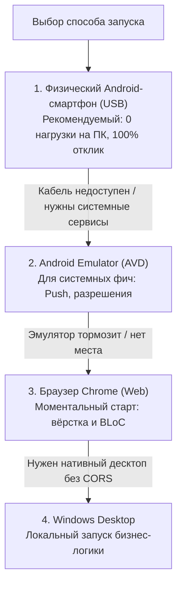

# Руководство разработчика и Задачи Этапа 1 (Хасан Ризоев)

> **Статус**: Готово к передаче в разработку  
> **Роль**: Мобильный разработчик (Flutter)  
> **Автор / Архитектор**: Данил (Lead Architect / Team Lead)  
> **Репозиторий**: [github.com/orbit-polytech/mobile](https://github.com/orbit-polytech/mobile)  
> **Целевой стек**: Flutter 3.47+, Dart 3.13+, Android SDK (API 34/36), Web/Chrome, BLoC 9.1+, Hive CE 2.22+, GoRouter 18.1+

---

## 1. Введение и контекст задачи

Базовый каркас мобильного приложения `mobile` успешно инициализирован, проверен на тестовом билде Android 14 (API 34), протестирован на физическом устройстве по USB, в эмуляторе и в Web, и выложен в репозиторий `origin/main`. Твоя задача на **Этапе 1** — развернуть чистую модульную архитектуру (Clean Architecture), реализовать дизайн-токены **Cron Dark**, создать адаптивный 5-вкладочный **Floating Dock** и построить первый экран расписания со счетчиком замен и офлайн-кэшированием в **Hive CE**.

---

## 2. Настройка рабочего окружения (Setup Guide)

### 2.1 Необходимое ПО
1. **Flutter SDK**: версия `3.47.x` или новее (канал `stable`), поставляется с Dart `3.13.x+`.
   - Путь к `flutter/bin` должен быть добавлен в системную переменную `PATH`.
2. **Android Studio** (Koala / Ladybug / Meerkat или новее):
   - В **SDK Manager -> SDK Platforms**: установить **Android 14.0 ("UpsideDownCake", API 34)** или **Android 15 (API 35)**.
   - В **SDK Manager -> SDK Tools**:
     - `Android SDK Build-Tools` (34.x / 35.x)
     - `Android SDK Command-line Tools (latest)`
     - `Android Emulator`
     - `Android SDK Platform-Tools`
     - `NDK (Side by side)` версии `28.2.13676358` или новее
     - `CMake` версии `3.22.1`

> [!CAUTION]
> **Важное предупреждение для VS Code:**  
> Если VS Code предложит установить расширение **«Extension Pack for Java»** — **НЕ устанавливай его** (или удали). Во Flutter весь код пишется на Dart, а Java-плагин перегружает систему анализом Gradle-скриптов и замедляет работу.

### 2.2 Настройка дискового пространства и AVD (Опционально)
Если на системном диске `C:` мало места, папку виртуальных устройств (AVD) можно вынести на любой свободный диск (например, `D:`):
```powershell
# 1. Создать целевую директорию на свободном диске
mkdir "D:\Android\avd"

# 2. Создать NTFS Junction (символическую ссылку)
cmd /c mklink /J "%USERPROFILE%\.android\avd" "D:\Android\avd"

# 3. Задать переменную среды
setx ANDROID_AVD_HOME "D:\Android\avd"
```

### 2.3 Рекомендованная конфигурация эмулятора Android (при использовании)
При создании AVD в Device Manager Android Studio:
- **Устройство**: Pixel 8 или Pixel 7.
- **Образ системы (System Image)**: **Android 14 (API 34) Google Play Intel x86_64 Atom System Image** (строго **БЕЗ** приписки `16 KB Page Size`, так как экспериментальный 16KB preview может приводить к зависаниям загрузки под Windows/WHPX).
- **RAM**: 4096 MB (`hw.ramSize = 4096`).
- **VM Heap**: 512 MB (`vm.heapSize = 512`).
- **Графика и рендеринг (GPU)**: По умолчанию `Automatic`. Если окно эмулятора остаётся чёрным или крашится при старте, в файле `config.ini` устройства выставить `hw.gpu.mode = auto` либо переключить в настройках AVD эмуляцию графики в `Software - GLES 2.0`.
- **Холодная загрузка (Cold Boot)**: Если эмулятор завис при восстановлении предыдущего состояния (Snapshot), запускайте его через меню **«Cold Boot Now»** в Android Studio или укажите `fastboot.forceColdBoot = yes` в `config.ini`.

---

## 3. Стратегия запуска и отладки (Multi-Target Testing Strategy)

В проекте поддерживается несколько вариантов запуска и тестирования приложения. Если один из способов работает медленно, зависает или недоступен на рабочей машине, используйте следующий по цепочке:



---

### Вариант 1 (Рекомендуемый): Физический Android-смартфон по USB
**Почему это основной и лучший способ:**
- **0 нагрузки на ПК**: процессор и видеокарта компьютера не тратят ресурсы на виртуализацию и рендеринг тяжелого эмулятора (компьютер не зависает).
- **Реальный экран и сенсор**: проверка настоящей частоты развёртки экрана (60/90/120 Гц), тактильного отклика и реальных шрифтов системы.
- **Быстрый цикл Hot Reload**: мгновенное применение изменений UI за доли секунды.

**Пошаговая настройка:**
1. **Включить режим разработчика на смартфоне:**
   - Откройте *Настройки -> О телефоне*.
   - Нажмите 7 раз на пункт *«Номер сборки»* (Build Number). Появится уведомление: *«Вы стали разработчиком!»*.
2. **Включить отладку по USB:**
   - Перейдите в *Настройки -> Система / Дополнительно -> Для разработчиков*.
   - Включите переключатель **«Отладка по USB»** (USB Debugging).
   - Если в вашей прошивке есть пункт **«Установка через USB»** (Install via USB) — также включите его.
3. **Подключить смартфон к ПК через USB-кабель:**
   - На экране телефона появится диалоговое окно: *«Разрешить отладку по USB с этого компьютера?»*.
   - Отметьте чекбокс **«Всегда разрешать с этого компьютера»** и нажмите **«Разрешить»**.
4. **Проверить подключение в терминале:**
   ```powershell
   flutter devices
   ```
   Устройство должно появиться в списке со статусом `device` (например: `MyPhone • <id> • android-arm64 • Android 14`).
5. **Запуск приложения:**
   ```powershell
   cd mobile
   flutter run
   ```
   *(Или выберите телефон в строке состояния в правом нижнем углу VS Code и нажмите `F5`).*
6. При первом запуске телефон может запросить подтверждение установки APK — нажмите **«Разрешить» / «Установить»**.
7. В терминале работает моментальный **Hot Reload** (нажмите клавишу `r` для обновления интерфейса без перезапуска приложения, или `R` для полного перезапуска).

---

### Вариант 2: Запуск в браузере (Chrome / Web) — Самый быстрый для вёрстки
**Когда использовать:**
- Если под рукой нет смартфона или USB-кабеля.
- Для быстрой вёрстки карточек, настройки цветов тем, типографики и проверки стейт-машины BLoC без ожидания сборки Gradle/APK.

**Инструкция:**
```powershell
cd mobile
flutter run -d chrome
```

**Эмуляция мобильного экрана в браузере:**
1. В открывшемся окне Chrome нажмите **F12** (или `Ctrl + Shift + I`) для открытия инструментов разработчика DevTools.
2. Нажмите комбинацию клавиш **`Ctrl + Shift + M`** (Toggle Device Toolbar).
3. В верхней панели выберите профиль мобильного устройства (например, *Pixel 7*, *iPhone 14 Pro*) или задайте разрешение вручную (например, `393 x 852`).
4. Изменения кода обновляются мгновенно по нажатию клавиши **`r`** в терминале.

---

### Вариант 3: Android Эмулятор (AVD)
**Когда использовать:**
- Если нужно протестировать системные разрешения Android, глубокую интеграцию со шторкой уведомлений или фоновые сервисы при отсутствии физического устройства.

**Инструкция по запуску:**
1. Запустите эмулятор из Android Studio (Device Manager) или через терминал:
   ```powershell
   flutter emulators --launch <имя_вашего_эмулятора>
   ```
2. Запустите проект:
   ```powershell
   cd mobile
   flutter run
   ```
3. *Диагностика проблем с эмулятором:*
   - Если окно эмулятора остаётся чёрным или не откликается: закройте его и выберите в Android Studio **«Cold Boot Now»** (холодная загрузка без снепшотов).
   - Если эмулятор крашится из-за графического драйвера: переключите эмуляцию GPU в настройках AVD на `Software - GLES 2.0`.

---

### Вариант 4: Локальное приложение Windows Desktop
**Когда использовать:**
- Для быстрой проверки бизнес-логики, парсинга JSON и сетевых вызовов без необходимости запускать мобильную ОС и без ограничений Web CORS.

**Инструкция:**
```powershell
cd mobile
flutter run -d windows
```

---

## 4. Архитектурный стандарт проекта

Проект строится строго по стандарту **Feature-First Clean Architecture**:

```text
lib/
├── core/
│   ├── network/            # Dio клиент, Interceptors, обработка ошибок
│   ├── storage/            # Hive CE инициализация, SecureStorage (JWT)
│   ├── theme/              # Цветовая палитра Cron Dark, типографика, AppTheme
│   └── router/             # GoRouter с StatefulShellRoute (Floating Dock)
├── features/
│   ├── schedule/
│   │   ├── data/           # RemoteDataSource, LocalDataSource (Hive Box), DTO
│   │   ├── domain/         # Entity, ScheduleRepository интерфейс
│   │   └── presentation/   # ScheduleBloc, экраны, карточки пар, счетчик замен
│   ├── auth/               # Авторизация по талону/логину
│   ├── profile/            # Настройки, выбор группы
│   └── exams/              # Экзамены и зачеты
└── main.dart               # Инициализация Hive, DI и запуск приложения
```

### 4.1 Правила BLoC и защита от гонок
- Для событий обновления расписания использовать трансформер `restartable()` из пакета `bloc_concurrency`, чтобы отменять устаревшие сетевые запросы при быстром переключении дней недели.
- Все состояния объявлять через `sealed class` в стиле Dart 3:
```dart
sealed class ScheduleState extends Equatable {
  const ScheduleState();
}

final class ScheduleInitial extends ScheduleState {
  @override
  List<Object?> get props => [];
}

final class ScheduleLoading extends ScheduleState {
  @override
  List<Object?> get props => [];
}

final class ScheduleLoaded extends ScheduleState {
  final ScheduleEntity schedule;
  final bool isFromCache;
  final int replacementCount;

  const ScheduleLoaded({
    required this.schedule,
    required this.isFromCache,
    required this.replacementCount,
  });

  @override
  List<Object?> get props => [schedule, isFromCache, replacementCount];
}
```

---

## 5. Техническое задание: Задачи Этапа 1 для Хасана

### Задача 1.1: Дизайн-система Cron Dark и токены
- Создать `lib/core/theme/colors.dart`:
  - `bgPrimary`: `#08090B` (глубокий тёмный фон)
  - `bgSecondary`: `#111318` (карточки, модальные окна)
  - `accent`: `#FF6B35` (фирменный тёплый оранжевый)
  - `textPrimary`: `#FFFFFF`
  - `textSecondary`: `#8E95A5`
  - `border`: `#1E222D`
- Создать `lib/core/theme/app_theme.dart` с настройкой `ThemeData.dark(useMaterial3: true)`.

### Задача 1.2: Адаптивный Floating Dock (5 вкладок)
- Реализовать плавающий нижний док через `GoRouter` и `StatefulShellRoute.indexedStack`.
- Вкладки:
  1. **Расписание** (`/schedule`) — иконка календаря.
  2. **Задачи / Дедлайны** (`/tasks`) — иконка чек-листа.
  3. **Сессия / Экзамены** (`/exams`) — иконка академической шапочки.
  4. **AI-Помощник** (`/assistant`) — иконка искры / интеллекта.
  5. **Профиль** (`/profile`) — иконка пользователя.
- Эффект стекла: `BackdropFilter` с блюром `sigmaX: 12, sigmaY: 12`, скругление `24.0`, плавающий отступ от низа экрана `16.0`.

### Задача 1.3: Офлайн-кэш Hive CE
- Зарегистрировать TypeAdapter для моделей `ScheduleDay` и `Lesson`.
- Реализовать стратегию **Cache-First**:
  1. При старте моментально отдавать кэш из Hive Box (`schedule_box`).
  2. В фоне слать запрос к `schedule-service` API.
  3. При получении новых данных обновлять Hive и эмитить `ScheduleLoaded(isFromCache: false)`.

### Задача 1.4: Экран расписания с чипом замен
- Реализовать горизонтальный селектор дней недели (Пн – Сб) с индикацией текущего дня.
- Добавить счётчик изменений/замен расписания: оранжевый бейдж (например, `"2 замены сегодня"`).
- Скелетоны (shimmer) при первоначальной загрузке при пустом кэше.

---

## 6. Проверка качества перед Pull Request

Перед созданием PR разработчик обязан выполнить в терминале:

```powershell
# 1. Проверка строгой статической типизации (должно быть 0 issues)
flutter analyze

# 2. Запуск автотестов
flutter test
```

> [!IMPORTANT]
> В проекте включены строгие правила Dart Analysis (`strict-casts`, `strict-inference`, `strict-raw-types`). Неявные приведения типов (`dynamic`) и нетипизированные коллекции запрещены.
