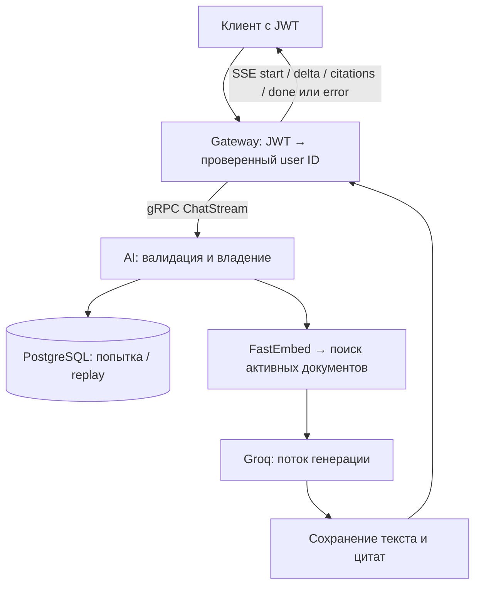

# Поток обработки AI-запроса

1. Gateway проверяет access JWT, размер JSON, UUIDv4 и текст; передаёт `x-user-id` из проверенного контекста.
2. AI валидирует идентичность, запрос и владение диалогом/попыткой. Регистрация попытки выполняется до генерации.
3. При успешном replay возвращаются сохранённые текст/цитаты без вызова RAG/LLM. Активный дубль, другой payload и повтор финализированной ошибки обрабатываются отдельно.
4. Для новой попытки при включённом RAG запрос преобразуется FastEmbed в вектор. PostgreSQL-поиск исключает неактивные документы, применяет порог релевантности и top-k.
5. Найденные фрагменты добавляются в prompt. Если подтверждение не найдено, модель получает предупреждение, но генерация не блокируется.
6. `delta` передаются клиенту по мере генерации; найденные цитаты — отдельным событием. Только после сохранения успешного результата отдаётся `done`.
7. Отмена/ошибка изменяет состояние попытки. Для следующей генерации после неуспеха нужен новый `message_id`.

Эмбеддер создаётся один раз при старте процесса и прогревается до `SERVING`. Ingestion выполняется отдельной операцией, не во время каждого запроса или старта сервера. Точные протоколы — [AI API](../gateway/ai-api.md), пределы возможностей — [ограничения](current-limitations.md).

**Источники:** [точка входа](https://github.com/orbit-polytech/ai-service/blob/main/src/orbit_ai/__main__.py), [usecase](https://github.com/orbit-polytech/ai-service/blob/main/src/orbit_ai/application/chat_stream_use_case.py).
