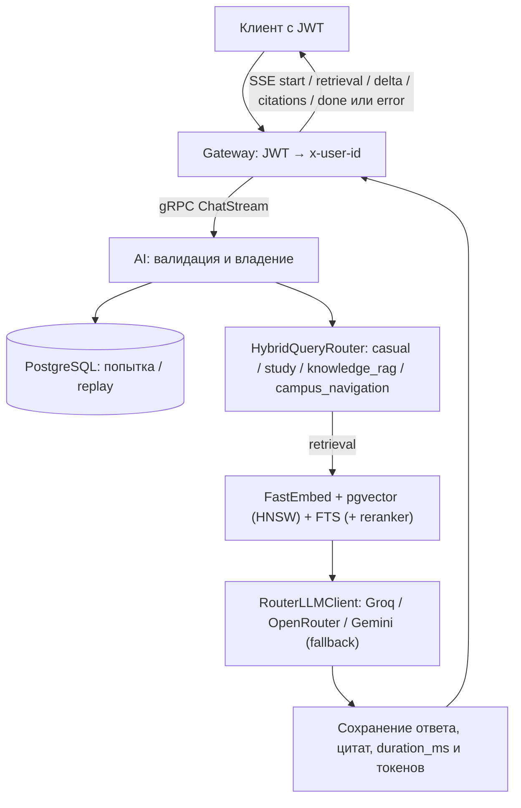

# Поток обработки AI-запроса

1. **Аутентификация и идемпотентность:** Gateway проверяет JWT, пробрасывает `x-user-id` и вызывает `ChatStream`. AI проверяет права на `conversation_id`, регистрирует попытку по `message_id` и при успешном повторе сразу отдаёт сохранённый ответ без вызова LLM.
2. **История и маршрутизация:** Для существующего диалога подгружается ограниченная история (по умолчанию до `10` сообщений). `HybridQueryRouter` классифицирует запрос:
   - светские фразы (`casual`) и общие учебные темы (`general_study`) идут без поиска по базе знаний;
   - вопросы по вузу (`knowledge_rag`) и аудиториям (`campus_navigation`) запускают RAG и переформулируют короткие уточнения из контекста диалога; в поток уходит стадия `retrieval`.
3. **Гибридный поиск:** Если включён `RAG_ENABLED`, FastEmbed строит 384-мерный вектор запроса. PostgreSQL ищет кандидатов среди активных документов одновременно через **HNSW-векторный поиск** и **полнотекстовый поиск** (`russian` и `simple` `tsvector`), объединяет оценки с лексическим бустом по заголовкам/секциям и, если включён `RAG_RERANKER_ENABLED`, прогоняет через cross-encoder reranker (`BAAI/bge-reranker-v2-m3`).
4. **Выбор модели и генерация:** Когда клиент не указал конкретную модель (или передал `auto`), `RouterLLMClient` берёт цепочку моделей для роли из `config/model_routing.json` (например, быстрая `openai/gpt-oss-20b` для `router`/`casual` и `openai/gpt-oss-120b` для RAG с fallback на бесплатные модели OpenRouter до первого токена).
5. **Телеметрия и завершение:** Через `contextvars` и response-хуки фиксируются провайдер, модель, `prompt_tokens`, `completion_tokens`, TTFT, общая длительность `duration_ms` и актуальные заголовки `x-ratelimit-*` / квоты OpenRouter для Prometheus (`:9093`). В поток уходят `delta`, затем `citations`, и только после сохранения в PostgreSQL — `done`.
6. **Ошибки и отмена:** Сбой до первого токена переключает на fallback-модель (если цепочка задана); ошибка после старта или отмена обновляют статус попытки в БД (для повтора после ошибки нужен новый `message_id`). Неразобранные отказы и ошибки генерации подхватывает `ops-bot` в `#untriaged`.

Метрики оценки качества RAG и ответы прогоняются офлайн через `python -m orbit_ai.scripts.run_eval`. Подробный внешний контракт — [AI API](../gateway/ai-api.md).
