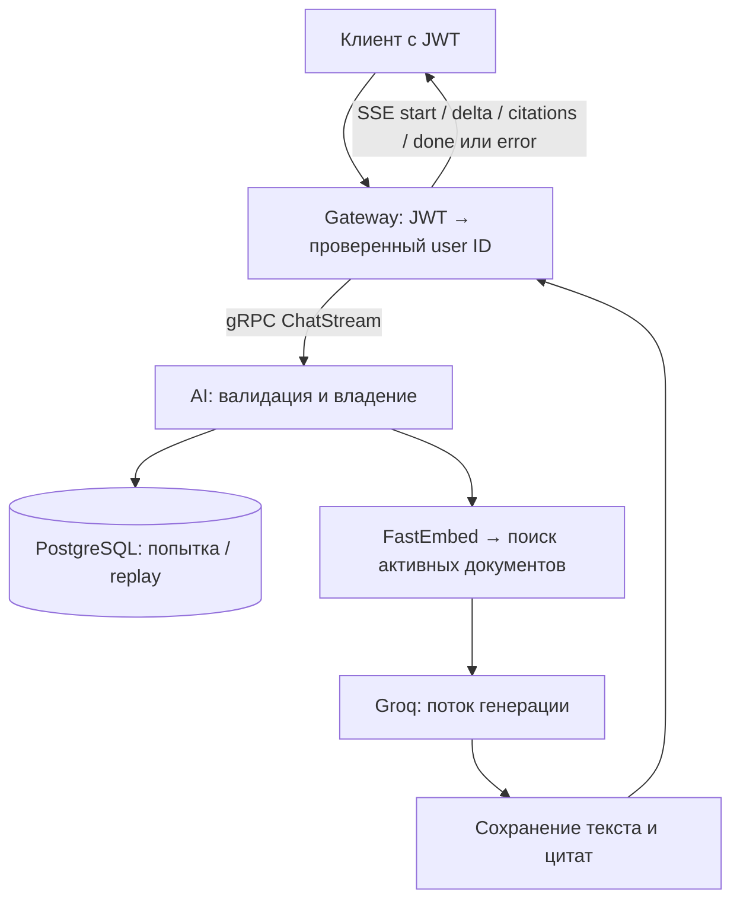

# Поток обработки AI-запроса

1. Gateway проверяет access JWT, размер JSON, UUIDv4 и текст; передаёт `x-user-id` из проверенного контекста.
2. AI валидирует идентичность, запрос и владение диалогом/попыткой. Регистрация попытки выполняется до генерации.
3. При успешном replay возвращаются сохранённые текст/цитаты без вызова RAG/LLM. Активный дубль, другой payload и повтор финализированной ошибки обрабатываются отдельно.
4. Для существующего `conversation_id` сервис при необходимости загружает ограниченную историю (по умолчанию до 10 сообщений). При поиске использует предыдущий вопрос пользователя вместе с текущим; если результаты отсутствуют, повторяет поиск только по текущему вопросу. История также передаётся модели. Ошибка загрузки истории может оставить запрос без неё.
5. При включённом RAG FastEmbed преобразует поисковый запрос в вектор. PostgreSQL выбирает кандидатов среди активных документов по порогу близости; совпадение слов в заголовке, секции и тексте повышает их рейтинг. Это переранжирование векторных кандидатов, а не независимый полнотекстовый поиск.
6. Найденные фрагменты добавляются в prompt. Если подтверждение не найдено, модель получает предупреждение, но генерация не блокируется.
7. `delta` передаются клиенту по мере генерации; найденные цитаты — отдельным событием. Только после сохранения успешного результата отдаётся `done`.
8. Отмена/ошибка изменяет состояние попытки. Для следующей генерации после неуспеха нужен новый `message_id`.

`relevance_score`, в том числе `1.00` после буста, не является вероятностью правильного ответа. Проверяйте конкретные утверждения по первоисточнику.

Эмбеддер создаётся один раз при старте процесса и прогревается до `SERVING`. Ingestion выполняется отдельной операцией, не во время каждого запроса или старта сервера. Точные протоколы — [AI API](../gateway/ai-api.md), пределы возможностей — [ограничения](current-limitations.md).

**Источники:** [точка входа](https://github.com/orbit-polytech/ai-service/blob/main/src/orbit_ai/__main__.py), [usecase](https://github.com/orbit-polytech/ai-service/blob/main/src/orbit_ai/application/chat_stream_use_case.py).
