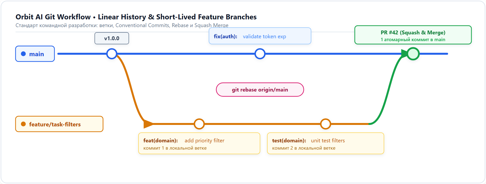

# Процесс работы с Git и GitHub Flow

В команде Orbit AI принят простой, строгий и надёжный процесс работы с Git на базе **GitHub Flow**. Мы не используем сложные модели вроде GitFlow с долгоживущими ветками `develop` и `release`, так как в команде из 10 человек они неизбежно приводят к конфликтам слияния.

---

## 1. Главные принципы

1. **Ветка `main` всегда готова к работе**: код в `main` обязан собираться без ошибок, проходить все тесты и линтеры. Прямой `git push` в ветку `main` технически заблокирован (Branch Protection).
2. **Все изменения только через ветки и Pull Request**: любая новая возможность, фикс бага или рефакторинг делаются в отдельной ветке.
3. **Ветки короткоживущие**: среднее время жизни ветки — от нескольких часов до 2–3 дней. Если работа над фичей занимает неделю, разбейте её на 3–4 независимых PR.
4. **Слияние через Squash and merge**: вся история ветки задачи схлопывается в один атомарный коммит в `main`, после чего ветка удаляется. Это сохраняет историю ветки `main` чистой и понятной.



---

## 2. Жизненный цикл задачи (Шаг за шагом)

### Шаг 1. Получить задачу и актуализировать `main`
Перед тем как начать писать код, всегда обновляйте локальный `main` из репозитория GitHub:

```bash
git checkout main
git pull origin main
```

### Шаг 2. Создать ветку
Имя ветки формируется по шаблону: `<тип>/<номер-задачи>-<кратко-на-английском>`

```bash
# Новая функциональность:
git checkout -b feat/42-task-deadlines

# Исправление ошибки:
git checkout -b fix/57-refresh-token-reuse

# Документация:
git checkout -b docs/12-local-setup
```

### Шаг 3. Локальная разработка и фиксация изменений
Делайте коммиты по мере логического прогресса. Сообщения оформляйте по [Conventional Commits](overview.md):

```bash
git add internal/domain/task.go internal/domain/task_test.go
git commit -m "feat(tasks): implement deadline calculation invariants"
```

### Шаг 4. Самопроверка перед отправкой
Перед созданием Pull Request обязательно запустите локальные проверки:

```bash
# Для Go:
go test -count=1 ./...
golangci-lint run ./...

# Для Python:
pytest
ruff check .
ruff format --check .

# Для Flutter:
flutter test
flutter analyze
```

### Шаг 5. Отправка ветки на GitHub
```bash
git push -u origin feat/42-task-deadlines
```

### Шаг 6. Открытие Pull Request и прохождение ревью
1. Перейдите по ссылке, которую выведет Git в консоли, и создайте Pull Request в ветку `main`.
2. Заполните шаблон описания: укажите номер задачи (`Closes #42`), что именно сделано и как проверить.
3. Дождитесь успешного завершения автоматических проверок (зелёные галочки GitHub Actions).
4. Запросите ревью у коллег (минимум 1 Approve).

### Шаг 7. Слияние и очистка
После получения аппрува нажмите зелёную кнопку **Squash and merge**, подтвердите понятное название итогового коммита и нажмите **Delete branch**.

На локальной машине вернитесь в `main` и удалите старую ветку:

```bash
git checkout main
git pull origin main
git branch -d feat/42-task-deadlines
```

---

## 3. Что делать при конфликтах слияния

Если пока вы делали ветку, кто-то успел влить свой PR в `main` и GitHub показывает `This branch has conflicts`:

1. Перейдите в свою ветку:
   ```bash
   git checkout feat/42-task-deadlines
   git fetch origin
   ```
2. Сделайте `rebase` на свежий `origin/main`:
   ```bash
   git rebase origin/main
   ```
3. Откройте VS Code, разрешите маркеры конфликтов в файлах.
4. Добавьте разрешённые файлы и продолжите:
   ```bash
   git add <исправленные файлы>
   git rebase --continue
   ```
5. Запустите тесты, чтобы убедиться, что ничего не сломалось.
6. Отправьте ветку с флагом `--force-with-lease`:
   ```bash
   git push --force-with-lease origin feat/42-task-deadlines
   ```
