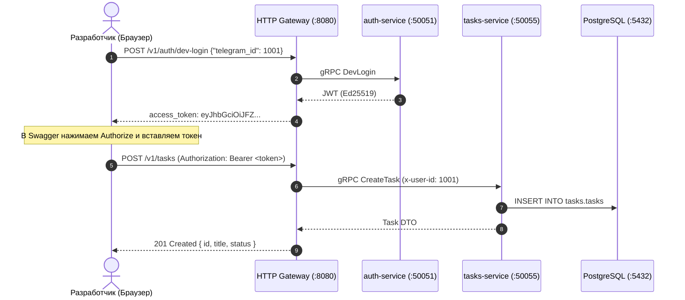

# Запуск проекта с нуля на своём компьютере

Цель этого руководства: за 20–30 минут получить полностью работающий микросервисный стек на своей машине и успешно отправить первый запрос через `gateway-service`. 

Никаких сложных облачных сервисов и Kubernetes для разработки не требуется: вся база данных, брокеры сообщений и сервисы поднимаются локально через Docker.

---

## 1. Системные требования и инструменты

Убедитесь, что на вашем компьютере установлены следующие версии инструментов:

| Инструмент | Минимальная версия | Проверка в терминале |
|---|---|---|
| **Git** | 2.40+ | `git --version` |
| **Docker Engine & Compose** | Compose 2.22+ (с поддержкой `watch`) | `docker compose version` |
| **Go** | 1.25+ | `go version` |
| **Python** | 3.12+ | `python --version` (Windows) / `python3 --version` (Linux) |
| **uv** (менеджер пакетов Python) | свежая | `uv --version` |
| **Flutter** | stable (3.24+) | `flutter doctor` |
| **Buf CLI** | 1.40+ (v2 config) | `buf --version` |
| **grpcurl** | свежая | `grpcurl --version` |
| **Make** | любая | `make --version` *(для Linux/macOS; на Windows опционально)* |

### Нативная разработка на Windows, Linux и macOS
Вам **не требуется** настраивать виртуальные машины или WSL 2, если вы этого не хотите. На Windows разработка ведётся нативно и комфортно: через обычный терминал (**PowerShell**, **Windows Terminal** или CMD), установленный **Docker Desktop** и стандартные инструменты разработчика.

> [!TIP]
> **А что насчет WSL 2?**  
> Если вы на Windows уже привыкли работать внутри Linux-окружения через WSL 2 (Ubuntu), вы можете продолжать им пользоваться — просто следуйте инструкциям на вкладках **Linux / macOS**. Но если WSL у вас не настроен, ставить его специально не нужно: нативная разработка в Windows через PowerShell и Docker Desktop полностью поддерживается и работает без лишних прослоек.

Чтобы локальная среда на Windows работала без сюрпризов, обратите внимание на три простых правила:
1. **Путь к рабочей папке (без пробелов и кириллицы)**: Создайте папку проекта прямо в корне любого удобного диска, например `F:\orbit`, `D:\orbit` или `C:\orbit`. Если положить репозитории в путь вроде `C:\Users\Иван Иванов\Документы\...`, компилятор Go и Docker-монтирования volumes могут спотыкаться о пробелы и русские буквы в путях.
2. **Кодировка UTF-8 в консоли**: В PowerShell перед началом работы можно выполнить команду `chcp 65001`, чтобы вывод консоли и логи на русском языке отображались без искажений.
3. **Окончания строк в Git**: Для исключения конфликтов переводов строк (CRLF vs LF) настройте Git: `git config --global core.autocrlf true`.

Установка консольных Go-утилит одной командой (работает одинаково в PowerShell, CMD, Bash и Zsh):

```bash
go install github.com/bufbuild/buf/cmd/buf@latest
go install github.com/fullstorydev/grpcurl/cmd/grpcurl@latest
go install github.com/pressly/goose/v3/cmd/goose@latest
go install github.com/golangci/golangci-lint/cmd/golangci-lint@latest
go install golang.org/x/vuln/cmd/govulncheck@latest
```

* `buf` — работа с Proto-контрактами;
* `grpcurl` — тестирование gRPC-эндпоинтов из консоли;
* `goose` — применение и откат миграций PostgreSQL;
* `golangci-lint` — статический анализатор кода Go;
* `govulncheck` — проверка зависимостей на уязвимости.

Убедитесь, что каталог с бинарными файлами Go добавлен в переменную `PATH`:
- **Windows**: `%USERPROFILE%\go\bin` (или `$env:USERPROFILE\go\bin`). Чтобы добавить один раз в PowerShell:
  ```powershell
  [Environment]::SetEnvironmentVariable("Path", $env:Path + ";$env:USERPROFILE\go\bin", "User")
  ```
- **Linux / macOS**: `$(go env GOPATH)/bin` (обычно `~/go/bin`).

---

## 2. Шаг 1. Клонирование репозиториев

Все сервисы проекта клонируются в одну общую рабочую директорию рядом друг с другом. Это ключевое архитектурное соглашение: Docker Compose в репозитории `infra` находит исходный код микросервисов по относительным путям `../<сервис>`.

=== "Windows (PowerShell)"
    ```powershell
    # Перейдите на ваш рабочий диск (например, F: или D:) и создайте рабочую папку
    # F:
    mkdir F:\orbit   # или D:\orbit, C:\orbit (любой удобный вам диск)
    cd F:\orbit

    # Инфраструктура, API-контракты и базовые сервисы
    git clone https://github.com/orbit-polytech/infra.git
    git clone https://github.com/orbit-polytech/contracts.git
    git clone https://github.com/orbit-polytech/gateway-service.git
    git clone https://github.com/orbit-polytech/auth-service.git
    git clone https://github.com/orbit-polytech/tasks-service.git
    # Дополнительные сервисы (ai-service, mobile и т.д.) клонируются по мере необходимости
    ```

=== "Linux / macOS"
    ```bash
    # Создаем рабочую папку и переходим в неё
    mkdir -p ~/orbit && cd ~/orbit

    # Инфраструктура, API-контракты и базовые сервисы
    git clone https://github.com/orbit-polytech/infra.git
    git clone https://github.com/orbit-polytech/contracts.git
    git clone https://github.com/orbit-polytech/gateway-service.git
    git clone https://github.com/orbit-polytech/auth-service.git
    git clone https://github.com/orbit-polytech/tasks-service.git
    ```

> [!TIP]
> Если у вас настроен SSH-ключ для GitHub, вместо HTTPS-ссылок вы можете клонировать через SSH: `git clone git@github.com:orbit-polytech/infra.git`.

Итоговая структура папок на вашем диске:

```text
orbit/  (например, F:\orbit, D:\orbit или ~/orbit)
├── infra/
├── contracts/
├── gateway-service/
├── auth-service/
├── tasks-service/
└── mobile/
```

---

## 3. Шаг 2. Переменные окружения и ключи

Перейдите в папку инфраструктуры и создайте файл локальных настроек `.env` на основе шаблона:

=== "Windows (PowerShell)"
    ```powershell
    cd infra    # или: cd F:\orbit\infra
    Copy-Item .env.example .env
    ```

=== "Linux / macOS"
    ```bash
    cd ~/orbit/infra
    cp .env.example .env
    ```

Значения по умолчанию из `.env.example` уже оптимизированы для локальной разработки (порты, пароли к тестовым БД и адреса брокеров). Внешние секреты (например, ключ Gemini API или токен Telegram) вносятся по желанию только в локальный `.env`. Файл `.env` защищён `.gitignore` и никогда не попадает в репозиторий.

Для авторизации в системе используется асимметричная подпись токенов **Ed25519**: сервис `auth-service` подписывает токен приватным ключом, а `gateway-service` проверяет его по открытому ключу. Создадим эту пару ключей в папке `secrets/`:

=== "Windows (PowerShell / OpenSSL)"
    ```powershell
    # Переходим в папку infra (если еще не там) и создаем каталог secrets
    cd infra    # или: cd F:\orbit\infra
    if (-not (Test-Path "secrets")) { New-Item -ItemType Directory -Path "secrets" }

    # Генерируем пару ключей Ed25519 через openssl (входит в стандартную поставку Git)
    openssl genpkey -algorithm ed25519 -out secrets/jwt_ed25519
    openssl pkey -in secrets/jwt_ed25519 -pubout -out secrets/jwt_ed25519.pub

    # Подсказка: если PowerShell сообщает, что команда openssl не найдена,
    # вызовите бинарник Git напрямую:
    # & "C:\Program Files\Git\usr\bin\openssl.exe" genpkey -algorithm ed25519 -out secrets/jwt_ed25519
    # & "C:\Program Files\Git\usr\bin\openssl.exe" pkey -in secrets/jwt_ed25519 -pubout -out secrets/jwt_ed25519.pub
    # Либо просто откройте терминал Git Bash в папке infra и выполните: make keys
    ```

=== "Linux / macOS / Make"
    ```bash
    make keys
    # Выполняет скрипт scripts/gen-keys.sh и создает пару в каталоге secrets/
    ```

В результате в каталоге `infra/secrets/` появятся файлы:
- `jwt_ed25519` — приватный ключ (читается `auth-service`);
- `jwt_ed25519.pub` — открытый ключ (монтируется в `gateway-service`).

Папка `secrets/` также добавлена в `.gitignore`.

---

## 4. Шаг 3. Запуск инфраструктурных контейнеров

Запустите контейнеры баз данных и брокеров сообщений:

```bash
docker compose up -d postgres redis rabbitmq jaeger
docker compose ps
```

Дождитесь, пока контейнеры перейдут в статус `healthy`. Быстрая проверка доступности:

```bash
# Проверка PostgreSQL 16
docker compose exec postgres psql -U orbit -d orbit -c "SELECT 1;"

# Проверка Redis 7
docker compose exec redis redis-cli ping
# Ответ: PONG
```

Веб-интерфейсы инфраструктуры доступны в браузере:
- **RabbitMQ Management**: [http://localhost:15672](http://localhost:15672) (логин / пароль: `guest` / `guest`);
- **Jaeger UI (трассировка)**: [http://localhost:16686](http://localhost:16686).

---

## 5. Шаг 4. Накатывание миграций баз данных

Каждый сервис изолированно управляет своей схемой БД в общей инстанции PostgreSQL (`search_path=auth`, `search_path=tasks` и т.д.):

=== "Через Make (Linux / macOS / Git Bash)"
    ```bash
    cd ../auth-service && make migrate-up
    cd ../tasks-service && make migrate-up
    cd ../infra
    ```

=== "Через Goose (Windows PowerShell / универсально)"
    ```powershell
    # Применяем миграции auth-service:
    cd ..\auth-service
    goose -dir migrations postgres "host=localhost port=5432 user=orbit password=orbit_dev_secret dbname=orbit search_path=auth sslmode=disable" up

    # Применяем миграции tasks-service:
    cd ..\tasks-service
    goose -dir migrations postgres "host=localhost port=5432 user=orbit password=orbit_dev_secret dbname=orbit search_path=tasks sslmode=disable" up

    # Возвращаемся в папку infra:
    cd ..\infra
    ```

---

## 6. Шаг 5. Запуск сервисов

Есть два основных сценария локальной разработки:

### Сценарий А: Запуск всех сервисов в Docker (удобно для фронтендеров и новичков)

=== "Windows (PowerShell)"
    ```powershell
    cd infra    # или: cd F:\orbit\infra
    docker compose --profile core up -d
    docker compose ps
    ```

=== "Linux / macOS"
    ```bash
    cd ~/orbit/infra
    docker compose --profile core up -d
    docker compose ps
    ```

Эта команда автоматически соберёт и запустит контейнеры `auth-service`, `tasks-service` и `gateway-service`. Все три сервиса должны быть в состоянии `Up` (running).

### Сценарий Б: Сервис разрабатывается на хосте, остальное в Docker (для бэкендеров)
Если вы прямо сейчас пишете код для `tasks-service`, остановите его Docker-контейнер и запустите сервис локально в IDE или терминале:

=== "Windows (PowerShell)"
    ```powershell
    cd infra    # или: cd F:\orbit\infra
    docker compose --profile core up -d
    docker compose stop tasks-service

    # Запуск сервиса на хосте:
    cd ..\tasks-service
    if (-not (Test-Path ".env")) { Copy-Item .env.example .env }
    go run ./cmd/tasks-service/main.go
    ```

=== "Linux / macOS"
    ```bash
    cd ~/orbit/infra
    docker compose --profile core up -d
    docker compose stop tasks-service

    # Запуск сервиса на хосте:
    cd ../tasks-service
    test -f .env || cp .env.example .env
    go run ./cmd/tasks-service/main.go
    # (или make run)
    ```

Шлюз `gateway-service` автоматически свяжется с сервисом на вашей хост-машине через адрес `host.docker.internal:50055`.

Для режима «меняю код на диске — контейнер сам пересобирается на лету» используйте встроенную функцию Docker:

```bash
docker compose --profile core watch
```

---

## 7. Шаг 6. Проверка работы и первый запрос

Поздравляем! Инфраструктура и сервисы запущены. Теперь проверим, как работает наш стек в реальном сценарии.

Вместо громоздких консольных команд с bash-пайпами, самый наглядный и быстрый способ для разработчика — воспользоваться интерактивным интерфейсом **Swagger UI** прямо в браузере.

---

### Основной способ: Проверка через Swagger UI (в браузере)

Шлюз `gateway-service` автоматически предоставляет веб-интерфейс со всеми эндпоинтами системы.

Откройте браузер по адресу:
[**`http://localhost:8080/swagger`**](http://localhost:8080/swagger) (или [**`http://localhost:8080/docs`**](http://localhost:8080/docs)).

Перед вами откроется интерактивная страница со списком доступных методов API. Пройдем базовый сценарий пользователя за 4 простых шага:



#### 1. Получаем тестовый токен (Dev-логин)
1. В секции **Auth** найдите метод **`POST /v1/auth/dev-login`** (в локальном окружении он позволяет мгновенно войти под тестовым профилем без отправки внешних кодов).
2. Нажмите кнопку **Try it out** справа.
3. В поле *Request body* укажите тестовый ID студента:
   ```json
   {
     "telegram_id": 1001
   }
   ```
4. Нажмите синюю кнопку **Execute**.
5. Прокрутите чуть ниже до блока **Responses** (статус `200 OK`). В ответе вы увидите поле `access_token` с длинной строкой токена (начинается с `eyJ...`). Скопируйте значение токена в буфер обмена (без кавычек).

#### 2. Авторизуемся в Swagger UI
1. Поднимитесь в верхнюю часть страницы Swagger UI и нажмите зеленую кнопку **Authorize** (с изображением замочка).
2. В поле *Value* введите:
   ```text
   Bearer ВАШ_СКОПИРОВАННЫЙ_ТОКЕН
   ```
   *(или просто сам токен, если поле настроено автоматически)*.
3. Нажмите **Authorize**, а затем **Close**. Теперь замочки рядом с методами закроются — все последующие запросы из браузера будут автоматически отправляться с вашим JWT-токеном.

#### 3. Создаем первую задачу студента
1. В секции **Tasks** найдите метод **`POST /v1/tasks`**.
2. Нажмите **Try it out**.
3. В поле *Request body* укажите параметры задачи:
   ```json
   {
     "title": "Сдать 1-ю лабораторную по микросервисам",
     "due_at": "2026-11-01T18:00:00Z"
   }
   ```
4. Если отображается поле заголовка `Idempotency-Key`, укажите любую уникальную строку (например, `test-task-1`).
5. Нажмите **Execute**.
6. В ответе со статусом `201 Created` (или `200 OK`) вы увидите созданную задачу с уникальным `id`, статусом `OPEN` и временем создания. Задача успешно записана в базу данных!

#### 4. Проверяем список задач
1. В той же секции **Tasks** разверните метод **`GET /v1/tasks`**.
2. Нажмите **Try it out** $\to$ **Execute**.
3. В теле ответа отобразится массив задач текущего авторизованного студента, содержащий созданную вами задачу.

---

### Наглядная трассировка запроса в Jaeger

После выполнения запросов откройте интерфейс распределенного трейсинга **Jaeger**:
[**`http://localhost:16686`**](http://localhost:16686)

1. В левой панели в выпадающем списке **Service** выберите `gateway-service` (или `tasks-service`).
2. Нажмите кнопку **Find Traces**.
3. Кликните на найденный трейс `POST /v1/tasks`.

Вы увидите интерактивную временную шкалу вызова:
- Вход HTTP-запроса в шлюз;
- Проверка криптографической подписи JWT в middleware;
- gRPC-вызов между `gateway-service` и `tasks-service`;
- Выполнение SQL-запроса `INSERT` в PostgreSQL.

Это наглядно демонстрирует, как взаимодействуют микросервисы без необходимости читать бесконечные консольные логи.

---

### Альтернатива: Проверка через терминал

Если вам привычнее отправлять запросы из консоли, используйте готовые команды без внешних зависимостей (`jq`, `tee` и `uuidgen` не требуются):

=== "Windows (PowerShell)"
    ```powershell
    # 1. Получаем токен авторизации dev-пользователя
    $login = Invoke-RestMethod -Method Post -Uri "http://localhost:8080/v1/auth/dev-login" `
      -ContentType "application/json; charset=utf-8" -Body '{"telegram_id": 1001}'
    $token = $login.access_token
    Write-Host "Получен токен: $token" -ForegroundColor Green

    # 2. Создаем задачу через HTTP Gateway
    $headers = @{
        "Authorization" = "Bearer $token"
        "Idempotency-Key" = [guid]::NewGuid().ToString()
    }
    $taskBody = '{"title": "Сдать 1-ю лабораторную по базам данных", "due_at": "2026-11-01T18:00:00Z"}'
    $newTask = Invoke-RestMethod -Method Post -Uri "http://localhost:8080/v1/tasks" `
      -Headers $headers -ContentType "application/json; charset=utf-8" -Body $taskBody
    Write-Host "Создана задача с ID: $($newTask.id)" -ForegroundColor Cyan

    # 3. Получаем список задач
    $tasks = Invoke-RestMethod -Method Get -Uri "http://localhost:8080/v1/tasks" `
      -Headers @{ "Authorization" = "Bearer $token" }
    $tasks
    ```

=== "Linux / macOS (cURL)"
    ```bash
    # 1. Получаем токен dev-пользователя
    TOKEN=$(curl -s -X POST http://localhost:8080/v1/auth/dev-login \
      -H 'Content-Type: application/json' \
      -d '{"telegram_id": 1001}' | grep -o '"access_token":"[^"]*' | cut -d'"' -f4)

    # 2. Создаем задачу через HTTP Gateway
    curl -s -X POST http://localhost:8080/v1/tasks \
      -H "Authorization: Bearer $TOKEN" \
      -H 'Content-Type: application/json' \
      -H "Idempotency-Key: task-test-01" \
      -d '{"title": "Сдать 1-ю лабораторную по базам данных", "due_at": "2026-11-01T18:00:00Z"}'

    # 3. Запрашиваем список задач
    curl -s http://localhost:8080/v1/tasks -H "Authorization: Bearer $TOKEN"
    ```

### Проверка gRPC напрямую (для бэкенд-разработчиков)
Если вам нужно протестировать gRPC-сервис в обход шлюза через утилиту `grpcurl`:

```bash
grpcurl -plaintext localhost:50055 list
grpcurl -plaintext localhost:50055 grpc.health.v1.Health/Check
```
*(gRPC reflection активирован по умолчанию при `APP_ENV=local`).*

---

## 8. Шаг 7. Запуск мобильного приложения на Flutter

Клиентское приложение `mobile` подключается к запущенному шлюзу:

=== "Windows (PowerShell)"
    ```powershell
    cd ..\mobile   # или: cd F:\orbit\mobile
    flutter pub get
    flutter run -t lib/main_development.dart --dart-define=API_URL=http://localhost:8080
    ```

=== "Linux / macOS"
    ```bash
    cd ~/orbit/mobile
    flutter pub get
    flutter run -t lib/main_development.dart --dart-define=API_URL=http://localhost:8080
    ```

> [!NOTE]
> При тестировании внутри Android-эмулятора адрес хост-компьютера `localhost` доступен по специальному IP `10.0.2.2`. 
> Параметр запуска для Android: `--dart-define=API_URL=http://10.0.2.2:8080`.

---

## Решение типовых проблем

| Симптом | Причина | Что сделать |
|---|---|---|
| `bind: address already in use (5432)` | Порт 5432 занят системным PostgreSQL, установленным ранее как служба Windows/Linux | **На Windows**: откройте диспетчер служб (`Win+R` $\to$ `services.msc`), найдите службу `postgresql-x64...` и остановите её (или в PowerShell: `Stop-Service postgresql*`).<br>**На Linux**: `sudo service postgresql stop`. |
| Ошибки сборки Go или монтирования volumes в Docker | В пути к папке проекта есть русские буквы или пробелы (например, `C:\Пользователи\Иван\...`) | Переместите проект в простой путь без кириллицы и пробелов: `F:\orbit`, `D:\orbit` или `C:\orbit`. |
| Искаженный вывод кириллицы в консоли Windows | Неверная кодовая страница PowerShell | Выполните в терминале команду `chcp 65001` (переключение на UTF-8). |
| `openssl` не распознаётся как команда в PowerShell | Путь к OpenSSL из Git не добавлен в системный `PATH` | Используйте прямой путь: `& "C:\Program Files\Git\usr\bin\openssl.exe" ...` либо запустите генерацию ключей в Git Bash (`make keys`). |
| Сервис падает с `connection refused` к Postgres | БД ещё не успела пройти инициализацию при первом старте | Дождитесь статуса healthy (`docker compose ps`) либо проверьте условия `condition: service_healthy` в `compose.yaml`. |
| `relation "tasks.tasks" does not exist` | Не применены миграции схемы базы данных | Выполните Шаг 4: накатите миграции через `goose` или `make migrate-up`. |
| Gateway возвращает `401 Unauthorized` | Истёк 15-минутный access-токен или были заново сгенерированы ключи в `secrets/` | Получите свежий токен через dev-логин (`POST /v1/auth/dev-login`). |
| Gateway возвращает `503 Service Unavailable` | Целевой микросервис (`tasks-service` или `auth-service`) не запущен | Проверьте состояние контейнеров `docker compose ps` или запустите сервис локально. |

Полный сброс и очистка всех контейнеров и баз данных (при необходимости начать всё заново):

=== "Windows (PowerShell)"
    ```powershell
    cd infra    # или: cd F:\orbit\infra
    docker compose --profile "*" down -v
    ```

=== "Linux / macOS"
    ```bash
    cd ~/orbit/infra
    docker compose --profile "*" down -v
    ```
