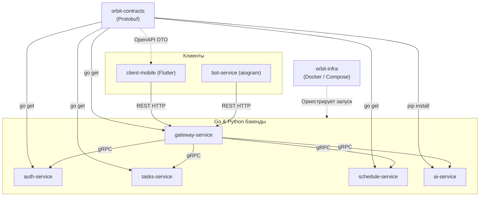

# Карта репозиториев организации

Официальная GitHub-организация проекта: [`https://github.com/orbit-polytech`](https://github.com/orbit-polytech).

Все репозитории публичны, имеют настроенные Branch Protection Rules для ветки `main` и запускают независимые CI/CD пайплайны GitHub Actions.

---

## 1. Реестр репозиториев

| № | Репозиторий | Назначение | Технологический стек | Ответственные |
| :-: | :--- | :--- | :--- | :--- |
| **1** | [`orbit-contracts`](https://github.com/orbit-polytech/orbit-contracts) | Единый источник схем API (.proto) и генерация кода | Protobuf v3, Buf v2, Go, Python, OpenAPI | Тимлид / Все |
| **2** | [`orbit-service-template`](https://github.com/orbit-polytech/orbit-service-template) | Эталонный шаблон Go-микросервиса (Clean Arch) | Go 1.24, gRPC, slog, Goose, Docker | Backend Core |
| **3** | [`gateway-service`](https://github.com/orbit-polytech/gateway-service) | Внешний API Gateway (REST $\leftrightarrow$ gRPC, JWT Ed25519) | Go 1.24, chi/fiber, gRPC-клиенты, Redis | Backend Gateway |
| **4** | [`auth-service`](https://github.com/orbit-polytech/auth-service) | Аутентификация, выпуск JWT Ed25519, сессии | Go 1.24, PostgreSQL, bcrypt/argon2 | Backend Auth |
| **5** | [`users-service`](https://github.com/orbit-polytech/users-service) | Профили студентов, группы, учебные роли | Go 1.24, PostgreSQL, gRPC | Backend Core |
| **6** | [`schedule-service`](https://github.com/orbit-polytech/schedule-service) | Расписание пар, сессий, числитель/знаменатель | Go 1.24, PostgreSQL, Redis кэш, gRPC | Backend Core |
| **7** | [`navigation-service`](https://github.com/orbit-polytech/navigation-service) | Корпуса Политеха (БС, АВ, ПР), аудитории, карты | Go 1.24, PostgreSQL, gRPC | Backend Core |
| **8** | [`tasks-service`](https://github.com/orbit-polytech/tasks-service) | Задачи студентов, дедлайны лаб, приоритеты | Go 1.24, PostgreSQL, RabbitMQ Outbox | Backend Core |
| **9** | [`notification-service`](https://github.com/orbit-polytech/notification-service) | Отправка Push- и Telegram-уведомлений по событиям | Go 1.24, RabbitMQ Consumer | Backend Core |
| **10** | [`ai-service`](https://github.com/orbit-polytech/ai-service) | RAG-поиск по регламентам вуза, Gemini API | Python 3.12, gRPC, pgvector, google-genai | AI & ML Team |
| **11** | [`bot-service`](https://github.com/orbit-polytech/bot-service) | Telegram-бот для студентов и старост | Python 3.12, aiogram 3, REST к Gateway | Bot Team |
| **12** | [`client-mobile`](https://github.com/orbit-polytech/client-mobile) | Кроссплатформенное мобильное приложение | Flutter 3.x, Dart 3, BLoC, Dio, SecureStorage | Mobile Team |
| **13** | [`orbit-infra`](https://github.com/orbit-polytech/orbit-infra) | Локальный запуск (Docker Compose, Postgres, RMQ) | Docker, Compose v2, Nginx, Prometheus | DevOps / Infra |
| **14** | [`orbit-docs`](https://github.com/orbit-polytech/orbit-docs) | Официальная документация и обучающий учебник | MkDocs Material, Markdown, GitHub Pages | Тимлид / Все |

---

## 2. Граф зависимостей между репозиториями

