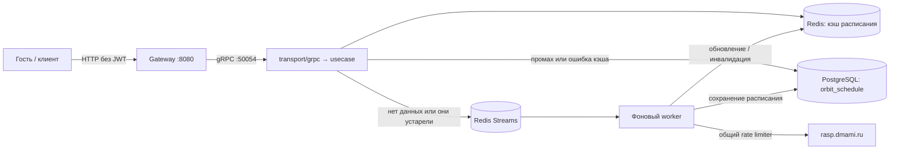

# schedule-service (Расписание занятий)

**Репозиторий:** [`orbit-polytech/schedule-service`](https://github.com/orbit-polytech/schedule-service)
**Статус:** реализован в `main`, подключён к Gateway и актуальному Compose.

## Назначение и границы

Сервис синхронизирует реестр групп и регулярное расписание с `https://rasp.dmami.ru`, сохраняет расписание в PostgreSQL и отдаёт расписание по календарным датам. Публичное чтение не требует аккаунта, профиля Users или JWT.

Текущий стек: Go, gRPC `orbit.schedule.v1`, PostgreSQL 16, Redis 7. Версия Go определяется `go.mod` сервиса. Redis используется для общего кэша расписания, очереди синхронизации и координации воркеров. RabbitMQ в текущем стенде не используется.

## Чтение и фоновое обновление



- **Чтение:** Redis → при промахе или ошибке PostgreSQL → календарная нарезка в usecase. Все посетители группы используют общий кэш полной сохранённой версии расписания, независимо от выбранных дат. Локальный `singleflight` объединяет одновременные загрузки одного ключа в пределах процесса, но не всех реплик.
- **Обновление по запросу:** для незагруженной или устаревшей группы usecase ставит фоновое задание. Запрос не ждёт HTTP-вызова внешнего источника. Для устаревших данных возвращается доступное расписание с `is_stale=true`.
- **Плановое обновление:** при старте и далее по интервалу реестр групп обновляется, задания поступают в periodic Stream. Воркеры читают priority и periodic с целевым соотношением 3:1; это не гарантия глобального порядка.
- **Координация:** consumer group, дедупликация, lease с продлением, повторная обработка зависших заданий и отложенные повторы. Защита записи по поколению в PostgreSQL не позволяет старому воркеру перезаписать более новую версию.
- Общий Redis token bucket применяется и к реестру, и к расписанию: скорость пополнения в Compose `2 RPS`, ёмкость `5`. Возможны короткие всплески; это не строгий предел двух запросов в каждую секунду.
- `last_checked_at` — время проверки источника, `last_updated_at` — время изменения содержимого. Неизменившийся хэш не требует сохранения новой версии расписания.

## Кэш и отказоустойчивость

Ключ: `schedule:cache:v1:group:<title>:regular`. Срок хранения — `24h` плюс положительный jitter `0..2h`. `SCHEDULE_FRESHNESS_TTL` независимо определяет устаревание данных; существующий ключ не означает, что расписание актуально.

После успешной транзакции кэш обновляется или инвалидируется; отметка об ошибке обновления сохраняет исходное время истечения через `KEEPTTL`. PostgreSQL — основное хранилище, Redis — восстанавливаемый кэш и координатор фоновых задач.

При ошибках кэша читаем PostgreSQL. Если расписание уже сохранено, сбой очереди не должен лишать клиента этих данных. Если расписание ещё не загружено и подтвердить постановку задания невозможно, возвращается `503`, а не ложный `PENDING_SYNC`. После начальной недоступности Redis приложение повторяет подключение; синхронизация возобновляется после восстановления. Прямого обхода глобального лимитера через внешний источник нет.

## Структура реализации

```text
cmd/schedule/             # запуск приложения
internal/
├── app/                  # сборка зависимостей и жизненный цикл
├── config/               # env и проверка конфигурации
├── domain/               # модели, ошибки, сетка звонков
├── usecase/              # сценарии поиска и чтения, выбор периода
├── infrastructure/       # адаптеры PostgreSQL и Redis (кэш, очередь, lease, limiter)
├── parser/               # преобразование и валидация данных источника
├── syncer/               # HTTP-клиент, ограничитель, синхронизация
├── worker/               # плановая постановка задач и обработка очередей
└── transport/grpc/       # protobuf и gRPC status
migrations/               # SQL-миграции Goose
```

Выбор недели и проверка интервала находятся в usecase, расчёт времени пар — в domain. gRPC-хэндлер не содержит эту бизнес-логику, Gateway не дублирует её.

## API и контракты

`contracts@v0.5.0`, пакет `orbit.schedule.v1`:

| RPC | Назначение |
|---|---|
| `SearchGroups` | Поиск групп по названию с лимитом |
| `GetGroupSchedule` | Регулярное расписание за выбранные календарные даты |

HTTP-маршруты, поведение необязательных дат, JSON и ошибки описаны в [руководстве по API расписания](../../gateway/schedule-api.md).

## Адреса и конфигурация

- Compose DNS: `schedule-service:50054`.
- Порт для диагностики на хосте: `127.0.0.1:50054` (переопределяется `SCHEDULE_GRPC_HOST_PORT`).
- База в Compose: `${SCHEDULE_POSTGRES_DB:-orbit_schedule}`; приложение получает `POSTGRES_DSN`.
- Образы: `ghcr.io/orbit-polytech/schedule-service` и `ghcr.io/orbit-polytech/schedule-migrate`.

| Env приложения | Значение по умолчанию в коде |
|---|---|
| `POSTGRES_DSN` | Обязателен, без дефолта |
| `SCHEDULE_GRPC_HOST` / `SCHEDULE_GRPC_PORT` | `0.0.0.0` / `50054` |
| `SCHEDULE_SHUTDOWN_TIMEOUT` | `10s` |
| `SCHEDULE_FRESHNESS_TTL` | `24h` |
| `SCHEDULE_CACHE_TTL` / `SCHEDULE_CACHE_JITTER` | `24h` / `2h` |
| `REDIS_ADDR` / `REDIS_PASSWORD` / `REDIS_DB` | В Compose: `redis:6379`, пароль из `.env`, база `0` |
| `SCHEDULE_SYNC_ENABLED` | `false`; **в Compose включён по умолчанию** |
| `SCHEDULE_SYNC_INTERVAL` | `6h` |
| `SCHEDULE_SYNC_RPS` | `2` |
| `SCHEDULE_SOURCE_BASE_URL` | `https://rasp.dmami.ru` |
| `POSTGRES_MAX_CONNS` / `POSTGRES_MIN_CONNS` | `15` / `2` |
| `POSTGRES_MAX_CONN_IDLE_TIME` / `POSTGRES_MAX_CONN_LIFETIME` | `5m` / `1h` |
| `LOG_LEVEL` | `info` |

Параметры кэша и синхронизации переопределяются через `infra/.env`; контейнер получает только явно переданные Compose значения. См. [справочник env](../ports-and-env.md).

## Готовность и ограничения

- Healthcheck проверяет готовность сервиса, **не завершение обновления всех групп**.
- Известная группа без загруженного расписания: `200 PENDING_SYNC`, если постановка задания подтверждена или задание уже существует; иначе `503 UNAVAILABLE`.
- Сохранённое расписание: `200 READY`, в том числе с `is_stale=true`. Неизвестная группа — `404`.
- `published_from` / `published_to` описывают период опубликованного расписания, а не запрошенные даты и не гарантированную длительность семестра. Неизвестные границы не выдумываются.
- Параллельные занятия одного слота сохраняются; календарная выдача учитывает интервалы дат занятий. Отдельного API-фильтра подгрупп и универсального вычисления чётности недели нет. Одно поле `week` не доказывает поддержку всех правил числителя/знаменателя.
- Сессия, расписание преподавателей/аудиторий, ручные правки, presets, `/grid` и публикация межсервисных событий — будущие этапы.

См. [API расписания](../../gateway/schedule-api.md) и [диагностику синхронизации](../../how-to/schedule-sync-diagnostics.md).
