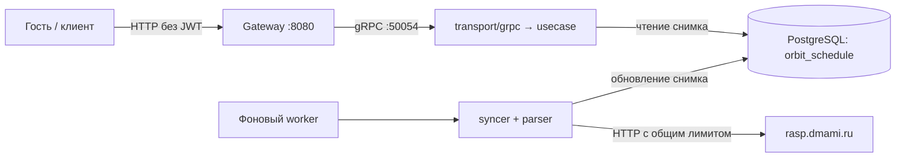

# schedule-service (Расписание занятий)

**Репозиторий:** [`orbit-polytech/schedule-service`](https://github.com/orbit-polytech/schedule-service)
**Статус:** реализован в `main`, подключён к Gateway и актуальному Compose.

## Назначение и границы

Сервис синхронизирует реестр групп и регулярное расписание с `https://rasp.dmami.ru`, сохраняет снимки в PostgreSQL и отдаёт расписание по календарным датам. Публичное чтение не требует аккаунта, профиля Users или JWT.

Текущий стек: Go, gRPC `orbit.schedule.v1`, PostgreSQL 16. Версия Go определяется `go.mod` сервиса. **Redis и RabbitMQ текущему Schedule не нужны.** Redis в общем стенде используется Auth.

## Два независимых пути



- **Read path:** HTTP Gateway → gRPC → usecase → PostgreSQL. Запрос пользователя не запускает обращение к источнику.
- **Sync path:** worker обновляет реестр, затем последовательно обходит группы. Первый проход начинается при старте; следующий — через заданный интервал после завершения предыдущего.
- Общий ограничитель исходящих запросов действует и на реестр, и на расписания групп. В Compose — `2 RPS`.
- Изменение содержимого определяется хэшем. `last_checked_at` показывает проверку источника, `last_updated_at` — обновление содержимого снимка.

## Структура реализации

```text
cmd/schedule/             # запуск приложения
internal/
├── app/                  # сборка зависимостей и жизненный цикл
├── config/               # env и проверка конфигурации
├── domain/               # модели, ошибки, сетка звонков
├── usecase/              # сценарии поиска и чтения, выбор периода
├── infrastructure/       # адаптер хранения PostgreSQL
├── parser/               # преобразование и валидация данных источника
├── syncer/               # HTTP-клиент, ограничитель, синхронизация
├── worker/               # фоновый обход групп
└── transport/grpc/       # protobuf и gRPC status
migrations/               # SQL-миграции Goose
```

Выбор недели и проверка интервала находятся в usecase, расчёт времени пар — в domain. gRPC-хэндлер не содержит эту бизнес-логику, Gateway не дублирует её.

## API и контракты

`contracts@v0.4.0`, пакет `orbit.schedule.v1`:

| RPC | Назначение |
|---|---|
| `SearchGroups` | Поиск групп по названию с лимитом |
| `GetGroupSchedule` | Регулярное расписание за выбранные календарные даты |

HTTP-маршруты, поведение необязательных дат, JSON и ошибки описаны в [руководстве по API расписания](../../gateway/schedule-api.md).

## Адреса и конфигурация

- Compose DNS: `schedule-service:50054`.
- Порт для диагностики на хосте: `127.0.0.1:50054` (переопределяется `SCHEDULE_GRPC_HOST_PORT`).
- База в Compose: `${SCHEDULE_POSTGRES_DB:-orbit_schedule}`; приложение получает `POSTGRES_DSN`.
- Образы: `ghcr.io/orbit-polytech/schedule-service` и `ghcr.io/orbit-polytech/schedule-migrate`.

| Env приложения | Значение по умолчанию в коде |
|---|---|
| `POSTGRES_DSN` | Обязателен, без дефолта |
| `SCHEDULE_GRPC_HOST` / `SCHEDULE_GRPC_PORT` | `0.0.0.0` / `50054` |
| `SCHEDULE_SHUTDOWN_TIMEOUT` | `10s` |
| `SCHEDULE_FRESHNESS_TTL` | `24h` |
| `SCHEDULE_SYNC_ENABLED` | `false`; **в Compose включён по умолчанию** |
| `SCHEDULE_SYNC_INTERVAL` | `6h` |
| `SCHEDULE_SYNC_RPS` | `2` |
| `SCHEDULE_SOURCE_BASE_URL` | `https://rasp.dmami.ru` |
| `POSTGRES_MAX_CONNS` / `POSTGRES_MIN_CONNS` | `15` / `2` |
| `POSTGRES_MAX_CONN_IDLE_TIME` / `POSTGRES_MAX_CONN_LIFETIME` | `5m` / `1h` |
| `LOG_LEVEL` | `info` |

Не все env приложения пробрасываются из `infra/.env`: часть настроек сейчас явно задана в Compose. См. [справочник env](../ports-and-env.md).

## Готовность и ограничения

- gRPC healthcheck проверяет готовность сервиса, **не завершение синхронизации всех групп**.
- Пока у известной группы нет снимка, чтение возвращает `Unavailable` → HTTP `503`.
- При устаревшем сохранённом снимке возможен успешный ответ с `metadata.is_stale=true`; это не то же самое, что отсутствие снимка.
- Реализовано регулярное расписание групп. Расписание преподавателей/аудиторий, сессия, ручные правки, подгруппы, пресеты и `/grid` пока не реализованы.
- Поле `week` передаётся из источника; отдельная фильтрация календарной выдачи по чётности недели пока не реализована. Нельзя обещать корректный числитель/знаменатель на основании наличия этого поля.
- Публикация событий, Redis-кэш и on-demand синхронизация — возможные будущие этапы, не часть текущего API.
