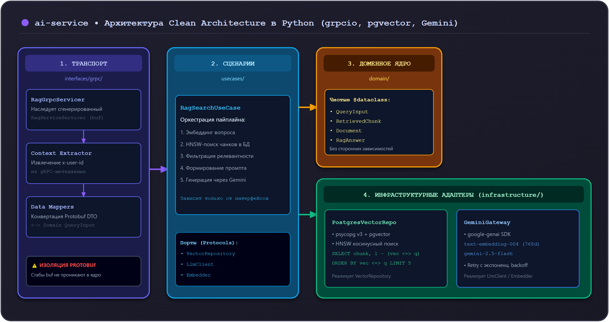

# 01. Внутренний gRPC-стек AI (grpcio, pgvector, Gemini)

Микросервис **`ai-service`** отвечает за интеллектуальные возможности экосистемы Orbit AI: семантический поиск по регламентам Московского Политеха, суммаризацию учебных материалов и генерацию ответов на базе языковых моделей Google Gemini.

В отличие от публичных веб-приложений, `ai-service` работает исключительно во **внутреннем сетевом периметре** и взаимодействует с остальной системой по протоколу **gRPC** (библиотека `grpcio`). Внешний REST доступ к нему осуществляется только через единый API Gateway.

---

## 1. Архитектура сервиса: Clean Architecture в Python

Сгенерированные утилитой `buf` файлы Protobuf (`rag_pb2.py`, `rag_pb2_grpc.py`) являются артефактами сетевого транспорта и не должны проникать в бизнес-логику:




---

## 2. Асинхронный gRPC-сервер (`grpc.aio.server`)

Пайплайн RAG на 90% состоит из сетевых I/O-ожиданий: вызов Google Gemini API занимает от 500 до 2000 мс, а векторный поиск в базе — 10–50 мс.

Использование классического синхронного сервера с пулом потоков (`ThreadPoolExecutor`) привело бы к быстрому исчерпанию пула и блокировкам GIL. Поэтому `ai-service` строится на **`grpc.aio` (асинхронный event loop)**:

```python
import asyncio
import logging
import grpc
from grpc.aio import Server

from orbit.ai.v1 import rag_pb2_grpc
from interfaces.grpc.rag_servicer import RagGrpcServicer
from usecases.rag_search import RagSearchUseCase

async def serve() -> None:
    # Опции сетевого канала gRPC
    options = [
        ("grpc.max_receive_message_length", 32 * 1024 * 1024),  # 32 МБ
        ("grpc.max_send_message_length", 32 * 1024 * 1024),
        ("grpc.keepalive_time_ms", 30000),
        ("grpc.keepalive_timeout_ms", 10000),
    ]

    server: Server = grpc.aio.server(options=options)
    
    # Регистрация сервисера
    use_case = RagSearchUseCase(...)
    rag_pb2_grpc.add_RagServiceServicer_to_server(RagGrpcServicer(use_case), server)

    bind_address = "0.0.0.0:50052"
    server.add_insecure_port(bind_address)
    logging.info(f"ai-service запущен на {bind_address}")

    await server.start()

    # Graceful Shutdown при остановке контейнера
    try:
        await server.wait_for_termination()
    except asyncio.CancelledError:
        logging.info("Остановка gRPC сервера...")
        await server.stop(grace=5.0)

if __name__ == "__main__":
    logging.basicConfig(level=logging.INFO)
    asyncio.run(serve())
```

---

## 3. Чтение метаданных авторизации (`x-user-id`)

В соответствии с архитектурным соглашением **ADR-004**, API Gateway прокидывает проверенный идентификатор студента в метаданных вызова.

Все ключи HTTP/2 метаданных приводятся к нижнему регистру:

```python
import grpc
from typing import Mapping

def extract_metadata(context: grpc.aio.ServicerContext) -> Mapping[str, str]:
    """Извлекает и нормализует gRPC-метаданные в словарь."""
    raw_metadata = context.invocation_metadata() or ()
    result = {}
    for key, value in raw_metadata:
        k = key.lower()
        if isinstance(value, bytes):
            result[k] = value.decode("utf-8", errors="replace")
        else:
            result[k] = value
    return result

async def require_user_id(context: grpc.aio.ServicerContext) -> str:
    metadata = extract_metadata(context)
    user_id = metadata.get("x-user-id")
    if not user_id:
        # В grpc.aio вызов abort является корутиной и требует await!
        await context.abort(
            grpc.StatusCode.UNAUTHENTICATED,
            "Заголовок x-user-id отсутствует в метаданных"
        )
    return user_id
```

> [!WARNING] Критическое отличие `grpc.aio`
> Метод `context.abort()` в `grpc.aio` является **асинхронной корутиной** и вызывается строго через **`await context.abort(...)`**. Пропуск `await` приведет к тому, что запрос не прервётся, а вернет пустой результат.

---

## 4. Интеграция с официальным Google Gen AI SDK (`google-genai`)

В проекте используется актуальный унифицированный SDK **`google-genai`** (пакет `pip install google-genai`), сменивший устаревшую библиотеку `google-generativeai`.

### 4.1 Генерация эмбеддингов (`text-embedding-004`)
Модель `text-embedding-004` преобразует текст в вектор размерностью **768** чисел с плавающей точкой:

```python
from google import genai
from google.genai import types

class GeminiEmbeddingClient:
    def __init__(self, api_key: str):
        # Асинхронный клиент для неблокирующих вызовов
        self._aclient = genai.Client(api_key=api_key).aio

    async def get_embedding(self, text: str, task_type: str = "RETRIEVAL_QUERY") -> list[float]:
        response = await self._aclient.models.embed_content(
            model="text-embedding-004",
            contents=text,
            config=types.EmbedContentConfig(
                task_type=task_type,
            ),
        )
        # Извлекаем значения вектора (768 float)
        return response.embeddings[0].values
```

### 4.2 Генерация ответов (`gemini-2.0-flash`)
Для формирования ответов используется высокоскоростная модель `gemini-2.0-flash` с низкой задержкой генерации:

```python
async def generate_response(aclient: genai.Client.aio, system_prompt: str, prompt: str) -> str:
    config = types.GenerateContentConfig(
        system_instruction=system_prompt,
        temperature=0.2,            # Строгость и фактологичность
        max_output_tokens=1000,
    )
    
    response = await aclient.models.generate_content(
        model="gemini-2.0-flash",
        contents=prompt,
        config=config,
    )
    return response.text
```

### 4.3 Защита от исчерпания квот (429 Rate Limit)
При пиковых нагрузках Google API может вернуть код `429 RESOURCE_EXHAUSTED`. Для надежности используется экспоненциальный откат со случайным джиттером с помощью библиотеки `tenacity`:

```python
from tenacity import retry, wait_random_exponential, stop_after_attempt
from google.genai.errors import ClientError

@retry(
    wait=wait_random_exponential(min=1, max=10),
    stop=stop_after_attempt(3),
    retry=lambda e: isinstance(e, ClientError) and e.code == 429,
    reraise=True
)
async def robust_generate(aclient, **kwargs):
    return await aclient.models.generate_content(**kwargs)
```

---

## 5. Подключение к PostgreSQL + pgvector через `psycopg` (v3)

Для асинхронной работы с базой данных и расширением `pgvector` используется драйвер `psycopg` 3 с пулом соединений:

```python
import numpy as np
from psycopg_pool import AsyncConnectionPool
from pgvector.psycopg import register_vector_async

class VectorRepository:
    def __init__(self, dsn: str):
        async def configure(conn):
            # Регистрация адаптера типов векторов для каждого подключения
            await register_vector_async(conn)

        self._pool = AsyncConnectionPool(
            conninfo=dsn,
            min_size=2,
            max_size=10,
            configure=configure,
            open=False
        )

    async def open(self):
        await self._pool.open()

    async def close(self):
        await self._pool.close()

    async def search_chunks(self, query_embedding: list[float], limit: int = 5) -> list[str]:
        vector = np.array(query_embedding, dtype=np.float32)
        
        # В ORDER BY используется чистый оператор расстояния <=> ASC для задействования HNSW-индекса!
        sql = """
            SELECT content, 1 - (embedding <=> %s) AS score
            FROM knowledge_chunks
            ORDER BY embedding <=> %s ASC
            LIMIT %s;
        """
        async with self._pool.connection() as conn:
            async with conn.cursor() as cur:
                await cur.execute(sql, (vector, vector, limit))
                rows = await cur.fetchall()
                return [row[0] for row in rows]
```

---

## 6. Антипаттерны: как нельзя и как правильно

### ❌ Как нельзя:
```python
# ОШИБКА 1: Синхронный gRPC с ThreadPoolExecutor для RAG
server = grpc.server(futures.ThreadPoolExecutor(max_workers=5))
# При одновременных 6 запросах к Gemini сервер зависнет

# ОШИБКА 2: Вызов context.abort без await в grpc.aio
context.abort(grpc.StatusCode.NOT_FOUND, "error") # Корутина создана, но не выполнена!

# ОШИБКА 3: Использование устаревшего SDK google.generativeai
import google.generativeai as genai # Устаревший интерфейс

# ОШИБКА 4: Протекание Protobuf структур в репозиторий БД
await repo.save(req.document) # Привязка хранилища к сетевым DTO
```

### ✅ Как правильно:
```python
# Асинхронный сервер на базе asyncio:
server = grpc.aio.server()

# Обязательный await при аварийном завершении вызова:
await context.abort(grpc.StatusCode.NOT_FOUND, "Документ не найден")

# Официальный SDK google-genai:
from google import genai
client = genai.Client(api_key=...).aio

# Четкое разделение слоев через доменные dataclass:
@dataclass(frozen=True)
class QueryInput:
    user_id: str
    query_text: str
```

---

## Резюме

1. `ai-service` работает внутри периметра по gRPC через `grpc.aio.server`.
2. Авторизация извлекается из метаданных `x-user-id` с обязательным `await context.abort`.
3. Интеграция с LLM выполняется через единый `google-genai` SDK (`gemini-2.0-flash` + `text-embedding-004`).
4. База знаний хранится в PostgreSQL `pgvector(768)` с драйвером `psycopg` (v3).
