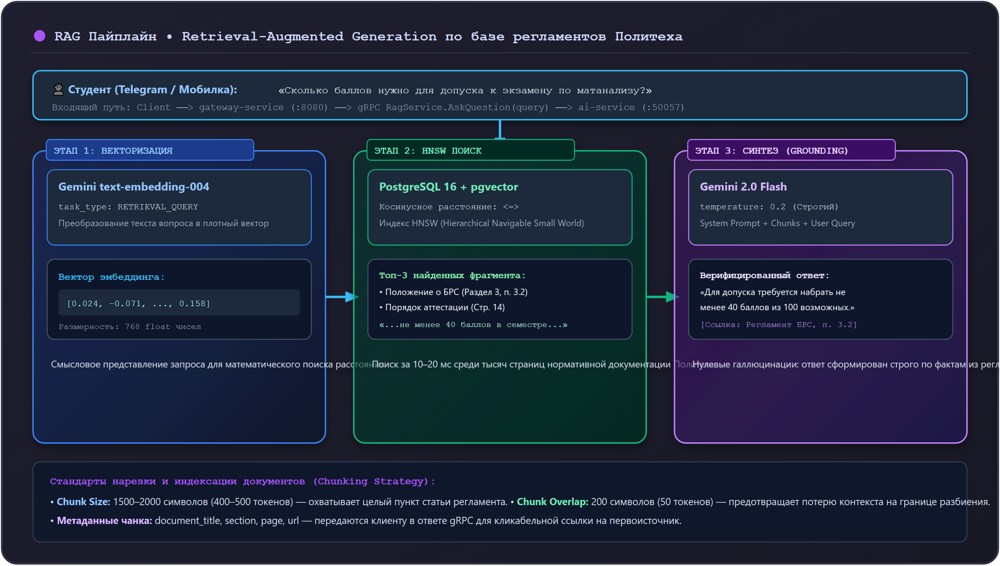

# 02. Пайплайн RAG-поиска по регламентам Политеха

Языковые модели общего назначения не знают локальных правил Московского Политеха: структуры балльно-рейтинговой системы (БРС), порядка ликвидации академических задолженностей, расписания звонков или особенностей переходов между корпусами на Большой Семёновской и Автозаводской.

Для предоставления студентам точных, юридически выверенных ответов в Orbit AI используется архитектура **Retrieval-Augmented Generation (RAG)** — генерация ответов с дополнением контекстом из верифицированной базы знаний.

---

## 1. Схема сквозного пайплайна RAG



---

## 2. Подготовка и нарезка документов (Chunking Strategy)

Загружать официальный регламент целиком (30–50 страниц текста) в контекст неэффективно: модель теряет фокус («Lost in the Middle»), а стоимость запроса возрастает.

### Стандарты нарезки текстов в Orbit AI:
1. **Размер фрагмента (Chunk Size)**: 1500–2000 символов (около 400–500 токенов). Этого достаточно, чтобы полностью вместить один логический пункт или статью регламента.
2. **Перекрытие (Chunk Overlap)**: 200 символов (около 50 токенов). Гарантирует, что смысл предложений на границе разреза не потеряется.
3. **Метаданные чанка**: каждый фрагмент снабжается метаданными:
   ```json
   {
       "document_title": "Положение о балльно-рейтинговой системе оценивания",
       "section": "Раздел 3. Допуск к промежуточной аттестации",
       "page": 7,
       "source_url": "https://mospolytech.ru/upload/docs/brs_2025.pdf"
   }
   ```

---

## 3. Векторный поиск в PostgreSQL с индексом HNSW

Сгенерированные векторы `text-embedding-004` (768 чисел) сохраняются в таблице `knowledge_chunks`:

```sql
CREATE EXTENSION IF NOT EXISTS vector;

CREATE TABLE knowledge_chunks (
    id UUID PRIMARY KEY DEFAULT gen_random_uuid(),
    document_title VARCHAR(255) NOT NULL,
    section_name VARCHAR(255) NOT NULL,
    content TEXT NOT NULL,
    embedding vector(768) NOT NULL,
    created_at TIMESTAMPTZ NOT NULL DEFAULT NOW()
);

-- Индекс HNSW для мгновенного обхода графа ближайших соседей
CREATE INDEX idx_knowledge_embedding_hnsw 
ON knowledge_chunks 
USING hnsw (embedding vector_cosine_ops)
WITH (m = 16, ef_construction = 64);
```

### ⚠️ Критическое правило SQL-запроса для работы индекса HNSW

> [!CAUTION] Опасная ошибка производительности
> Если в блоке `ORDER BY` написать `ORDER BY (1 - (embedding <=> $1)) DESC`, оптимизатор PostgreSQL **не сможет задействовать HNSW индекс** и переключится на полное сканирование таблицы (`Sequential Scan`)!
> Чтобы индекс сработал, в `ORDER BY` должен использоваться **только оператор расстояния в порядке `ASC`**.

```python
# infrastructure/postgres/vector_repo.py
import numpy as np
from psycopg_pool import AsyncConnectionPool

class KnowledgeVectorRepository:
    def __init__(self, pool: AsyncConnectionPool):
        self._pool = pool

    async def find_relevant_chunks(
        self, query_vector: list[float], limit: int = 3, min_similarity: float = 0.65
    ) -> list[dict]:
        vector_np = np.array(query_vector, dtype=np.float32)
        
        # ✅ ПРАВИЛЬНО: Индекс HNSW задействован на 100%
        query = """
            SELECT document_title, section_name, content, (1 - (embedding <=> %s)) AS similarity
            FROM knowledge_chunks
            WHERE (1 - (embedding <=> %s)) >= %s
            ORDER BY embedding <=> %s ASC
            LIMIT %s;
        """
        async with self._pool.connection() as conn:
            async with conn.cursor() as cur:
                await cur.execute(query, (vector_np, vector_np, min_similarity, vector_np, limit))
                rows = await cur.fetchall()
                return [
                    {
                        "document": row[0],
                        "section": row[1],
                        "content": row[2],
                        "similarity": float(row[3]),
                    }
                    for row in rows
                ]
```

---

## 4. Промпт-инжиниринг и синтез ответа (Gemini 2.0 Flash)

Чтобы исключить фантазии нейросети, системный промпт строится на принципах **Strict Fact Grounding**:

```python
# usecases/rag_orchestrator.py
from google import genai
from google.genai import types

SYSTEM_PROMPT = """
Ты — официальный AI-ассистент студентов Московского Политеха «Orbit AI».
Твоя задача — отвечать на вопросы студентов строго на основе приведенных официальных регламентов.

ПРАВИЛА ОТВЕТА:
1. Отвечай только на основе предоставленного контекста. Не придумывай правила, которых нет в тексте.
2. Если в контексте нет точного ответа, прямо скажи: «В регламентах Московского Политеха нет точной информации по данному вопросу. Рекомендуем обратиться в студенческий офис».
3. Обязательно указывай название документа и раздела, на который ты ссылаешься.
4. Пиши понятным, доброжелательным языком, но сохраняй официальную точность формулировок.
"""

async def build_rag_answer(
    aclient: genai.Client.aio,
    user_query: str,
    chunks: list[dict]
) -> str:
    if not chunks:
        return "К сожалению, в базе регламентов Московского Политеха не найдено релевантной информации по вашему запросу."

    # Формирование блока контекста с указанием источников
    context_blocks = []
    for idx, chunk in enumerate(chunks, 1):
        context_blocks.append(
            f"[Источник {idx}: {chunk['document']} — {chunk['section']}]\n{chunk['content']}"
        )
    formatted_context = "\n\n---\n\n".join(context_blocks)

    user_prompt = f"ОФИЦИАЛЬНЫЙ КОНТЕКСТ:\n{formatted_context}\n\nВОПРОС СТУДЕНТА:\n{user_query}"

    config = types.GenerateContentConfig(
        system_instruction=SYSTEM_PROMPT,
        temperature=0.2,            # Минимизация вариативности для точности
        max_output_tokens=1200,
    )

    response = await aclient.models.generate_content(
        model="gemini-2.0-flash",
        contents=user_prompt,
        config=config,
    )
    return response.text
```

---

## 5. Антипаттерны: как нельзя и как правильно

### ❌ Как нельзя:
```python
# ОШИБКА 1: Отправка вопроса в модель без контекста
response = await client.generate_content("Сколько баллов нужно для зачета в Политехе?")
# Модель начнет галлюцинировать общие правила других вузов

# ОШИБКА 2: Высокая температура генерации
types.GenerateContentConfig(temperature=0.9) # Приводит к выдумыванию несуществующих пунктов регламента

# ОШИБКА 3: Ломающий индекс ORDER BY в pgvector
# ORDER BY (1 - (embedding <=> $1)) DESC -> Отключает HNSW!
```

### ✅ Как правильно:
```python
# 1. Поиск релевантных регламентов по вектору:
chunks = await vector_repo.find_relevant_chunks(query_vector)

# 2. Низкая температура и жесткий системный промпт:
types.GenerateContentConfig(temperature=0.2, system_instruction=SYSTEM_PROMPT)

# 3. Индексный поиск по графу:
# ORDER BY embedding <=> $1 ASC
```

---

## Резюме

1. RAG решает проблему галлюцинаций LLM в специфичном вузовском контексте.
2. Регламенты нарезаются на чанки по 1500–2000 символов с перекрытием 200 символов.
3. Поиск выполняется через PostgreSQL `pgvector` с индексом HNSW по косинусному расстоянию (`<=>`).
4. Генерация выполняется через `gemini-2.0-flash` при `temperature=0.2` со строгой привязкой к источникам.
