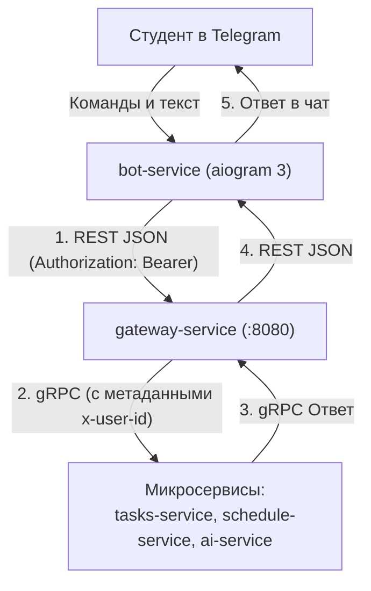

# 03. Telegram-бот (aiogram 3) и обращение к Gateway по REST

Telegram-бот (**`bot-service`**) предоставляет студентам удобный мобильный доступ к функциям Orbit AI: просмотру расписания, дедлайнам учебных задач и консультациям по регламентам университета.

В соответствии с архитектурой системы бот является **внешним клиентом** (наряду с мобильным приложением). Ему **запрещено напрямую подключаться к внутренним микросервисам по gRPC или к базам данных**. Все операции выполняются исключительно через **API Gateway по протоколу REST/JSON**.

---

## 1. Архитектура взаимодействия бота и бэкенда




---

## 2. Архитектура aiogram 3: Router, Dispatcher и Dependency Injection

Фреймворк **aiogram 3** построен на концепции модульных роутеров (`Router`) и декларативных фильтров (`F`):

```python
# bot/handlers/dialog.py
from aiogram import Router, F
from aiogram.filters import CommandStart, Command
from aiogram.types import Message
from bot.services.gateway import ApiGatewayClient

ai_router = Router(name="ai_router")

@ai_router.message(CommandStart())
async def cmd_start(message: Message):
    await message.answer(
        "👋 Привет! Я — официальный ассистент Orbit AI Московского Политеха.\n\n"
        "Задай мне любой вопрос по расписанию, сессии или регламентам университета!"
    )

# Обработка текстовых вопросов к AI-ассистенту
@ai_router.message(F.text & ~F.text.startswith("/"))
async def handle_ai_question(message: Message, gateway: ApiGatewayClient):
    # Показываем статус «печатает...» в Telegram
    await message.bot.send_chat_action(chat_id=message.chat.id, action="typing")

    # Вызов API Gateway
    answer = await gateway.ask_question(
        telegram_user_id=str(message.from_user.id),
        query=message.text
    )
    await message.answer(answer)
```

---

## 3. Управление жизненным циклом HTTP-клиента (Persistent Session)

Критическая ошибка при разработке ботов — создание HTTP-клиента внутри хендлера на каждое входящее сообщение.

### Почему это недопустимо:
1. На каждый HTTP-запрос создается новый TCP-сокет и выполняется TLS-рукопожатие (потеря 150–300 мс на запрос).
2. При высокой нагрузке сокеты зависают в состоянии операционной системы `TIME_WAIT`, вызывая ошибку `Too many open files`.

### Эталонное решение: Единый `httpx.AsyncClient` и внедрение зависимостей
Сессия создается один раз при старте диспетчера и передается во все хэндлеры через механизм **Dependency Injection**:

```python
# bot/main.py
import asyncio
import logging
import httpx
from aiogram import Bot, Dispatcher
from aiogram.client.default import DefaultBotProperties
from aiogram.enums import ParseMode

from bot.handlers.dialog import ai_router
from bot.services.gateway import ApiGatewayClient

async def main():
    logging.basicConfig(level=logging.INFO)

    bot = Bot(
        token="TELEGRAM_BOT_TOKEN",
        default=DefaultBotProperties(parse_mode=ParseMode.HTML)
    )
    dp = Dispatcher()
    dp.include_router(ai_router)

    # Настройка пула HTTP-соединений
    limits = httpx.Limits(max_keepalive_connections=20, max_connections=100)
    timeout = httpx.Timeout(connect=5.0, read=30.0, write=5.0, pool=5.0)

    # Единый клиент на весь жизненный цикл бота:
    async with httpx.AsyncClient(
        base_url="http://gateway:8080",
        limits=limits,
        timeout=timeout,
        headers={"Accept": "application/json"}
    ) as http_client:
        
        gateway_client = ApiGatewayClient(
            client=http_client,
            bot_secret_jwt="SERVICE_JWT_TOKEN"
        )

        # Проброс gateway_client во все хэндлеры через start_polling:
        logging.info("Бот Orbit AI успешно запущен...")
        await dp.start_polling(
            bot,
            gateway=gateway_client,
            allowed_updates=dp.resolve_used_update_types()
        )

if __name__ == "__main__":
    asyncio.run(main())
```

---

## 4. Клиент взаимодействия с Gateway (`ApiGatewayClient`)

Клиент инкапсулирует вызовы REST API, прокидывает заголовки авторизации и обрабатывает сетевые сбои:

```python
# bot/services/gateway.py
import logging
import httpx

class ApiGatewayClient:
    def __init__(self, client: httpx.AsyncClient, bot_secret_jwt: str):
        self._client = client
        self._jwt = bot_secret_jwt

    async def ask_question(self, telegram_user_id: str, query: str) -> str:
        headers = {
            "Authorization": f"Bearer {self._jwt}",
            "X-Telegram-User-Id": telegram_user_id,
            "Content-Type": "application/json",
        }
        payload = {"prompt": query}

        try:
            resp = await self._client.post("/api/v1/ai/ask", json=payload, headers=headers)

            if resp.status_code == 200:
                data = resp.json()
                return data.get("answer", "Ответ получен без текста.")

            elif resp.status_code == 401:
                logging.error("Ошибка авторизации бота на API Gateway (401)")
                return "Служебная ошибка авторизации. Администраторы уже уведомлены."

            elif resp.status_code == 429:
                return "Слишком много запросов за короткое время. Пожалуйста, подождите минуту."

            elif resp.status_code >= 500:
                logging.error(f"Ошибка бэкенда {resp.status_code}: {resp.text}")
                return "Сервис Orbit AI временно перегружен. Попробуйте повторить запрос чуть позже."

            else:
                return f"Не удалось обработать запрос (код ошибки: {resp.status_code})."

        except httpx.TimeoutException:
            logging.warning(f"Таймаут запроса к AI Gateway для пользователя {telegram_user_id}")
            return "Время ожидания ответа нейросети истекло. Пожалуйста, попробуйте снова."

        except httpx.RequestError as ex:
            logging.error(f"Сбой сетевого соединения с Gateway: {ex}")
            return "Не удалось связаться с сервером Orbit AI."
```

---

## 5. Антипаттерны: как нельзя и как правильно

### ❌ Как нельзя:
```python
# ОШИБКА 1: Создание сессии в хэндлере на каждое сообщение
@router.message()
async def handler(msg: Message):
    async with httpx.AsyncClient() as client: # Утечка сокетов TIME_WAIT!
        await client.post(...)

# ОШИБКА 2: Использование блокирующей библиотеки requests
import requests
resp = requests.post(...) # Блокирует весь цикл событий asyncio для всех пользователей бота!

# ОШИБКА 3: Прямой вызов базы данных или gRPC из бота
# Бот лезет в чужую БД в обход бизнес-правил Gateway
```

### ✅ Как правильно:
```python
# Единый пул соединений httpx.AsyncClient в контексте диспетчера:
async with httpx.AsyncClient(limits=limits) as http_client:
    await dp.start_polling(bot, gateway=gateway_service)

# В хэндлере используется неблокирующий асинхронный вызов через инжектированный клиент:
@router.message()
async def handler(msg: Message, gateway: ApiGatewayClient):
    answer = await gateway.ask_question(...)
```

---

## Резюме

1. `bot-service` — внешний клиент, общающийся с системой строго через REST API Gateway.
2. aiogram 3 использует древовидную маршрутизацию (`Router`) и декларативные фильтры `F`.
3. Пул HTTP-соединений создается единожды и передается в хэндлеры через Dependency Injection.
4. Все внешние ошибки и таймауты аккуратно обрабатываются с понятными сообщениями пользователю.
