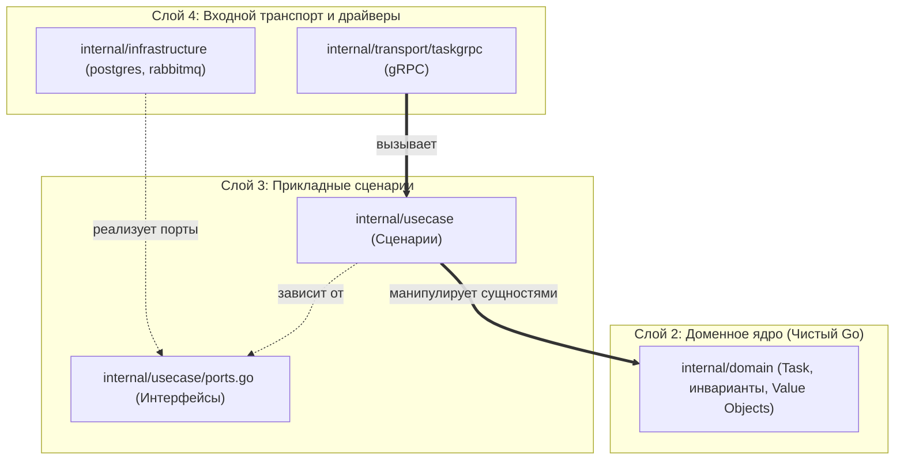

# 02. Анатомия шаблона сервиса

Чтобы исключить создание хаотичной структуры папок и «God-файлов», все Go-микросервисы Orbit AI создаются на базе репозитория **`orbit-service-template`** (эталонная реализация представлена в `examples/tasks-service`).

В основе шаблона лежит сочетание **Standard Go Project Layout** и **Clean Architecture (Чистая архитектура)**.

---

## 1. Структура директорий сервиса

```text
service-root/
├── cmd/
│   └── service-name/
│       └── main.go              # Composition Root: точка входа, DI, Graceful Shutdown
├── internal/                    # Приватный код сервиса (защищён компилятором Go)
│   ├── config/                  # Загрузка и строгая валидация .env
│   ├── domain/                  # Ядро: сущности, Value Objects, доменные ошибки
│   ├── usecase/                 # Прикладные сценарии и порты (интерфейсы)
│   ├── infrastructure/          # Адаптеры внешнего мира
│   │   ├── postgres/            # Реализация репозиториев для PostgreSQL
│   │   ├── inmemory/            # Потокобезопасные репозитории в памяти
│   │   ├── rabbitmq/            # Публикация и чтение AMQP-событий
│   │   └── idgen/               # Реализация генераторов ID (UUIDv4)
│   └── transport/               # Входные адаптеры (первичные)
│       └── taskgrpc/            # gRPC сервер, хендлеры, интерцепторы, мапперы
├── pkg/                         # Публичный сгенерированный код
│   └── api/                     # Protobuf/gRPC DTO и интерфейсы стабов
├── api/
│   └── proto/                   # Исходные схемы Protobuf и buf.yaml
├── .golangci.yml                # Правила линтера и архитектурных ограничений
├── buf.gen.yaml                 # Конфигурация генерации Protobuf
├── Dockerfile                   # Многоэтапный distroless-образ
├── go.mod & go.sum
└── README.md
```

### Зачем нужна директория `internal/`:
В Go имя пакета `internal` является зарезервированным словом компилятора. Код, расположенный внутри `internal/`, **не может быть импортирован** сторонними модулями или другими репозиториями. Это предотвращает случайное протекание внутренних реализаций за пределы сервиса.

---

## 2. Границы слоёв и Правило зависимостей (Dependency Rule)

Главное правило чистой архитектуры: **внутренние слои ничего не знают о внешних слоях**.




### Зоны ответственности слоёв:

1. **`internal/domain` (Ядро)**:
   - Содержит бизнес-правила и инварианты системы (например: дедлайн не может быть в прошлом, название не короче 3 символов).
   - Не имеет зависимостей от внешних фреймворков, баз данных или gRPC. Разрешена только стандартная библиотека Go (`$gostd`).
2. **`internal/usecase` (Сценарии и порты)**:
   - Описывает бизнес-сценарии: `CreateTaskUseCase`, `CompleteTaskUseCase`.
   - Задаёт контракты внешнего мира в виде интерфейсов (портов): `TaskSaver`, `TaskFinder`, `EventPublisher`.
   - Не знает, куда сохраняются данные — в PostgreSQL, MongoDB или в память.
3. **`internal/infrastructure` (Адаптеры)**:
   - Содержит конкретную реализацию портов: подключение к Postgres через `pgx`, публикация событий в RabbitMQ.
4. **`internal/transport` (Транспорт)**:
   - Принимает gRPC-запросы, выполняет аутентификацию (через интерцепторы), транслирует DTO в вызовы сценариев `usecase` и маппит ошибки в коды gRPC.
5. **`cmd/.../main.go` (Composition Root)**:
   - Единственное место, где создаются конкретные экземпляры структур и передаются друг другу в качестве зависимостей (Dependency Injection).

---

## 3. Автоматический контроль архитектуры линтером (`depguard`)

Чтобы предотвратить случайные нарушения архитектурных границ (например, импорт базы данных в домен), в `.golangci.yml` настроен плагин **depguard**:

```yaml
--8<-- "examples/tasks-service/.golangci.yml:depguard_config"
```

### Доказательство работы depguard:
Если разработчик случайно добавит в `internal/domain/task.go` сторонний импорт (например, `github.com/google/uuid`), запуск `golangci-lint run` немедленно завершится ошибкой:

```text
internal/domain/task.go:6:2: import 'github.com/google/uuid' is not allowed by rule 'domain_isolation' (depguard)
```

Сборка в CI блокируется, предотвращая загрязнение домена.

---

## 4. Антипаттерны: как нельзя и как правильно

### ❌ Как нельзя:
```go
// Файл: internal/domain/task.go
package domain

import (
    "github.com/jackc/pgx/v5" // ОШИБКА 1: Домен зависит от драйвера БД!
    "google.golang.org/grpc"  // ОШИБКА 2: Домен зависит от транспорта!
)

type Task struct {
    ID string `json:"id" db:"task_id"` // ОШИБКА 3: Теги БД и JSON в домене
}

func (t *Task) SaveToDB(conn *pgx.Conn) error { // ОШИБКА 4: Бизнес-сущность сама сохраняет себя в БД
    // SQL запрос прямо в сущности
}
```

### ✅ Как правильно:
```go
// Файл: internal/domain/task.go
package domain

// Только стандартная библиотека!
type Task struct {
    id    TaskID
    title Title
}

// Файл: internal/usecase/ports.go
package usecase

// Порт сохранения объявляется в usecase
type TaskSaver interface {
    Save(ctx context.Context, task *domain.Task) error
}

// Файл: internal/infrastructure/postgres/task_repository.go
package postgres

// Инфраструктура реализует интерфейс, используя pgx
type TaskRepository struct {
    pool *pgxpool.Pool
}

func (r *TaskRepository) Save(ctx context.Context, task *domain.Task) error {
    // SQL логика изолирована здесь
}
```

---

## Резюме

1. **`internal/`**: приватный код защищен компилятором от несанкционированного импорта.
2. **Чистая архитектура**: домен изолирован и стабилен, внешние детали (БД, gRPC) подключаются через порты.
3. **`depguard`**: автоматически гарантирует соблюдение правил изоляции на этапе CI.
4. **`main.go`**: точка сборки всех зависимостей, единственное место создания конкретных структур.
