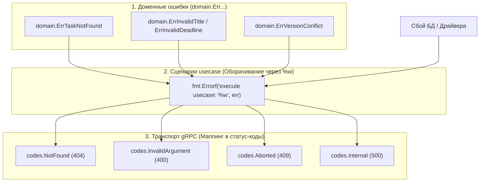

# 05. Обработка и проброс ошибок между слоями

В чистой архитектуре каждый слой оперирует своим понятийным аппаратом. Ошибки низкоуровневых драйверов (например, сбой сокета PostgreSQL) не должны просачиваться в презентационный слой и тем более передаваться клиенту.

В этой главе описан сквозной механизм обработки и трансляции ошибок в микросервисах Orbit AI.

---

## 1. Иерархия ошибок по слоям




---

## 2. Доменные ошибки (Sentinel Errors)

В доменном слое ошибки объявляются как экспортируемые переменные с помощью `errors.New(...)`:

```go
--8<-- "examples/tasks-service/internal/domain/task.go:domain_errors"
```

### Почему Sentinel Errors:
- Ошибки объявляются один раз и иммутабельны.
- Проверка ошибок в верхних слоях выполняется без анализа строк — строго через `errors.Is(err, target)`.

---

## 3. Оборачивание ошибок через `fmt.Errorf` и `%w`

Когда ошибка передаётся вверх по стеку вызовов, к ней добавляется контекст текущей операции с помощью глагола `%w`:

```go
// Инфраструктурный слой:
if err := r.pool.Exec(ctx, query, args...); err != nil {
    return fmt.Errorf("выполнение sql вставки задачи: %w", err)
}

// Слой Use Case:
if err := uc.repo.Save(ctx, task); err != nil {
    return fmt.Errorf("сохранение задачи в репозитории: %w", err)
}
```

> [!TIP] Зачем нужен глагол `%w`
> `%w` сохраняет исходную ошибку в цепочке (Error Chain). Это позволяет функции `errors.Is` на самом верхнем уровне обнаружить исходную доменную ошибку сквозь любое количество обёрток.

---

## 4. Маппинг ошибок в gRPC-статусы

Транспортный хендлер gRPC не возвращает «сырую» Go-ошибку клиенту. Он пропускает её через функцию **`mapError`**:

```go
--8<-- "examples/tasks-service/internal/transport/taskgrpc/handler.go:grpc_error_mapping"
```

### Таблица трансляции кодов ошибок:

| Доменная ошибка Go | gRPC Статус-код | HTTP эквивалент на Gateway | Смысл для клиента |
| :--- | :--- | :--- | :--- |
| `context.Canceled` | `codes.Canceled` | `499 Client Closed Request` | Клиент сам оборвал соединение |
| `context.DeadlineExceeded` | `codes.DeadlineExceeded` | `504 Gateway Timeout` | Истёк таймаут выполнения |
| `domain.ErrEmptyOwnerID` | `codes.Unauthenticated` | `401 Unauthorized` | Отсутствуют метаданные пользователя |
| `domain.ErrEmptyTitle`, `ErrInvalidDeadline`, `ErrInvalidPriority` | `codes.InvalidArgument` | `400 Bad Request` | Ошибка валидации входных параметров |
| `domain.ErrTaskNotFound` | `codes.NotFound` | `404 Not Found` | Задача с указанным ID не найдена |
| `domain.ErrTaskAlreadyCompleted` | `codes.FailedPrecondition` | `400 Bad Request` | Состояние сущности запрещает операцию |
| `domain.ErrVersionConflict` | `codes.Aborted` | `409 Conflict` | Конфликт оптимистичной блокировки |
| Неизвестная ошибка | `codes.Internal` | `500 Internal Server Error` | Серверный сбой (детали скрыты) |

---

## 5. Защита от утечки информации (Information Disclosure)

Если в базе данных PostgreSQL упало соединение или произошла ошибка синтаксиса SQL, клиент **ни в коем случае не должен увидеть** реальный стек-трейс:

❌ **Уязвимо:**
```text
rpc error: code = Unknown desc = connection to 10.0.4.12:5432 refused: password authentication failed for user "tasks_db"
```
Такой ответ сообщает злоумышленнику внутренний IP-адрес, тип базы данных и логин пользователя.

✅ **Безопасно (стандарт Orbit AI):**
```text
rpc error: code = Internal desc = внутренняя ошибка сервиса
```
Реальная причина аварии со всеми деталями фиксируется в логах сервиса с уровнем `ERROR`:
```go
h.logger.ErrorContext(ctx, "непредвиденная внутренняя ошибка сервера", slog.String("error", err.Error()))
```

---

## 6. Антипаттерны: как нельзя и как правильно

### ❌ Как нельзя:
```go
// ОШИБКА 1: Проверка ошибки по совпадению текста
if err.Error() == "учебная задача не найдена" { // Сломается при первом же добавлении %w
    return status.Error(codes.NotFound, ...)
}

// ОШИБКА 2: Использование %v вместо %w
return fmt.Errorf("ошибка: %v", err) // Разрывает цепочку ошибок, errors.Is перестает работать!

// ОШИБКА 3: Паника при ошибке в хендлере
if err != nil {
    panic(err) // Ломает соединение и крашит сервис
}
```

### ✅ Как правильно:
```go
// Проверка через errors.Is сохраняет устойчивость к оберткам:
if errors.Is(err, domain.ErrTaskNotFound) {
    return status.Error(codes.NotFound, domain.ErrTaskNotFound.Error())
}

// Оборачивание через %w сохраняет контекст:
return fmt.Errorf("поиск задачи по ID: %w", err)
```

---

## Резюме

1. Домен объявляет фиксированные Sentinel-ошибки через `errors.New`.
2. Инфраструктура и сценарии оборачивают ошибки через `fmt.Errorf("...: %w", err)`.
3. Хендлеры gRPC транслируют ошибки в статус-коды через `mapError`.
4. Внутренние сбои маскируются кодом `codes.Internal`, а полный трейс пишется в `slog`.
