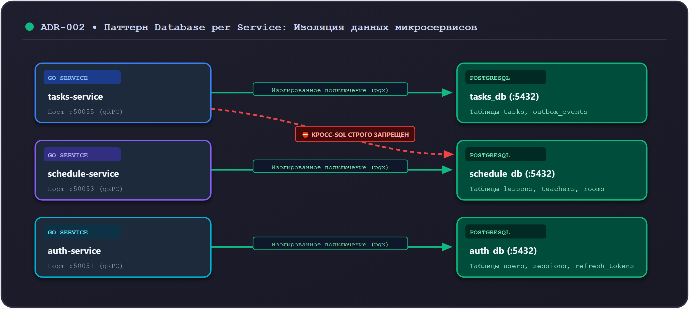

# 07. База данных PostgreSQL и миграции

После того как домен и сценарии протестированы с in-memory репозиторием, сервис подключается к реальной реляционной базе данных.

В проекте Orbit AI в качестве основной СУБД используется **PostgreSQL 16**. В этой главе мы заменим in-memory хранилище на адаптер PostgreSQL, настроим миграции через `goose` и драйвер `pgx/v5`.

---

## 1. Архитектурный принцип: Database-per-Service (ADR-002)

В соответствии с решением **ADR-002**, каждый микросервис владеет собственной изолированной базой данных:
- `tasks-service` подключается к базе `tasks_db`;
- `schedule-service` подключается к базе `schedule_db`;
- `auth-service` подключается к базе `auth_db`.




> [!CRITICAL] Запрет прямых межсервисных SQL-запросов
> Микросервису `tasks-service` категорически запрещено обращаться к таблицам пользователей `users_db` или расписания `schedule_db`. Любое межсервисное взаимодействие выполняется только через gRPC-клиенты или события RabbitMQ.

---

## 2. Схема базы данных и миграции (`goose`)

Все изменения структуры таблиц версионируются в виде SQL-файлов миграций с помощью утилиты **[goose](https://github.com/pressly/goose)**. Изменять схему вручную через DBeaver на боевом сервере запрещено.

### Миграция: `migrations/00001_create_tasks_table.sql`

```sql
-- +goose Up
-- +goose StatementBegin
CREATE TABLE IF NOT EXISTS tasks (
    id VARCHAR(64) PRIMARY KEY,
    owner_id VARCHAR(64) NOT NULL,
    title VARCHAR(200) NOT NULL,
    description TEXT NOT NULL DEFAULT '',
    deadline TIMESTAMPTZ NOT NULL,
    priority SMALLINT NOT NULL,
    status SMALLINT NOT NULL,
    version BIGINT NOT NULL DEFAULT 1,
    created_at TIMESTAMPTZ NOT NULL
);

-- Индекс для высокоскоростной пагинации по конкретному студенту
CREATE INDEX IF NOT EXISTS idx_tasks_owner_created 
    ON tasks (owner_id, created_at ASC, id ASC);
-- +goose StatementEnd

-- +goose Down
-- +goose StatementBegin
DROP TABLE IF EXISTS tasks;
-- +goose StatementEnd
```

### Зачем составной индекс `(owner_id, created_at, id)`:
Запрос `ListTasks` фильтрует выборку по `owner_id` и сортирует по `created_at ASC, id ASC`. Составной индекс позволяет PostgreSQL выполнять Index Only Scan без тяжелой сортировки в оперативной памяти (Sort / QuickSort).

---

## 3. Пул соединений `pgxpool.Pool` (`jackc/pgx/v5`)

В Go стандартный пакет `database/sql` уступает по производительности специализированному драйверу **`pgx/v5`**, который поддерживает нативный бинарный протокол PostgreSQL, типы `TIMESTAMPTZ` и пулы соединений.

```go
// internal/infrastructure/postgres/pool.go
package postgres

import (
    "context"
    "fmt"
    "time"

    "github.com/jackc/pgx/v5/pgxpool"
)

func NewPool(ctx context.Context, dsn string) (*pgxpool.Pool, error) {
    config, err := pgxpool.ParseConfig(dsn)
    if err != nil {
        return nil, fmt.Errorf("ошибка парсинга DSN: %w", err)
    }

    config.MaxConns = 25
    config.MinConns = 5
    config.MaxConnIdleTime = 5 * time.Minute
    config.MaxConnLifetime = 1 * time.Hour

    pool, err := pgxpool.NewWithConfig(ctx, config)
    if err != nil {
        return nil, fmt.Errorf("ошибка подключения к PostgreSQL: %w", err)
    }

    if err := pool.Ping(ctx); err != nil {
        return nil, fmt.Errorf("ping PostgreSQL не прошёл: %w", err)
    }

    return pool, nil
}
```

---

## 4. Реализация `PostgresTaskRepository` и оптимистичная блокировка

Репозиторий реализует интерфейсы портов `TaskSaver`, `TaskFinder` и `TaskLister`:

```go
// internal/infrastructure/postgres/task_repository.go
package postgres

import (
    "context"
    "errors"
    "fmt"

    "github.com/jackc/pgx/v5"
    "github.com/jackc/pgx/v5/pgxpool"
    "github.com/orbit-polytech/orbit-docs/examples/tasks-service/internal/domain"
    "github.com/orbit-polytech/orbit-docs/examples/tasks-service/internal/usecase"
)

type TaskRepository struct {
    pool *pgxpool.Pool
}

func NewTaskRepository(pool *pgxpool.Pool) *TaskRepository {
    return &TaskRepository{pool: pool}
}

// Save выполняет UPSERT с контролем версии (Оптимистичная блокировка)
func (r *TaskRepository) Save(ctx context.Context, task *domain.Task) error {
    if err := ctx.Err(); err != nil {
        return err
    }

    // Если версия 1 — новая задача, выполняем INSERT
    if task.Version() == 1 {
        query := `
            INSERT INTO tasks (id, owner_id, title, description, deadline, priority, status, version, created_at)
            VALUES ($1, $2, $3, $4, $5, $6, $7, $8, $9)
        `
        _, err := r.pool.Exec(ctx, query,
            task.ID().String(),
            task.OwnerID().String(),
            task.Title().String(),
            task.Description(),
            task.Deadline().Time(),
            int(task.Priority()),
            int(task.Status()),
            task.Version(),
            task.CreatedAt(),
        )
        if err != nil {
            return fmt.Errorf("insert task: %w", err)
        }
        return nil
    }

    // Если версия > 1 — обновление существующей записи с проверкой старой версии (version - 1)
    query := `
        UPDATE tasks 
        SET title = $1, description = $2, deadline = $3, priority = $4, status = $5, version = $6
        WHERE id = $7 AND version = $8
    `
    tag, err := r.pool.Exec(ctx, query,
        task.Title().String(),
        task.Description(),
        task.Deadline().Time(),
        int(task.Priority()),
        int(task.Status()),
        task.Version(),
        task.ID().String(),
        task.Version()-1,
    )
    if err != nil {
        return fmt.Errorf("update task: %w", err)
    }

    // Если ни одна строка не обновилась — версия в БД не совпала (гонка параллельных изменений)
    if tag.RowsAffected() == 0 {
        return domain.ErrVersionConflict
    }

    return nil
}

// FindByID загружает задачу и восстанавливает сущность через ReconstituteTask
func (r *TaskRepository) FindByID(ctx context.Context, id domain.TaskID) (*domain.Task, error) {
    query := `
        SELECT id, owner_id, title, description, deadline, priority, status, version, created_at
        FROM tasks
        WHERE id = $1
    `
    row := r.pool.QueryRow(ctx, query, id.String())

    var (
        rawID, rawOwnerID, rawTitle, description string
        rawPriority, rawStatus                   int
        version                                  int64
        deadline, createdAt                      time.Time
    )

    err := row.Scan(&rawID, &rawOwnerID, &rawTitle, &description, &deadline, &rawPriority, &rawStatus, &version, &createdAt)
    if err != nil {
        if errors.Is(err, pgx.ErrNoRows) {
            return nil, domain.ErrTaskNotFound
        }
        return nil, fmt.Errorf("select task by id: %w", err)
    }

    taskID, _ := domain.NewTaskID(rawID)
    ownerID, _ := domain.NewOwnerID(rawOwnerID)
    title, _ := domain.NewTitle(rawTitle)
    dl := domain.ReconstituteDeadline(deadline)

    return domain.ReconstituteTask(
        taskID,
        ownerID,
        title,
        description,
        dl,
        domain.TaskPriority(rawPriority),
        domain.TaskStatus(rawStatus),
        version,
        createdAt,
    ), nil
}
```

---

## 5. Антипаттерны: как нельзя и как правильно

### ❌ Как нельзя:
```go
// ОШИБКА 1: Конкатенация строк в SQL (SQL Injection уязвимость!)
query := fmt.Sprintf("SELECT * FROM tasks WHERE id = '%s'", rawID)

// ОШИБКА 2: UPDATE без проверки версии
query := "UPDATE tasks SET status = $1 WHERE id = $2" // Затирает параллельные изменения

// ОШИБКА 3: Паника при ошибке пула соединений
pool := pgxpool.MustConnect(...) // Краш сервиса при временном лаге сети
```

### ✅ Как правильно:
```go
// Параметризованные плейсхолдеры $1, $2:
r.pool.QueryRow(ctx, "SELECT ... WHERE id = $1", id)

// Контроль версии в WHERE (Оптимистичная блокировка):
tag, err := r.pool.Exec(ctx, "UPDATE ... WHERE id = $1 AND version = $2", id, expectedVersion)
if tag.RowsAffected() == 0 {
    return domain.ErrVersionConflict
}
```

---

## Резюме

1. Каждый сервис изолирован в своей БД (ADR-002).
2. Миграции версионируются через `goose` и запускаются строго в CI/CD.
3. Оптимистичная блокировка реализуется атомарно через условие `WHERE version = $old_version`.
4. Восстановление сущностей из строк БД выполняется через `domain.ReconstituteTask`.
