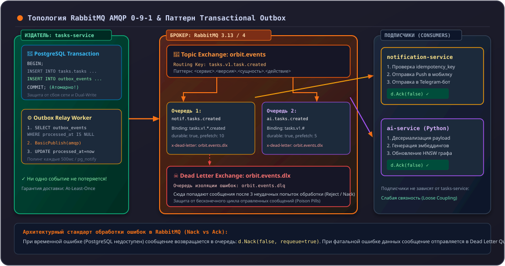

# 08. Брокер сообщений RabbitMQ и Transactional Outbox

В распределенной системе Orbit AI синхронные gRPC-вызовы используются только тогда, когда клиенту требуется немедленный ответ. Все побочные эффекты (отправка push-уведомлений, пересчет аналитики в AI) обрабатываются асинхронно через брокер сообщений **RabbitMQ 3.13** (согласно **ADR-003** и **ADR-006**).

В этой главе мы реализуем интеграцию с RabbitMQ и решим проблему двойной записи (Dual-Write) с помощью паттерна **Transactional Outbox**.

---

## 1. Топология AMQP 0-9-1 в Orbit AI

Все события публикуются в центральный обменник типа `topic`:



### Соглашение об именовании ключей маршрутизации (Routing Keys):
```text
<сервис>.<версия>.<сущность>.<действие>
Пример: tasks.v1.task.created
```

---

## 2. Решение проблемы Dual-Write: паттерн Transactional Outbox

В главе 6.5 мы зафиксировали критический риск: если сохранить задачу в БД, а брокер RabbitMQ в этот момент окажется недоступен, событие потеряется, а задача останется в базе.

### Архитектурное решение:
Событие записывается в специальную таблицу **`outbox_events`** в **той же локальной транзакции базы данных**, что и сущность `Task`. Если транзакция откатывается — откатывается и событие.

### Таблица Outbox: `migrations/00002_create_outbox_table.sql`

```sql
-- +goose Up
CREATE TABLE IF NOT EXISTS outbox_events (
    id VARCHAR(64) PRIMARY KEY,
    event_type VARCHAR(100) NOT NULL,
    routing_key VARCHAR(100) NOT NULL,
    payload JSONB NOT NULL,
    status VARCHAR(20) NOT NULL DEFAULT 'PENDING',
    created_at TIMESTAMPTZ NOT NULL
);

CREATE INDEX IF NOT EXISTS idx_outbox_pending 
    ON outbox_events (created_at ASC) 
    WHERE status = 'PENDING';

-- +goose Down
DROP TABLE IF EXISTS outbox_events;
```

---

## 3. Атомарное сохранение в транзакции

Внутри PostgreSQL-адаптера сохранение задачи и запись события выполняются в единой транзакции `pgx.Tx`:

```go
func (r *TaskRepository) CreateWithOutbox(ctx context.Context, task *domain.Task, event domain.TaskCreated) error {
    tx, err := r.pool.Begin(ctx)
    if err != nil {
        return fmt.Errorf("начало транзакции: %w", err)
    }
    defer tx.Rollback(ctx)

    // 1. Вставка задачи
    queryTask := `INSERT INTO tasks (...) VALUES (...)`
    if _, err := tx.Exec(ctx, queryTask, ...); err != nil {
        return fmt.Errorf("вставка задачи: %w", err)
    }

    // 2. Вставка события в outbox_events
    payloadJSON, err := json.Marshal(event)
    if err != nil {
        return fmt.Errorf("сериализация события: %w", err)
    }

    queryOutbox := `
        INSERT INTO outbox_events (id, event_type, routing_key, payload, status, created_at)
        VALUES ($1, $2, $3, $4, 'PENDING', $5)
    `
    if _, err := tx.Exec(ctx, queryOutbox, event.EventID, "TaskCreated", "tasks.v1.task.created", payloadJSON, time.Now().UTC()); err != nil {
        return fmt.Errorf("запись события в outbox: %w", err)
    }

    // 3. Атомарный коммит: гарантирует, что задача и событие сохранены одновременно
    if err := tx.Commit(ctx); err != nil {
        return fmt.Errorf("коммит транзакции: %w", err)
    }

    return nil
}
```

---

## 4. Фоновый воркер публикации (`OutboxWorker`)

Фоновый процесс вычитывает пачки событий `PENDING`, отправляет их в RabbitMQ с включенным подтверждением доставки (**Publisher Confirms**) и помечает статус `PROCESSED`:

```go
func (w *OutboxWorker) ProcessBatch(ctx context.Context) error {
    // Вычитка с блокировкой строк SKIP LOCKED (безопасно для нескольких реплик сервиса)
    query := `
        SELECT id, routing_key, payload 
        FROM outbox_events 
        WHERE status = 'PENDING' 
        ORDER BY created_at ASC 
        LIMIT 50 
        FOR UPDATE SKIP LOCKED
    `
    rows, err := w.pool.Query(ctx, query)
    if err != nil {
        return err
    }
    defer rows.Close()

    for rows.Next() {
        var id, routingKey string
        var payload []byte
        if err := rows.Scan(&id, &routingKey, &payload); err != nil {
            return err
        }

        // Публикация в RabbitMQ
        err = w.amqpChannel.PublishWithContext(ctx,
            "orbit.events", // Exchange
            routingKey,     // Routing key
            true,           // Mandatory
            false,          // Immediate
            amqp.Publishing{
                DeliveryMode: amqp.Persistent, // Сохранять на диск брокера
                ContentType:  "application/json",
                MessageId:    id,
                Body:         payload,
            },
        )
        if err != nil {
            return fmt.Errorf("сбой публикации события %s: %w", id, err)
        }

        // Пометка события как успешно обработанного
        _, _ = w.pool.Exec(ctx, "UPDATE outbox_events SET status = 'PROCESSED' WHERE id = $1", id)
    }

    return nil
}
```

---

## 5. Идемпотентность потребителя (Consumer Idempotency)

Протоколы очередей сообщений гарантируют уровень доставки **At-Least-Once** (как минимум один раз). При сбоях сети подтверждение `ACK` может потеряться, и брокер доставит сообщение повторно.

### Правило подписчика в Orbit AI:
Каждый сервис-подписчик (`notification-service`, `ai-service`) обязан сохранять идентификатор полученного сообщения `MessageId` (UUID события) в таблице `processed_events` или Redis:

```go
func (c *Consumer) Handle(msg amqp.Delivery) error {
    eventID := msg.MessageId

    // Атомарная проверка в Redis (SET key 1 NX EX 86400)
    isNew, err := c.redis.SetNX(ctx, "event:processed:"+eventID, "1", 24*time.Hour).Result()
    if err != nil {
        _ = msg.Nack(false, true) // Возврат в очередь при сбое кэша
        return err
    }

    if !isNew {
        // Дубликат уже обрабатывался ранее: подтверждаем и пропускаем
        _ = msg.Ack(false)
        return nil
    }

    // Обработка бизнес-логики...
    _ = msg.Ack(false)
    return nil
}
```

---

## 6. Антипаттерны: как нельзя и как правильно

### ❌ Как нельзя:
```go
// ОШИБКА 1: Публикация в RabbitMQ ДО коммита транзакции
channel.Publish(...) // Событие ушло подписчикам!
err := tx.Commit()   // Коммит упал: в БД данных нет, а уведомление студенту уже улетело!

// ОШИБКА 2: Отсутствие Persistent режима у сообщений
amqp.Publishing{DeliveryMode: amqp.Transient} // При перезагрузке RabbitMQ сообщения стираются!

// ОШИБКА 3: Потребитель без дедупликации
// При повторной доставке сообщения студент получает 2 одинаковых push-уведомления
```

### ✅ Как правильно:
```go
// Запись в таблицу outbox_events внутри единой SQL-транзакции
tx.Exec(ctx, "INSERT INTO outbox_events ...")
tx.Commit(ctx)

// Фоновый воркер читает и публикует с DeliveryMode: amqp.Persistent
// Потребитель проверяет MessageId на дубликаты перед выполнением действий
```

---

## Резюме

1. Межсервисные события публикуются в `orbit.events` по шаблону `topic`.
2. Паттерн **Transactional Outbox** полностью устраняет риск Dual-Write.
3. Доставка At-Least-Once требует обязательной дедупликации сообщений на стороне потребителя.
