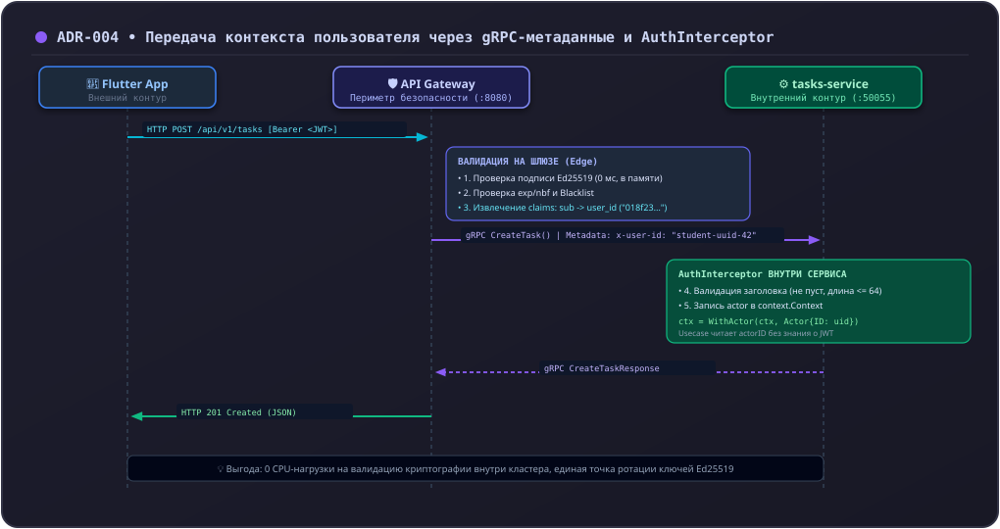

# 10. Аутентификация: gRPC-интерцептор и метаданные пользователя

В микросервисной архитектуре организация аутентификации требует выбора архитектурного компромисса между производительностью и изоляцией доверенных зон.

В Orbit AI действует архитектурное решение **ADR-004**: внешняя аутентификация по JWT возложена на **API Gateway**, а внутренним сервисам идентификатор пользователя передаётся через доверенные **gRPC-метаданные**.

---

## 1. Архитектурное обоснование компромисса (ADR-004)




### Почему микросервисы не проверяют JWT самостоятельно:
1. **Производительность**:
   Криптографическая проверка подписи Ed25519/RSA для каждого внутреннего вызова создаёт ощутимую нагрузку на CPU. Проверка один раз на шлюзе снимает эту нагрузку с бэкенд-сервисов.
2. **Единая точка ротации ключей**:
   При смене ключей подписи токенов обновляется только конфигурация `auth-service` и шлюза. Десятки внутренних микросервисов не требуют перезапуска или синхронизации ключей.
3. **Безопасность периметра**:
   Внутренние сервисы физически недоступны из интернета: они размещены в закрытой сети Docker/VPC и принимают соединения только от API Gateway.

---

## 2. Реализация `AuthInterceptor`

В `tasks-service` входящие запросы проходят через **`AuthInterceptor`**:

```go
--8<-- "examples/tasks-service/internal/transport/taskgrpc/interceptors.go:auth_interceptor"
```

### Защита периметра (Defense in Depth):
Хотя сервис доверяет шлюзу, интерцептор не полагается на него слепо и валидирует заголовок:
1. **Пропуск проверок здоровья**:
   Методы стандартного протокола проверки здоровья (`/grpc.health.v1.Health/`) пропускаются без заголовка, что необходимо для Kubernetes и Docker Compose.
2. **Ограничение длины (`len(rawUserID) <= 64`)**:
   Предотвращает атаки на переполнение памяти.
3. **Блокировка управляющих символов (`containsControlChars`)**:
   Символы `\r`, `\n`, `\t` и непечатные байты блокируются, исключая инъекции в заголовки и лог-файлы.
4. **Контекстный упаковщик**:
   Валидный идентификатор преобразуется в Value Object `domain.OwnerID` и сохраняется в контексте с помощью приватного ключа:
   ```go
   type contextKey struct{}
   var actorContextKey = contextKey{}
   
   func ContextWithActor(ctx context.Context, actor domain.OwnerID) context.Context {
       return context.WithValue(ctx, actorContextKey, actor)
   }
   ```

---

## 3. Извлечение пользователя в хендлере (`ActorFromContext`)

В транспортных хендлерах субъект авторизации извлекается одной строкой:

```go
func ActorFromContext(ctx context.Context) (domain.OwnerID, error) {
    actor, ok := ctx.Value(actorContextKey).(domain.OwnerID)
    if !ok || actor.IsZero() {
        return domain.OwnerID{}, status.Error(codes.Unauthenticated, "субъект авторизации отсутствует в контексте")
    }
    return actor, nil
}
```

Благодаря этому сценарии `CreateTaskUseCase`, `GetTaskUseCase`, `CompleteTaskUseCase` гарантированно получают доверенный `domain.OwnerID` текущего студента.

---

## 4. Антипаттерны: как нельзя и как правильно

### ❌ Как нельзя:
```go
// ОШИБКА 1: Передача owner_id в теле запроса клиента
message CreateTaskRequest {
    string owner_id = 1; // Уязвимость: студент может передать чужой ID и создать задачу от чужого имени
}

// ОШИБКА 2: Раздача приватных ключей JWT всем микросервисам
// При компрометации одного вспомогательного сервиса скомпрометирована вся система

// ОШИБКА 3: Слепое чтение метаданных без валидации
actor := md.Get("x-user-id")[0] // Пустая строка или спецсимволы приводят к скрытым сбоям в БД
```

### ✅ Как правильно:
```go
// В контракте тело содержит только данные задачи:
message CreateTaskRequest {
    string title = 1;
    string description = 2;
}

// Идентификатор извлекается только из метаданных шлюза:
actor, err := ActorFromContext(ctx)
if err != nil {
    return nil, err
}
```

---

## Резюме

1. Аутентификация централизована на API Gateway (ADR-004).
2. Внутренние сервисы получают проверенный `x-user-id` через gRPC-метаданные.
3. `AuthInterceptor` валидирует длину и отсутствие спецсимволов.
4. Бизнес-сценарии оперируют типизированным субъектом `domain.OwnerID`.
