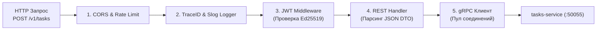

# 11. REST-слой Gateway (Роутер, DTO, JWT-middleware, gRPC-клиенты)

Сервис **`gateway-service` (API Gateway)** выступает единой входной точкой (Single Point of Entry) для внешних клиентов — мобильного приложения на Flutter, веб-интерфейсов и внешних интеграций.

Gateway принимает внешние запросы по протоколу **HTTP/REST (JSON)**, проверяет JWT-токены и транслирует запросы во внутреннюю сеть через быстрые **gRPC-вызовы**.

---

## 1. Архитектура и поток запроса в Gateway




---

## 2. Изоляция DTO Gateway от Protobuf и Домена

Критическое архитектурное правило: **JSON-структуры внешнего REST API не должны быть привязаны к сгенерированным Protobuf-стабам**.

### Почему DTO разделены:
- Внешний API версионируется независимо от внутренней структуры gRPC;
- Protobuf генерирует специфичные поля (`state`, `sizeCache`, `unknownFields`), которые не должны попадать в публичный JSON;
- Имена полей в JSON (camelCase) могут отличаться от внутренних контрактов.

```go
// gateway/internal/transport/http/dto/task.go
package dto

import "time"

type CreateTaskRequest struct {
    Title          string    `json:"title"`
    Description    string    `json:"description"`
    Deadline       time.Time `json:"deadline"`
    Priority       string    `json:"priority"`
    IdempotencyKey string    `json:"idempotency_key,omitempty"`
}

type TaskResponse struct {
    ID          string    `json:"id"`
    Title       string    `json:"title"`
    Description string    `json:"description"`
    Deadline    time.Time `json:"deadline"`
    Priority    string    `json:"priority"`
    Status      string    `json:"status"`
    CreatedAt   time.Time `json:"created_at"`
}
```

---

## 3. JWT-Middleware (Аутентификация)

Middleware извлекает токен из заголовка `Authorization: Bearer <token>`, валидирует цифровую подпись Ed25519 и помещает проверенные claims (`userID`, `roles`) в `context.Context`:

```go
// gateway/internal/middleware/auth.go
package middleware

import (
    "context"
    "net/http"
    "strings"

    "github.com/golang-jwt/jwt/v5"
)

type contextKey string
const UserIDKey contextKey = "user_id"

func JWTMiddleware(publicKey any) func(http.Handler) http.Handler {
    return func(next http.Handler) http.Handler {
        return http.HandlerFunc(func(w http.ResponseWriter, r *http.Request) {
            authHeader := r.Header.Get("Authorization")
            if authHeader == "" {
                http.Error(w, `{"error":"заголовок Authorization обязателен"}`, http.StatusUnauthorized)
                return
            }

            tokenStr := strings.TrimPrefix(authHeader, "Bearer ")
            token, err := jwt.Parse(tokenStr, func(t *jwt.Token) (any, error) {
                return publicKey, nil
            })

            if err != nil || !token.Valid {
                http.Error(w, `{"error":"недействительный токен"}`, http.StatusUnauthorized)
                return
            }

            claims, ok := token.Claims.(jwt.MapClaims)
            if !ok {
                http.Error(w, `{"error":"некорректный payload токена"}`, http.StatusUnauthorized)
                return
            }

            userID, ok := claims["sub"].(string)
            if !ok || userID == "" {
                http.Error(w, `{"error":"отсутствует sub в токене"}`, http.StatusUnauthorized)
                return
            }

            ctx := context.WithValue(r.Context(), UserIDKey, userID)
            next.ServeHTTP(w, r.WithContext(ctx))
        })
    }
}
```

---

## 4. Вызов gRPC-сервиса с пробросом метаданных

При обращении к внутреннему `tasks-service` шлюз упаковывает `userID` в gRPC-метаданные через `metadata.NewOutgoingContext`:

```go
// gateway/internal/handler/task_handler.go
package handler

import (
    "encoding/json"
    "net/http"

    tasksv1 "github.com/orbit-polytech/orbit-docs/examples/tasks-service/pkg/api/orbit/tasks/v1"
    "google.golang.org/grpc/metadata"
    "google.golang.org/protobuf/types/known/timestamppb"
)

type TaskGatewayHandler struct {
    client tasksv1.TaskServiceClient
}

func (h *TaskGatewayHandler) CreateTask(w http.ResponseWriter, r *http.Request) {
    userID := r.Context().Value(middleware.UserIDKey).(string)

    var req dto.CreateTaskRequest
    if err := json.NewDecoder(r.Body).Decode(&req); err != nil {
        http.Error(w, `{"error":"некорректный JSON запроса"}`, http.StatusBadRequest)
        return
    }

    // 1. Проброс проверенного user_id в метаданные gRPC (ADR-004)
    ctx := metadata.NewOutgoingContext(r.Context(), metadata.Pairs(
        "x-user-id", userID,
    ))

    // 2. Вызов внутреннего сервиса по gRPC
    grpcResp, err := h.client.CreateTask(ctx, &tasksv1.CreateTaskRequest{
        Title:          req.Title,
        Description:    req.Description,
        Deadline:       timestamppb.New(req.Deadline),
        Priority:       mapPriorityToProto(req.Priority),
        IdempotencyKey: req.IdempotencyKey,
    })

    if err != nil {
        MapGRPCToHTTPError(w, err)
        return
    }

    // 3. Формирование ответа для клиента
    w.Header().Set("Content-Type", "application/json")
    w.WriteHeader(http.StatusCreated)
    _ = json.NewEncoder(w).Encode(mapProtoToTaskResponse(grpcResp.GetTask()))
}
```

---

## 5. Маппинг gRPC-статусов в HTTP-коды

Шлюз транслирует коды возврата gRPC в стандартизированные HTTP-статусы:

```go
func MapGRPCToHTTPError(w http.ResponseWriter, err error) {
    st, ok := status.FromError(err)
    if !ok {
        http.Error(w, `{"error":"внутренняя ошибка сервера"}`, http.StatusInternalServerError)
        return
    }

    var httpCode int
    switch st.Code() {
    case codes.InvalidArgument:
        httpCode = http.StatusBadRequest // 400
    case codes.Unauthenticated:
        httpCode = http.StatusUnauthorized // 401
    case codes.PermissionDenied:
        httpCode = http.StatusForbidden // 403
    case codes.NotFound:
        httpCode = http.StatusNotFound // 404
    case codes.Aborted:
        httpCode = http.StatusConflict // 409
    case codes.DeadlineExceeded:
        httpCode = http.StatusGatewayTimeout // 504
    case codes.Canceled:
        httpCode = 499 // Client Closed Request
    default:
        httpCode = http.StatusInternalServerError // 500
    }

    w.Header().Set("Content-Type", "application/json")
    w.WriteHeader(httpCode)
    _ = json.NewEncoder(w).Encode(map[string]string{
        "code":    st.Code().String(),
        "message": st.Message(),
    })
}
```

> [!NOTE] Спецификация API
> Полная документация эндпоинтов Gateway описана в [Спецификации внешнего API (OpenAPI)](../../reference/api/openapi.md).

---

## 6. Антипаттерны: как нельзя и как правильно

### ❌ Как нельзя:
```go
// ОШИБКА 1: Прямая отдача Protobuf DTO наружу в JSON
json.NewEncoder(w).Encode(grpcTask) // В JSON улетят внутренние поля Protobuf

// ОШИБКА 2: Отсутствие проверки подписи JWT на шлюзе
// Пропуск непроверенных токенов во внутренний периметр

// ОШИБКА 3: Возврат 500 ошибки на все gRPC сбои
// Клиент получает 500 Internal Server Error вместо понятного 404 Not Found или 400 Bad Request
```

### ✅ Как правильно:
```go
// Изолированные структуры DTO:
type CreateTaskRequest struct { ... }

// Проверка JWT на Gateway и передача x-user-id в metadata:
ctx := metadata.NewOutgoingContext(r.Context(), metadata.Pairs("x-user-id", userID))

// Точный маппинг gRPC кодов в HTTP (NotFound -> 404, InvalidArgument -> 400):
MapGRPCToHTTPError(w, err)
```

---

## Резюме

1. Gateway — единственный компонент, открытый для внешнего мира.
2. Проверка JWT выполняется на входе в Gateway.
3. Внутренние вызовы выполняются по gRPC с добавлением `x-user-id` в исходящие метаданные.
4. Внешние DTO изолированы от внутренних Protobuf-сообщений.
