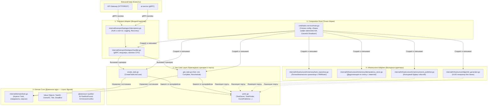

# 6.0 Принципы на практике: карта слоёв tasks-service

В этой главе мы разбираем реальную архитектуру микросервиса **`tasks-service`** — эталонной реализации чистого бэкенд-сервиса на Go в проекте Orbit AI.

Вместо абстрактных диаграмм мы сопоставляем классические концепции **Clean Architecture**, **Hexagonal Architecture (Ports and Adapters)** и **Domain-Driven Design (DDD)** с конкретными файлами в репозитории.

---

## 1. Архитектурная карта сервиса



---

## 2. Поток выполнения vs Направление зависимостей

В классическом монолите или спагетти-коде поток вызовов совпадает с направлением импортов: HTTP-хендлер импортирует базу данных напрямую.

В Clean Architecture действует **Принцип инверсии зависимостей (Dependency Inversion Principle, DIP)**:
- **Поток выполнения (Control Flow)** идёт снаружи внутрь: `Client` -> `Transport` -> `Usecase` -> `Infrastructure` (БД) -> `Response`.
- **Направление зависимостей (Source Code Dependencies)** направлено строго к центру: и `Transport`, и `Infrastructure` зависят от абстракций, объявленных в `Usecase` и `Domain`.

```text
┌───────────────────────────────────────────────────────────┐
│                      cmd/main.go                          │
│               (Знает обо всех компонентах)                │
└──────────────┬─────────────────────────────┬──────────────┘
               │ создаёт                     │ создаёт
               ▼                             ▼
┌──────────────────────────┐    ┌──────────────────────────┐
│    internal/transport    │    │  internal/infrastructure │
│   (Зависит от usecase)   │    │   (Зависит от usecase)   │
└──────────────┬───────────┘    └────────────┬─────────────┘
               │ вызывает                    │ реализует интерфейс
               ▼                             ▼
┌───────────────────────────────────────────────────────────┐
│                     internal/usecase                      │
│            (Объявляет порты и бизнес-сценарии)            │
└──────────────────────────────┬────────────────────────────┘
                               │ оперирует сущностями
                               ▼
┌───────────────────────────────────────────────────────────┐
│                     internal/domain                       │
│           (Чистое ядро: не зависит ни от кого)            │
└───────────────────────────────────────────────────────────┘
```

---

## 3. Матрица разрешений и запретов по слоям

| Слой | Что РАЗРЕШЕНО делать | Что КАТЕГОРИЧЕСКИ ЗАПРЕЩЕНО |
| :--- | :--- | :--- |
| **`domain`** | Валидировать бизнес-инварианты, проверять дедлайн, менять статус агрегата, отдавать доменные ошибки. | Импортировать что-либо кроме `$gostd` (никаких SQL, gRPC, JSON, сторонних библиотек, UUID). |
| **`usecase`** | Координировать шаги сценария, проверять права доступа (`loadOwned`), обращаться к портам, отдавать DTO выхода. | Знать о деталях хранения (SQL-запросы, транзакции БД), знать о протоколах связи (gRPC, HTTP, Protobuf). |
| **`infrastructure`** | Писать SQL, работать с сокетами, сериализовать данные в JSON/BSON, реализовывать порты из `usecase`. | Менять бизнес-инварианты сущностей в обход доменных методов, вызывать gRPC хендлеры. |
| **`transport`** | Валидировать формат входных DTO proto, извлекать метаданные авторизации (`x-user-id`), маппить ошибки через `mapError`. | Выполнять бизнес-логику, напрямую обращаться к базе данных или репозиториям в обход Use Case. |
| **`cmd/.../main.go`** | Читать переменные окружения, собирать граф зависимостей, перехватывать системные сигналы ОС, слушать порт. | Содержать бизнес-логику или хендлеры. |

---

## Резюме

Следующие главы проведут вас шаг за шагом через реализацию каждого слоя `tasks-service`:
- **6.1**: Доменное ядро (сущность `Task` и Value Objects);
- **6.2**: Сценарии и порты (Use Cases);
- **6.3**: Хранилище в памяти и оптимистичная блокировка;
- **6.4**: Транспортный gRPC-слой и DTO;
- **6.5**: Порт событий и Outbox;
- **6.6**: Точка сборки и Graceful Shutdown;
- **6.7**: Практикум рефакторинга антипаттернов;
- **6.8**: Тестирование слоёв и защита от гонок.
