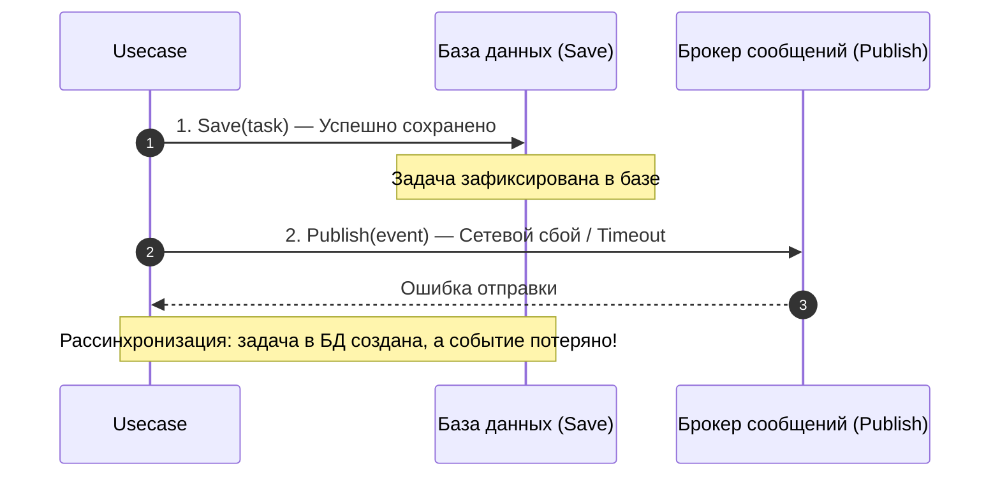

# 6.5 События как порт (Event Publisher)

Для интеграции микросервисов без жесткого связывания в Orbit AI используется событийно-ориентированная архитектура (Event-Driven Architecture).

Когда студент создаёт учебную задачу, сервису задач не требуется напрямую вызывать `notification-service` или `ai-service` по сети. Сервис просто фиксирует факт: произошло событие **`TaskCreated`**.

---

## 1. Порт публикации событий в слое Use Case

Слой Use Case не зависит от конкретного брокера (RabbitMQ, Kafka, NATS). Вместо этого определён абстрактный порт:

```go
// internal/usecase/ports.go
type EventPublisher interface {
    PublishTaskCreated(ctx context.Context, event domain.TaskCreated) error
}
```

### Принцип иммутабельности событий:
Событие `domain.TaskCreated` передаётся **по значению**, а не по указателю:
- Событие фиксирует факт из прошлого, который не может измениться.
- Передача по значению исключает случайную мутацию данных события во внешних горутинах.

---

## 2. In-Memory реализация с кольцевым буфером

Для локального запуска и unit-тестов создана потокобезопасная in-memory реализация `EventPublisher`:

```go
--8<-- "examples/tasks-service/internal/infrastructure/inmemory/event_publisher.go:inmemory_events"
```

### Защита от утечки памяти (Ring Buffer):
Если сервис работает долгое время без очистки очереди, бесконечно растущий слайс `events` приведёт к переполнению оперативной памяти (OOM Crash).
В `EventPublisher` буфер ограничен лимитом в 1 000 элементов: при переполнении старые события вытесняются:
```go
if len(p.events) >= p.maxEvents {
    p.events = p.events[1:]
}
```

---

## 3. Критический архитектурный риск: Проблема двойной записи (Dual-Write)

Обратите внимание на последовательность операций в `CreateTaskUseCase`:

```go
// 1. Запись в хранилище:
if err := uc.saver.Save(ctx, task); err != nil {
    return nil, err
}

// 2. Отправка события во внешнюю шину:
if err := uc.events.PublishTaskCreated(ctx, event); err != nil {
    return nil, err
}
```




### Почему распределённые транзакции (2PC) — плохая идея:
Двухфазные коммиты (Two-Phase Commit, XA) создают распределённые блокировки, резко снижают пропускную способность системы и не поддерживаются большинством современных брокеров (включая RabbitMQ).

### Как решается проблема в Orbit AI:
В главе 8 мы внедрим паттерн **Transactional Outbox**:
- Событие сохраняется в реляционную таблицу `outbox_events` **в той же транзакции базы данных**, что и сама задача.
- Фоновый воркер асинхронно вычитывает неотправленные события из таблицы и гарантированно доставляет их в RabbitMQ.

---

## 4. Антипаттерны: как нельзя и как правильно

### ❌ Как нельзя:
```go
// ОШИБКА 1: Передача указателя на изменяемую сущность
type EventPublisher interface {
    PublishTaskCreated(ctx context.Context, task *domain.Task) // Подписчик может изменить статус задачи!
}

// ОШИБКА 2: Неконтролируемый рост слайса в памяти
p.events = append(p.events, event) // Утечка памяти при высокой нагрузке

// ОШИБКА 3: Прямой импорт amqp091 в домене или usecase
import "github.com/rabbitmq/amqp091-go" // Нарушение чистой архитектуры!
```

### ✅ Как правильно:
```go
// Неизменяемая структура события со строгим набором полей:
type TaskCreated struct {
    EventID    string
    TaskID     TaskID
    OccurredAt time.Time
}

// Порт принимает событие по значению:
func (p *EventPublisher) PublishTaskCreated(ctx context.Context, event domain.TaskCreated) error
```

---

## Резюме

1. Межсервисные события объявляются как порт `EventPublisher` в слое Use Case.
2. События неизменяемы и передаются по значению.
3. In-memory буфер защищён от утечек памяти кольцевым лимитом.
4. Проблема Dual-Write осознана и будет устранена в главе 8 через Transactional Outbox.
