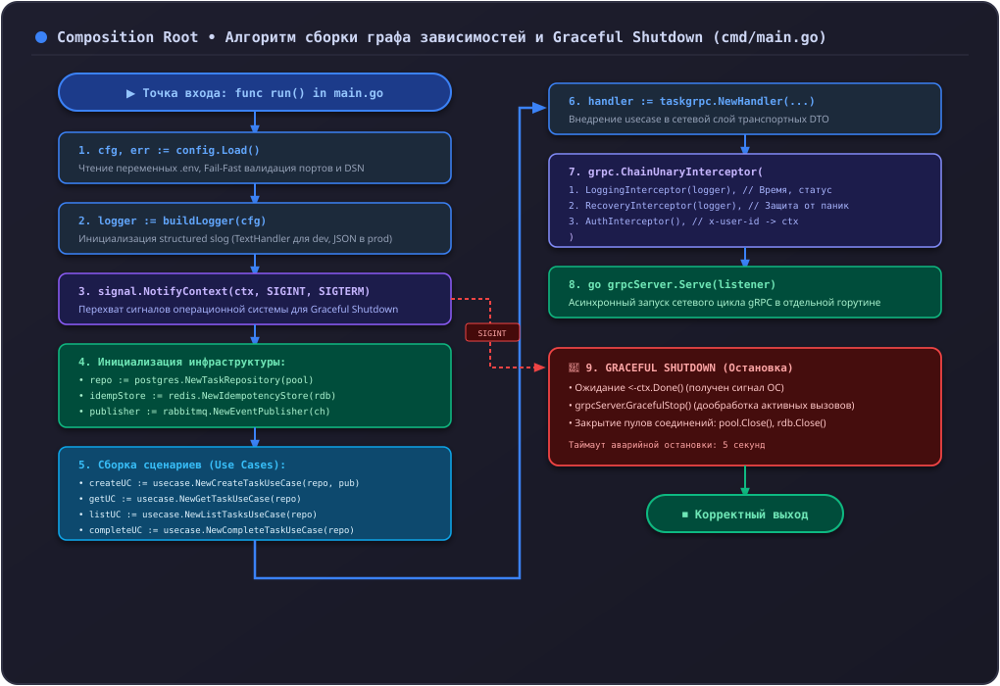

# 6.6 Точка сборки (main и Graceful Shutdown)

Паттерн **Composition Root (Точка сборки)** определяет единственное место в приложении, где создаются конкретные экземпляры классов/структур и связываются между собой через конструкторы.

В сервисе `tasks-service` точкой сборки является функция `run()` в файле **`cmd/tasks-service/main.go`**.

---

## 1. Сборка графа зависимостей




Полный код точки сборки:

```go
--8<-- "examples/tasks-service/cmd/tasks-service/main.go:composition_root"
```

---

## 2. Цепочка интерцепторов gRPC (Middleware)

Интерцепторы выполняются в строгом порядке, определённом в вызове `grpc.ChainUnaryInterceptor`:

```go
grpcServer := grpc.NewServer(
    grpc.ChainUnaryInterceptor(
        taskgrpc.LoggingInterceptor(logger),   // 1. Внешний слой: замер времени и лог
        taskgrpc.RecoveryInterceptor(logger),  // 2. Перехват паник
        taskgrpc.AuthInterceptor(),            // 3. Авторизация и контекст пользователя
    ),
)
```

### 1. `LoggingInterceptor`:
Засекает время выполнения запроса и логирует статус завершения.

### 2. `RecoveryInterceptor`:
Защищает процесс от аварийного падения при непредвиденных паниках:

```go
--8<-- "examples/tasks-service/internal/transport/taskgrpc/interceptors.go:recovery_interceptor"
```
Если в хендлере происходит разыменование нулевого указателя (`nil pointer dereference`), интерцептор перехватывает панику, логирует полный стек вызовов через `debug.Stack()` и возвращает клиенту безопасную ошибку `codes.Internal`.

### 3. `AuthInterceptor` и Граница доверия (ADR-004):
В микросервисной архитектуре Orbit AI проверка криптографической подписи JWT возложена на **API Gateway**. Внутренним микросервисам Gateway передаёт проверенный идентификатор в метаданных `x-user-id`:

```go
--8<-- "examples/tasks-service/internal/transport/taskgrpc/interceptors.go:auth_interceptor"
```

#### Защита в `AuthInterceptor`:
- Пропускает стандартные проверки жизнеспособности (`/grpc.health.v1.Health/`) без авторизации.
- Проверяет длину заголовка (`len(rawUserID) <= 64`).
- Блокирует управляющие символы (`containsControlChars`), исключая инъекции в заголовки.
- Помещает валидированный `domain.OwnerID` в контекст через `ContextWithActor`.

---

## 3. Надёжный Graceful Shutdown

При деплое новой версии сервиса в Docker/Kubernetes процессу отправляется сигнал `SIGTERM`.

### Почему опасен резкий `os.Exit(0)`:
Если прервать процесс немедленно:
- Клиенты, отправляющие запросы в данный момент, получат ошибку соединения `connection reset by peer`.
- Транзакции в базе данных могут оборваться на середине.

### Двухэтапная остановка в `tasks-service`:
1. `signal.NotifyContext` перехватывает сигналы завершения `os.Interrupt` и `syscall.SIGTERM`.
2. Запускается горутина с `grpcServer.GracefulStop()`:
   - Сервер перестаёт принимать новые подключения.
   - Сервер ожидает завершения всех активных RPC-вызовов.
3. Устанавливается жесткий дедлайн в 5 секунд (`shutdownCtx`):
   Если какой-то запрос завис (например, долгий сетевой вызов), по истечении 5 секунд вызывается принудительный `grpcServer.Stop()`, и процесс завершается с предупреждением в логах.

---

## 4. Антипаттерны: как нельзя и как правильно

### ❌ Как нельзя:
```go
// ОШИБКА 1: Отсутствие Recovery интерцептора
// Любая опечатка или nil в бизнес-логике намертво роняет весь контейнер

// ОШИБКА 2: Мгновенное завершение процесса без Graceful Shutdown
func main() {
    go grpcServer.Serve(lis)
    <-ctx.Done()
    os.Exit(0) // Все активные запросы клиентов разорваны!
}

// ОШИБКА 3: Создание зависимостей внутри классов (Service Locator)
type TaskUseCase struct {
    repo *TaskRepository // Инициализируется прямо внутри структуры: нет гибкости
}
```

### ✅ Как правильно:
```go
// Сборка графа через Dependency Injection в main.go:
repo := inmemory.NewTaskRepository()
usecase := usecase.NewCreateTaskUseCase(repo, ...)
handler := taskgrpc.NewTaskHandler(usecase, ...)

// Остановка сервера с таймаутом безопасности:
shutdownCtx, cancel := context.WithTimeout(context.Background(), 5*time.Second)
defer cancel()
go func() {
    grpcServer.GracefulStop()
    close(stoppedCh)
}()
```

---

## Резюме

1. `main.go` — единственная точка сборки зависимостей сервиса.
2. Цепочка интерцепторов обеспечивает сквозное логирование, перехват паник и аутентификацию.
3. `AuthInterceptor` доверяет шлюзу, но строго валидирует формат `x-user-id`.
4. Двухэтапный Graceful Shutdown гарантирует корректное завершение активных запросов.
