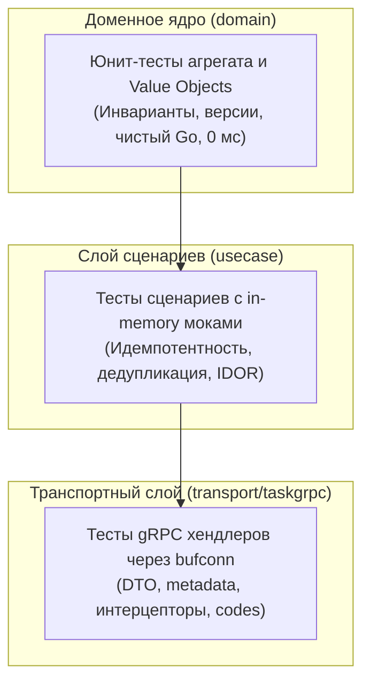

# 6.8 Тестирование слоёв (Unit-тесты и моки)

Главное практическое преимущество **Clean Architecture** — исключительная тестируемость.

Поскольку домен не зависит от внешнего мира, а сценарии Use Case взаимодействуют с инфраструктурой только через узкие интерфейсы (ISP), для проверки системы не требуется поднимать медленные базы данных или внешние сервисы.

---

## 1. Пирамида тестирования слоёв



---

## 2. Тестирование доменного слоя (`task_test.go`)

Доменные тесты выполняются за миллисекунды, так как работают исключительно в памяти и не используют моки:

```go
--8<-- "examples/tasks-service/internal/domain/task_test.go:domain_tests"
```

### Что проверяют доменные тесты:
- Корректная начальная версия `version = 1` при создании задачи;
- Проверка принадлежности задачи через `IsOwnedBy`;
- Атомарный инкремент `version++` при завершении (`Complete`) и переносе дедлайна (`Reschedule`);
- Запрет повторного закрытия завершённой задачи (`ErrTaskAlreadyCompleted`);
- Валидация дедлайна в будущем относительно переданного времени `now`.

---

## 3. Тестирование Use Case и структурные моки

Благодаря принципу разделения интерфейсов (ISP), моки в Orbit AI пишутся прямо в тестовом файле без тяжелых сторонних кодогенераторов:

```go
--8<-- "examples/tasks-service/internal/usecase/create_task_test.go:usecase_mocks"
```

### Тестирование сценария создания задачи и дедупликации:

```go
--8<-- "examples/tasks-service/internal/usecase/create_task_test.go:usecase_tests"
```

#### Ключевые кейсы проверки `CreateTaskUseCase`:
1. **Успешное создание**: задача сохранена в репозитории, событие `TaskCreated` отправлено в шину, ключ идемпотентности зафиксирован.
2. **Повторный вызов с тем же `IdempotencyKey`**: возвращается уже существующая задача без повторного обращения к `saver.Save` и без повторной генерации события.
3. **Отказ хранилища идемпотентности или репозитория**: корректный проброс ошибки с прерыванием операции.

---

## 4. Тестирование gRPC-транспорта в памяти (`bufconn`)

Чтобы протестировать gRPC-хендлеры и интерцепторы без занятия реальных TCP-портов на компьютере, используется пакет `google.golang.org/grpc/test/bufconn`:

```go
--8<-- "examples/tasks-service/internal/transport/taskgrpc/handler_test.go:grpc_handler_tests"
```

### Сценарии тестирования транспорта:
- **Проверка метаданных `x-user-id`**: запрос без заголовка возвращает `codes.Unauthenticated`.
- **Защита от чужих задач (IDOR)**: запрос на получение задачи чужого студента возвращает `codes.NotFound`.
- **Перехват паник (`RecoveryInterceptor`)**: метод, вызвавший `panic("boom")`, возвращает клиенту безопасный код `codes.Internal` без падения сервиса.

---

## 5. Запуск тестов с детектором гонок данных

Любой запуск тестов локально и в CI выполняется со строгим набором флагов:

```bash
go test -v -race -count=1 ./...
```

* `-race`: активирует встроенный в компилятор Go инструмент анализа гонок памяти (ThreadSanitizer).
* `-count=1`: отключает кэширование тестов, гарантируя реальный запуск всех проверок.

---

## 6. Антипаттерны: как нельзя и как правильно

### ❌ Как нельзя:
```go
// ОШИБКА 1: Поднятие реальной БД PostgreSQL в unit-тесте
func TestCreateTask(t *testing.T) {
    db := connectToRealPostgres() // Медленно (секунды), флакует при недоступности сети
}

// ОШИБКА 2: Игнорирование проверки типа ошибки
err := uc.Execute(ctx, ...)
if err == nil {
    t.Fail() // Не проверено, какая именно ошибка вернулась!
}

// ОШИБКА 3: Запуск тестов без детектора гонок
go test ./... // Пропускает критические гонки данных в мьютексах
```

### ✅ Как правильно:
```go
// Быстрые изолированные in-memory моки:
repo := inmemory.NewTaskRepository()
clock := &mockClock{now: fixedTime}

// Строгая проверка конкретной доменной ошибки:
_, err := uc.Execute(ctx, actor, invalidInput)
require.ErrorIs(t, err, domain.ErrInvalidDeadline)

// Обязательный запуск с флагом -race:
// go test -race -count=1 ./...
```

---

## Резюме

1. Домен тестируется без внешних зависимостей и без моков.
2. Сценарии Use Case тестируются через узкие ISP-моки.
3. Транспорт gRPC и интерцепторы проверяются в памяти через `bufconn`.
4. Флаг `go test -race -count=1 ./...` обязателен для локального прогона и CI.
