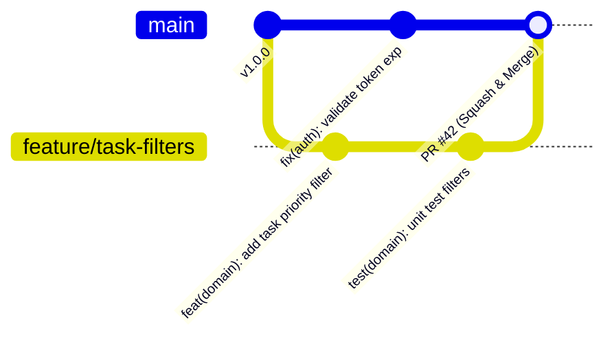

# 01. Git и командный workflow с нуля

В проекте **Orbit AI** кодовая база разделена на независимые сервисы в рамках GitHub-организации `orbit-polytech` (модель **Polyrepo**). Чтобы 10 инженеров могли работать параллельно без перезаписи чужого кода, хаоса в ветках и сломанных сборок, в проекте действует строгий командный регламент работы с Git.

---

## 1. Базовые правила организации

1. **Главная ветка `main` священна**:
   Прямой пуш (`git push origin main`) технически заблокирован настройками GitHub Branch Protection. Весь код попадает в `main` **только через Pull Request (PR)** после прохождения автоматических тестов (CI) и ревью.
2. **Один PR = одна логическая задача**:
   Не смешивайте исправление бага в авторизации, рефакторинг базы данных и правку документации в одной ветке. Небольшие изменения легче проверять и безопаснее накатывать.
3. **Линейная история коммитов (Rebase workflow)**:
   Мы не засоряем историю бесконечными коммитами вида `Merge branch 'main' into feature`. Обновление своей рабочей ветки выполняется через `git rebase`.



---

## 2. Соглашение об именовании веток

Имя ветки создаётся строго на английском языке в нижнем регистре с использованием дефисов:

| Префикс | Назначение | Пример |
| :--- | :--- | :--- |
| `feature/` | Новая функциональность сервиса | `feature/reschedule-task-endpoint` |
| `fix/` | Исправление бага или уязвимости | `fix/jwt-signature-verification` |
| `refactor/` | Изменение структуры без изменения поведения | `refactor/split-repository-interfaces` |
| `test/` | Добавление или исправление тестов | `test/add-idempotency-race-tests` |
| `docs/` | Обновление технической документации | `docs/update-auth-flow-diagram` |

---

## 3. Стандарт Conventional Commits

Все сообщения коммитов должны следовать спецификации [Conventional Commits](https://www.conventionalcommits.org/):

```text
<тип>(<область>): <описание изменений в повелительном наклонении>

[опциональное подробное тело коммита]
[опциональный футер со ссылкой на задачу, например: Closes #14]
```

### Допустимые типы:
* `feat`: новая функциональность (например, `feat(usecase): implement task reschedule`);
* `fix`: исправление ошибки (например, `fix(grpc): map duplicate key to aborted`);
* `refactor`: рефакторинг кода без добавления фич и исправления багов;
* `test`: добавление или коррекция юнит-/интеграционных тестов;
* `docs`: правки документации и комментариев;
* `perf`: оптимизация производительности;
* `chore`: рутинные задачи (обновление `.gitignore`, bump версий зависимостей в `go.mod`).

### Примеры:

```bash
#  Правильно:
git commit -m "feat(domain): add IsOwnedBy check to Task entity"
git commit -m "fix(transport): prevent panic on missing x-user-id header"
git commit -m "test(inmemory): add concurrent race test for task completion"

# ❌ Неправильно (такие PR будут отклонены):
git commit -m "исправил баг"
git commit -m "fix"
git commit -m "WIP"
git commit -m "update code and files"
```

---

## 4. Пошаговый цикл разработки (Daily Workflow)

### Шаг 1. Актуализация локальной ветки `main`
Всегда начинайте новую задачу от свежей версии основной ветки:

```bash
git checkout main
git pull origin main
```

### Шаг 2. Создание изолированной ветки
```bash
git switch -c feature/add-task-deadline-validation
```

### Шаг 3. Внесение изменений и атомарные коммиты
Разбивайте работу на логические шаги:
```bash
# Проверяем статус изменённых файлов
git status

# Добавляем конкретные файлы в индекс (избегайте бездумного git add .)
git add internal/domain/task.go internal/domain/task_test.go

# Фиксируем коммит по стандарту
git commit -m "feat(domain): introduce deadline value object with UTC normalization"
```

### Шаг 4. Временное сохранение незавершённого кода (`git stash`)
Если вам нужно срочно переключиться на другую ветку, но текущий код ещё не скомпилирован:
```bash
# Сохранить текущие незакоммиченные изменения в стек:
git stash push -m "WIP: working on deadline validator"

# Переключиться на другую ветку, сделать задачу, вернуться обратно:
git checkout main
# ...
git checkout feature/add-task-deadline-validation

# Извлечь изменения обратно:
git stash pop
```

### Шаг 5. Синхронизация с `main` через Rebase
Перед тем как открыть Pull Request, обновите свою ветку поверх свежих коммитов `main`:

```bash
# Скачиваем свежие коммиты без слияния
git fetch origin

# Перебазируем наши коммиты поверх свежего main
git rebase origin/main
```

### Шаг 6. Пуш ветки на GitHub
Первый пуш ветки выполняется с привязкой к upstream:
```bash
git push -u origin feature/add-task-deadline-validation
```

Если вы уже делали push, а затем выполнили локальный `git rebase`, история ветки изменилась. В таком случае пушить нужно с флагом `--force-with-lease` (**никогда** не используйте голый `-f`):
```bash
git push --force-with-lease
```

---

## 5. Разрешение конфликтов слияния (Merge Conflicts)

Конфликт возникает, когда два разработчика изменили одни и те же строки одного файла. В процессе `git rebase origin/main` Git приостановит операцию и пометит конфликтующие файлы:

```text
CONFLICT (content): Merge conflict in internal/domain/task.go
error: could not apply 3a7b1c4... feat(domain): add deadline validation
Resolve all conflicts manually, mark them as resolved with
"git add/rm <conflicted_files>", then run "git rebase --continue".
```

### Маркеры конфликта в коде:
Откройте файл в редакторе (VS Code подсветит конфликт интерактивными кнопками):

```go
<<<<<<< HEAD (текущее состояние в main)
func (t *Task) Complete() error {
    t.status = TaskStatusCompleted
    return nil
}
======= (разделитель версий)
func (t *Task) Complete() error {
    if t.status == TaskStatusCompleted {
        return ErrTaskAlreadyCompleted
    }
    t.status = TaskStatusCompleted
    t.version++
    return nil
}
>>>>>>> 3a7b1c4 (ваш коммит)
```

### Алгоритм разрешения:
1. Изучите обе версии и оставьте корректный итоговый код, удалив маркеры `<<<<<<<`, `=======` и `>>>>>>>`.
2. Запустите тесты и линтер, чтобы убедиться, что код компилируется и работает:
   ```bash
   go test ./...
   ```
3. Добавьте разрешённый файл в индекс:
   ```bash
   git add internal/domain/task.go
   ```
4. Продолжите процесс перебазирования:
   ```bash
   git rebase --continue
   ```
5. Если вы запутались и хотите вернуть всё в исходное состояние до rebase:
   ```bash
   git rebase --abort
   ```

---

## 6. Шпаргалка спасения разработчика

* **Сбросить незакоммиченные изменения в одном файле к состоянию последнего коммита**:
  ```bash
  git restore internal/domain/task.go
  ```
* **Убрать файл из индекса (unstage)**:
  ```bash
  git restore --staged internal/domain/task.go
  ```
* **Исправить сообщение самого последнего коммита (до пуша)**:
  ```bash
  git commit --amend -m "feat(domain): correct commit message"
  ```
* **Отменить уже запушенный коммит в main безопасным способом**:
  ```bash
  # Создаёт новый коммит, зеркально отменяющий указанный
  git revert <commit_hash>
  ```

После того как код написан и синхронизирован, переходите к главе **[02. Запуск локального окружения (orbit-infra)](02-local-infra.md)**.
