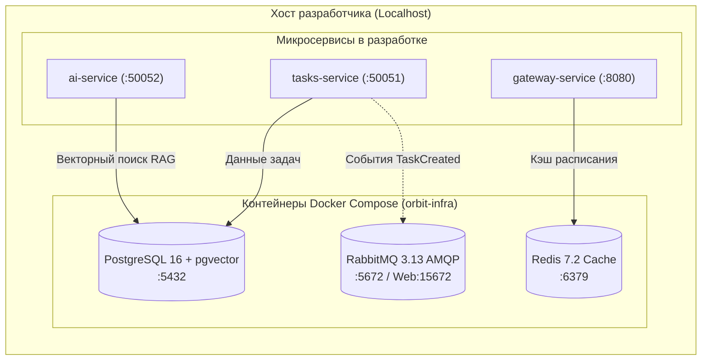

# 02. Запуск локального окружения (orbit-infra)

Микросервисы Orbit AI не хранят дублирующие конфигурации баз данных внутри каждого сервисного репозитория. Вся внешняя инфраструктура (базы данных, кэш, брокер сообщений) централизована в репозитории **`orbit-infra`**.

В этой главе описан запуск локального окружения с помощью Docker Compose и проверка работоспособности всех узлов.

---

## 1. Состав инфраструктурного стека

Локальный стек `orbit-infra` поднимает изолированные контейнеры, необходимые для запуска сервисов на машинах разработчиков:



| Компонент | Образ Docker | Порт на хосте | Роль в проекте |
| :--- | :--- | :--- | :--- |
| **PostgreSQL 16** | `pgvector/pgvector:pg16` | `5432` | Реляционные данные сервисов и векторные эмбеддинги базы знаний Политеха (`vector(1536)`). |
| **Redis 7.2** | `redis:7.2-alpine` | `6379` | Высокоскоростной кэш расписания (отклик 2–3 мс) и временные ключи идемпотентности. |
| **RabbitMQ 3.13** | `rabbitmq:3.13-management-alpine` | `5672` (AMQP)<br>`15672` (Web UI) | Асинхронная шина событий для межсервисной интеграции без жесткого связывания. |

---

## 2. Клонирование и первый запуск

### Шаг 1. Клонирование репозитория инфраструктуры
Склонируйте `orbit-infra` в отдельную директорию на уровне ваших сервисов:

```bash
git clone git@github.com:orbit-polytech/orbit-infra.git
cd orbit-infra
```

Рекомендуемая структура папок на диске:
```text
workspace/
├── orbit-infra/          # Docker Compose и конфиги инфраструктуры
├── orbit-docs/           # Документация и эталонные примеры
├── orbit-contracts/      # Protobuf схемы
├── tasks-service/        # Микросервис задач
└── gateway-service/      # API Gateway
```

### Шаг 2. Настройка переменных окружения
Скопируйте шаблон окружения:

```bash
cp .env.example .env
```

Содержимое `.env` по умолчанию настроено для локальной разработки:
```env
# PostgreSQL
POSTGRES_USER=orbit_user
POSTGRES_PASSWORD=orbit_secret_password
POSTGRES_HOST_PORT=5432

# Redis
REDIS_HOST_PORT=6379

# RabbitMQ
RABBITMQ_DEFAULT_USER=orbit_mq
RABBITMQ_DEFAULT_PASS=orbit_mq_password
RABBITMQ_AMQP_PORT=5672
RABBITMQ_MANAGEMENT_PORT=15672
```

### Шаг 3. Запуск контейнеров в фоновом режиме
```bash
docker compose up -d
```

---

## 3. Проверка работоспособности (Healthcheck)

### 3.1. Статус контейнеров
Выполните команду `docker compose ps`. Все сервисы должны находиться в статусе `Up` или `Up (healthy)`:

```text
NAME                     IMAGE                               COMMAND                  STATUS         PORTS
orbit-postgres-1         pgvector/pgvector:pg16              "docker-entrypoint.s…"   Up (healthy)   0.0.0.0:5432->5432/tcp
orbit-redis-1            redis:7.2-alpine                    "docker-entrypoint.s…"   Up (healthy)   0.0.0.0:6379->6379/tcp
orbit-rabbitmq-1         rabbitmq:3.13-management-alpine    "docker-entrypoint.s…"   Up (healthy)   0.0.0.0:5672->5672/tcp, 0.0.0.0:15672->15672/tcp
```

### 3.2. Проверка PostgreSQL
Убедитесь, что сервер базы данных принимает сетевые подключения:

```bash
docker exec -it orbit-postgres-1 pg_isready -U orbit_user
# Вывод: /var/run/postgresql:5432 - accepting connections
```

Проверьте наличие расширения `vector`:
```bash
docker exec -it orbit-postgres-1 psql -U orbit_user -d postgres -c "SELECT * FROM pg_extension WHERE extname = 'vector';"
```

### 3.3. Проверка Redis
Отправьте команду `PING` встроенным клиентом:

```bash
docker exec -it orbit-redis-1 redis-cli ping
# Ответ: PONG
```

### 3.4. Проверка RabbitMQ Management UI
Откройте браузер по адресу: **`http://localhost:15672`**.
* **Логин**: `orbit_mq` (или `guest`)
* **Пароль**: `orbit_mq_password` (или `guest`)

Панель отображает состояние очередей (Queues), обменников (Exchanges) и скорость передачи сообщений.

---

## 4. Раздельные базы данных (Database-Per-Service)

Согласно архитектурному решению **ADR-002**, каждый микросервис изолированно владеет своей базой данных. В `orbit-infra` при первом старте контейнера выполняется скрипт инициализации `init-databases.sh`, создающий схемы для сервисов:

* `orbit_tasks_db` — база микросервиса задач;
* `orbit_auth_db` — база сервиса авторизации;
* `orbit_schedule_db` — база расписания пар;
* `orbit_ai_db` — база векторных знаний AI.

Сервисы не имеют права подключаться к чужой БД напрямую через SQL (только через сетевые gRPC-вызовы).

---

## 5. Управление и устранение неполадок

### Остановка и перезапуск
```bash
# Остановить контейнеры (данные в томах сохраняются):
docker compose stop

# Запустить снова:
docker compose start

# Просмотр логов в реальном времени:
docker compose logs -f postgres
```

### Ошибка «Port is already allocated» (Порт занят)
Если на вашей машине уже запущен локальный PostgreSQL или Redis:
```text
Error response from daemon: driver failed programming external connectivity on endpoint: 
Bind for 0.0.0.0:5432 failed: port is already allocated
```

* **Решение 1 (Рекомендуемое)**: Остановите локальную службу:
  ```bash
  # Linux:
  sudo systemctl stop postgresql

  # Windows (PowerShell от администратора):
  Stop-Service postgresql*
  ```
* **Решение 2**: Измените внешний порт в файле `.env` (например, `POSTGRES_HOST_PORT=5433`).

### Полный сброс данных (Hard Reset)
Если вам нужно полностью стереть локальные данные и пересоздать базы с нуля:
```bash
# Остановка с удалением Docker Volumes:
docker compose down -v

# Чистый перезапуск:
docker compose up -d
```

После успешного старта инфраструктуры переходите к изучению контрактов: **[03. Контракты API и Buf (Go и Python)](03-contracts-buf.md)**.
