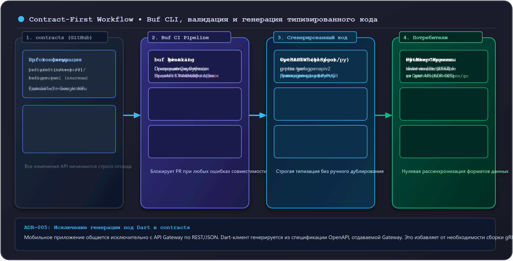

# 03. Контракты API и Buf (Go и Python)

В микросервисной архитектуре **Orbit AI** контракты взаимодействия являются первоисточником истины (Single Source of Truth). Сервисы не должны договариваться о форматах данных в чатах или синхронизировать типы вручную.

В проекте принят строгий подход **Contract-First (API-First)**: любая функциональность начинается с проектирования Protobuf-схемы в центральном репозитории **`contracts`**, валидации линтером и генерации строго типизированных клиентов и серверов.

---

## 1. Концепция Contract-First и роль `contracts`

В модели Polyrepo каждый сервис изолирован, но им необходим общий язык общения. Для этого выделен единый репозиторий **`contracts`**:



### Ключевые архитектурные решения:
1. **Единый источник истины**:
   `.proto`-файлы хранятся только в `contracts`. Сервисы подключают сгенерированный код как зависимости:
   - Go-сервисы импортируют сгенерированный Go-модуль `github.com/orbit-polytech/contracts/gen/go/...`;
   - Python-сервисы устанавливают пакет `contracts` через `pip install`.
2. **Dart и мобильный клиент (ADR-005)**:
   Мобильное приложение Flutter общается исключительно с внешним **API Gateway** по протоколу REST/JSON. Мобильный клиент генерируется из спецификации OpenAPI, которую отдаёт Gateway. В репозитории `contracts` генерация под Dart исключена, что снижает накладные расходы и устраняет необходимость сборки gRPC-Web.

---

## 2. Стандарты проектирования Protobuf (Google Cloud AIP)

Все схемы в проекте проектируются в соответствии с [Google Cloud API Design Guide (AIP)](https://google.aip.dev/):

### 2.1. Именование пакетов и файлов
- Версионирование заложено в имя пакета: `orbit.<service>.v1`.
- Путь к файлу строго соответствует пакету: `api/proto/orbit/tasks/v1/task.proto`.
- Синтаксис: строго `syntax = "proto3";`.

### 2.2. Перечисления (Enums)
В синтаксисе proto3 значение по умолчанию для enum — числовой ноль (`0`). Если поле не передано в бинарном потоке, оно инициализируется нулём.
Поэтому первое значение перечисления **обязано** иметь суффикс `_UNSPECIFIED = 0`:

```protobuf
--8<-- "examples/tasks-service/api/proto/orbit/tasks/v1/task.proto:proto_enums"
```

> [!WARNING] Опасность неявного дефолта
> Если задать `TASK_PRIORITY_LOW = 0`, сервер не сможет отличить ситуацию «клиент явно выбрал низкий приоритет» от «клиент забыл указать приоритет». Значение `UNSPECIFIED` защищает доменную логику от случайного искажения данных.

### 2.3. Сущности и оптимистичная блокировка
Модель данных описывает доменные атрибуты с использованием стандартных типов Google (`google.protobuf.Timestamp`):

```protobuf
--8<-- "examples/tasks-service/api/proto/orbit/tasks/v1/task.proto:proto_task_message"
```

Поле `version` (начиная с 1) используется для защиты от состояния гонки при параллельном обновлении (Optimistic Concurrency Control).

### 2.4. Запросы, пагинация и идемпотентность
Каждый метод RPC оперирует персональными типами Request и Response:

```protobuf
--8<-- "examples/tasks-service/api/proto/orbit/tasks/v1/task.proto:proto_requests"
```

#### Стандарты полей запросов:
* **Идемпотентность (AIP-155)**: поле `idempotency_key` (UUID или строковый ключ до 64 символов) передаётся в методе создания `CreateTaskRequest`. Повторный запрос клиента с тем же ключом возвращает ранее созданную задачу без дублирования записи в базе и повторной публикации событий.
* **Пагинация (AIP-158)**: метод списка `ListTasksRequest` принимает `limit` (строго от 1 до 100) и `offset` (целое число `>= 0`). Ответ `ListTasksResponse` возвращает список и общее количество записей `total_count`.
* **Безопасность (Security Context)**: в `CreateTaskRequest` и `ListTasksRequest` **нет поля `owner_id`**. Идентификатор пользователя извлекается на сервере из контекста доверенных gRPC-метаданных (`x-user-id`), проставленных шлюзом. Клиент не имеет возможности подделать чужой ID.

### 2.5. Определение сервиса (RPC)

```protobuf
--8<-- "examples/tasks-service/api/proto/orbit/tasks/v1/task.proto:proto_service"
```

---

## 3. Сборка и валидация через Buf v2

Вместо устаревшей утилиты `protoc`, требующей локальной установки компиляторов плагинов, в Orbit AI используется инструмент нового поколения — **[Buf](https://buf.build)** (спецификация конфигурации v2).

### 3.1. Конфигурация модуля `buf.yaml`

Файл `buf.yaml` размещается в корне прото-спецификаций (`api/proto/buf.yaml`):

```yaml
--8<-- "examples/tasks-service/api/proto/buf.yaml:buf_config"
```

* `lint.use: [STANDARD]`: активирует полный набор отраслевых проверок стиля Google (именование в `snake_case`, наличие `_UNSPECIFIED` в enum, соответствие названий Request/Response).
* `breaking.use: [FILE]`: включает проверку обратной совместимости на уровне файлов (запрет удаления полей, смены номеров тегов, удаления методов).

### 3.2. Генерация кода `buf.gen.yaml`

Генерация кода управляется файлом `buf.gen.yaml` с использованием удалённых плагинов (Remote Plugins), не требующих локального бинарника `protoc-gen-go`:

```yaml
--8<-- "examples/tasks-service/buf.gen.yaml:buf_gen"
```

* `managed.enabled: true`: режим Managed Mode автоматически проставляет необходимые для компилятора Go пакетные метаданные (`go_package`), избавляя от необходимости хардкодить `option go_package` в каждом `.proto`-файле.
* `plugins`: плагины `protocolbuffers/go` (создаёт структуры DTO) и `grpc/go` (создаёт интерфейсы клиентских и серверных стабов).

Для Python и сервиса искусственного интеллекта аналогичная секция плагинов генерирует Stubs:
```yaml
  - remote: buf.build/grpc/python
    out: gen/python
```

---

## 4. Командный цикл работы с контрактами

### Шаг 1. Проверка стиля схемы (Linting)
Запустите линтер из директории с `buf.yaml`:

```bash
cd api/proto
buf lint
```

Если правило стиля нарушено, утилита укажет точную причину:
```text
orbit/tasks/v1/task.proto:9:3:Enum zero value name "LOW" should have suffix "_UNSPECIFIED".
```

### Шаг 2. Проверка обратной совместимости (Breaking Changes)
Перед открытием Pull Request проверьте, что ваши изменения не ломают текущий API в ветке `main`:

```bash
buf breaking --against ".git#branch=main"
```

Если вы случайно удалили поле `title = 3` или изменили тип `int32` на `string`, Buf заблокирует коммит:
```text
orbit/tasks/v1/task.proto:26:3:Field "3" with name "title" on message "Task" changed type from "string" to "int32".
```

### Шаг 3. Генерация кода
Сгенерируйте код стабов:

```bash
buf generate
```

Сгенерированные файлы появятся в директории `pkg/api/orbit/tasks/v1/`:
- `task.pb.go` — структуры данных и методы сериализации;
- `task_grpc.pb.go` — клиентский стаб `TaskServiceClient` и интерфейс сервера `TaskServiceServer`.

---

## 5. Антипаттерны при проектировании контрактов

### ❌ Как нельзя:
```protobuf
// ОШИБКА 1: Отсутствует значение UNSPECIFIED
enum Priority {
  LOW = 0;
  HIGH = 1;
}

// ОШИБКА 2: Клиент сам передает свой ID (уязвимость IDOR)
message CreateTaskRequest {
  string owner_id = 1;
  string text = 2; // Нарушение стиля именования
}

// ОШИБКА 3: Один общий Request на все методы
message GenericRequest {
  string id = 1;
  string payload = 2;
}
```

### ✅ Как правильно:
```protobuf
enum TaskPriority {
  TASK_PRIORITY_UNSPECIFIED = 0;
  TASK_PRIORITY_LOW = 1;
  TASK_PRIORITY_HIGH = 2;
}

// Идентификатор извлекается из контекста авторизации на сервере
message CreateTaskRequest {
  string title = 1;
  string description = 2;
  string idempotency_key = 3;
}

// Каждый метод имеет собственные изолированные DTO
message GetTaskRequest {
  string id = 1;
}
message GetTaskResponse {
  Task task = 1;
}
```

---

## Резюме

1. **Контракт первичен**: схемы пишутся и согласовываются до написания кода логики.
2. **Buf v2**: гарантирует соблюдение стандартов Google AIP и защищает от критических изменений API в `main`.
3. **Безопасность в контракте**: данные авторизации (`user_id`) передаются исключительно через метаданные контекста шлюза, а не через тело запроса.
4. **Идемпотентность и пагинация**: закладываются в контракт на уровне дизайна запросов.
