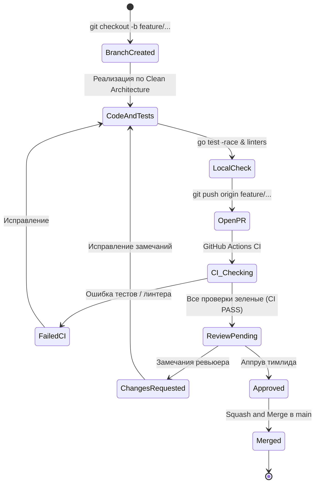
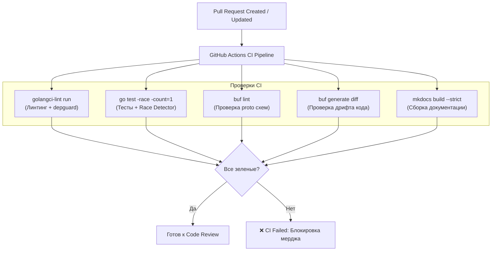

# 04. Как открыть и защитить свой Pull Request

В проекте **Orbit AI** ветка `main` защищена от прямой записи. Любой код — будь то новый микросервис, доработка доменной сущности или исправление опечатки в документации — попадает в кодовую базу **только через Pull Request (PR)**.

Код-ревью в нашей инженерной культуре — это не формальность и не бюрократия, а инструмент обеспечения надежности архитектуры, передачи знаний и защиты от технических долгов.

---

## 1. Жизненный цикл задачи и Pull Request

Работа над любой задачей проходит через строго определённые этапы:



1. **Создание ветки**: ветка отводится от свежего `main` (`feature/name`, `fix/name`, `refactor/name`).
2. **Локальная разработка**: соблюдение слоёв Clean Architecture, написание тестов.
3. **Локальный Quality Gate**: запуск проверок перед коммитом.
4. **Открытие PR**: заполнение шаблона, привязка задачи в GitHub Projects.
5. **Прохождение CI**: автоматические проверки в GitHub Actions.
6. **Code Review**: разбор замечаний, внесение правок.
7. **Вливание (Squash and Merge)**: один чистый коммит в историю `main`.

---

## 2. Чеклист самопроверки перед открытием PR

Не открывайте PR, пока не выполните локальный чеклист качества. Попытка переложить поиск базовых ошибок на CI и ревьюера отнимает время команды.

### Шаг 1. Проверка чистоты git-дерева
Убедитесь, что в коммит не попали временные файлы, секреты (`.env`), скомпилированные бинарники:

```bash
git status
```

### Шаг 2. Запуск тестов с детектором гонок
Все тесты должны проходить без сбоев:

```bash
# Для Go проектов:
go test -v -race -count=1 ./...

# Для Python проектов:
pytest -v

# Для Flutter:
flutter test
```

Флаг `-race` в Go обязателен: он обнаруживает конкурентный доступ к переменным без мьютексов.

### Шаг 3. Запуск линтеров
Код должен удовлетворять правилам стиля и архитектурным ограничениям (depguard):

```bash
# Для Go:
golangci-lint run ./...

# Для Python:
ruff check .

# Для Protobuf схем:
buf lint
```

### Шаг 4. Проверка генерации контрактов
Если вы модифицировали `.proto`-файлы, проверьте отсутствие drift (расхождения) сгенерированного кода:

```bash
buf generate
git diff --exit-code
```

Если команда `git diff --exit-code` возвращает ненулевой код, значит сгенерированные файлы не были закоммичены.

---

## 3. Стандарт оформления Pull Request

Каждый PR должен иметь осмысленное название, соответствующее стандарту [Conventional Commits](01-git-basics.md), и заполненное описание.

### Пример заголовка:
* `feat(usecase): implement reschedule task with owner verification`
* `fix(grpc): return not_found for foreign tasks to prevent idor`
* `refactor(domain): split task repository by ISP`

### Шаблон описания PR:

```markdown
## Что сделано
- Добавлен сценарий `RescheduleTaskUseCase` с проверкой владельца (`actor`).
- Добавлен метод `Reschedule` в агрегат `domain.Task` с инвариантом проверки нового дедлайна.
- Реализован маппинг gRPC-ошибок в хендлере `taskgrpc`.

## Связанная задача
Closes #42

## Тип изменений
- [ ] Bug fix (исправление ошибки)
- [x] New feature (новая функциональность)
- [ ] Refactoring (рефакторинг без изменения контракта)
- [ ] Breaking change (изменение, ломающее обратную совместимость)

## Самопроверка
- [x] Код протестирован с флагом `-race` (100% pass)
- [x] `golangci-lint` проходит без предупреждений
- [x] Нет нарушений архитектурных границ (domain не зависит от внешних слоев)
- [x] Контракты проверены через `buf lint`
```

---

## 4. Автоматические проверки в CI (GitHub Actions)

При открытии или обновлении PR в репозитории запускается пайплайн GitHub Actions.



> [!CRITICAL] Правило «Красного CI»
> Если хотя бы одна проверка в CI упала (красный крестик), **PR не рассматривается ревьюером**.
> Автор обязан изучить логи GitHub Actions, воспроизвести проблему локально, исправить её и запушить коммит в ветку.

---

## 5. Культура и регламент Code Review

Ревью проводится тимлидом или назначенным рецензентом.

### Классификация комментариев:

| Метка | Значение | Требуемое действие |
| :--- | :--- | :--- |
| 🔴 **[Blocker]** | Критический дефект: нарушение Clean Architecture, гонка данных, утечка памяти, уязвимость IDOR, логическая ошибка. | **Обязательно к исправлению.** Мердж заблокирован до устранения. |
| 🟡 **[Suggestion]** | Предложение по улучшению: повышение читаемости, более удачное именование, уменьшение вложенности `if`. | Автор может исправить либо аргументированно объяснить текущее решение. |
| 🟢 **[Nit]** | Мелкая придирка: опечатка в комментарии, лишний перенос строки. | Не блокирует мердж. Исправляется по возможности. |
| 💡 **[Question]** | Вопрос для понимания контекста решения: «Почему здесь выбран `sync.RWMutex`, а не канал?». | Автор даёт пояснение в комментарии. |

### Правила эффективного ревью:
1. **Обсуждаем код, а не автора**: формулируйте замечания объективно («Здесь возможна гонка при обращении к `m.tasks`», а не «Ты забыл мьютекс»).
2. **Предлагайте альтернативу**: указывайте не только на дефект, но и на то, как его исправить.
3. **Разрешение дискуссий (Resolve)**: нажимать кнопку **Resolve conversation** имеет право только тот, кто оставил замечание, после проверки коммита с исправлением.

---

## 6. Definition of Done (Критерии готовности)

Задача считается выполненной (Done), а PR готовым к слиянию в `main`, только если выполнены **все** условия:

* [x] **Архитектурное соответствие**:
  - Домен изолирован от внешних пакетов (только stdlib).
  - Use case зависит только от домена и интерфейсов портов.
  - Транспортный слой не содержит доменной логики.
* [x] **Качество кода и тесты**:
  - Бизнес-логика и пограничные случаи покрыты юнит-тестами.
  - Локальный запуск `go test -race ./...` и CI проходят успешно.
  - Отсутствуют предупреждения линтера (`golangci-lint run`).
* [x] **Безопасность**:
  - Идентификатор пользователя (`actor`) извлекается из метаданных контекста, а не передаётся в теле запроса.
  - Чужие задачи отдают `ErrTaskNotFound` (защита от IDOR).
* [x] **Контракты и API**:
  - Новые gRPC методы или поля добавлены в `.proto` без ломающих изменений (`buf breaking`).
  - Код DTO сгенерирован и закоммичен без дрифта.
* [x] **Ревью**:
  - Получен официальный аппрув (Approved) от тимлида.
  - Все открытые треды с метками `[Blocker]` закрыты.
