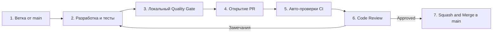
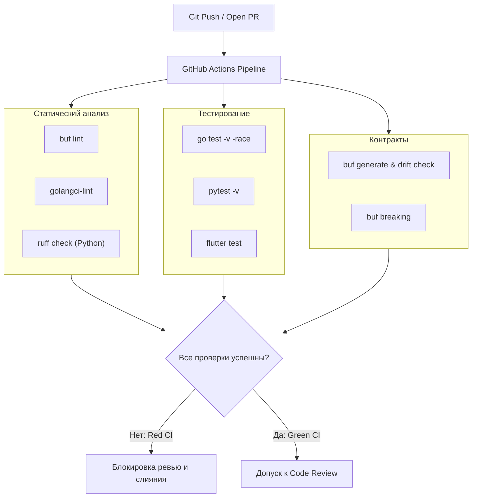
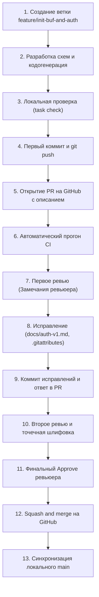

# 04. Как открыть и защитить свой Pull Request

В проекте **Orbit AI** ветка `main` защищена от прямой записи. Любой код — будь то новый микросервис, доработка доменной сущности или исправление опечатки в документации — попадает в кодовую базу **только через Pull Request (PR)**.

Код-ревью в нашей инженерной культуре — это не формальность и не бюрократия, а инструмент обеспечения надежности архитектуры, передачи знаний и защиты от технических долгов.

---

## 1. Жизненный цикл задачи и Pull Request



1. **Создание ветки**: ветка отводится от свежего `main` (`feature/name`, `fix/name`, `refactor/name`).
2. **Локальная разработка**: соблюдение слоёв Clean Architecture, написание тестов.
3. **Локальный Quality Gate**: запуск проверок перед коммитом.
4. **Открытие PR**: заполнение шаблона, привязка задачи в GitHub Projects.
5. **Прохождение CI**: автоматические проверки в GitHub Actions.
6. **Code Review**: разбор замечаний, внесение правок.
7. **Вливание (Squash and Merge)**: один чистый коммит в историю `main`.

---

## 2. Чеклист самопроверки перед открытием PR

Не открывайте PR, пока не выполните локальный чеклист качества. Попытка переложить поиск базовых ошибок на CI и ревьюера отнимает время команды.

### Шаг 1. Проверка чистоты git-дерева
Убедитесь, что в коммит не попали временные файлы, секреты (`.env`), скомпилированные бинарники:

```bash
git status
```

### Шаг 2. Запуск тестов с детектором гонок
Все тесты должны проходить без сбоев:

```bash
# Для Go проектов:
go test -v -race -count=1 ./...

# Для Python проектов:
pytest -v

# Для Flutter:
flutter test
```

Флаг `-race` в Go обязателен: он обнаруживает конкурентный доступ к переменным без мьютексов.

### Шаг 3. Запуск линтеров
Код должен удовлетворять правилам стиля и архитектурным ограничениям (depguard):

```bash
# Для Go:
golangci-lint run ./...

# Для Python:
ruff check .

# Для Protobuf схем:
buf lint
```

### Шаг 4. Проверка генерации контрактов
Если вы модифицировали `.proto`-файлы, проверьте отсутствие drift (расхождения) сгенерированного кода:

```bash
buf generate
git diff --exit-code
```

Если команда `git diff --exit-code` возвращает ненулевой код, значит сгенерированные файлы не были закоммичены.

---

## 3. Стандарт оформления Pull Request

Каждый PR должен иметь осмысленное название, соответствующее стандарту [Conventional Commits](01-git-basics.md), и заполненное описание.

### Пример заголовка:
* `feat(usecase): implement reschedule task with owner verification`
* `fix(grpc): return not_found for foreign tasks to prevent idor`
* `refactor(domain): split task repository by ISP`

### Шаблон описания PR:

```markdown
## Что сделано
- Добавлен сценарий `RescheduleTaskUseCase` с проверкой владельца (`actor`).
- Добавлен метод `Reschedule` в агрегат `domain.Task` с инвариантом проверки нового дедлайна.
- Реализован маппинг gRPC-ошибок в хендлере `taskgrpc`.

## Связанная задача
Closes #42

## Тип изменений
- [ ] Bug fix (исправление ошибки)
- [x] New feature (новая функциональность)
- [ ] Refactoring (рефакторинг без изменения контракта)
- [ ] Breaking change (изменение, ломающее обратную совместимость)

## Самопроверка
- [x] Код протестирован с флагом `-race` (100% pass)
- [x] `golangci-lint` проходит без предупреждений
- [x] Нет нарушений архитектурных границ (domain не зависит от внешних слоев)
- [x] Контракты проверены через `buf lint`
```

---

## 4. Автоматические проверки в CI (GitHub Actions)



> [!CRITICAL] Правило «Красного CI»
> Если хотя бы одна проверка в CI упала (красный крестик), **PR не рассматривается ревьюером**.
> Автор обязан изучить логи GitHub Actions, воспроизвести проблему локально, исправить её и запушить коммит в ветку.

---

## 5. Культура и регламент Code Review

Ревью проводится тимлидом или назначенным рецензентом.

### Классификация комментариев:

| Метка | Значение | Требуемое действие |
| :--- | :--- | :--- |
| 🔴 **[Blocker]** | Критический дефект: нарушение Clean Architecture, гонка данных, утечка памяти, уязвимость IDOR, логическая ошибка. | **Обязательно к исправлению.** Мердж заблокирован до устранения. |
| 🟡 **[Suggestion]** | Предложение по улучшению: повышение читаемости, более удачное именование, уменьшение вложенности `if`. | Автор может исправить либо аргументированно объяснить текущее решение. |
| 🟢 **[Nit]** | Мелкая придирка: опечатка в комментарии, лишний перенос строки. | Не блокирует мердж. Исправляется по возможности. |
| 💡 **[Question]** | Вопрос для понимания контекста решения: «Почему здесь выбран `sync.RWMutex`, а не канал?». | Автор даёт пояснение в комментарии. |

### Правила эффективного ревью:
1. **Обсуждаем код, а не автора**: формулируйте замечания объективно («Здесь возможна гонка при обращении к `m.tasks`», а не «Ты забыл мьютекс»).
2. **Предлагайте альтернативу**: указывайте не только на дефект, но и на то, как его исправить.
3. **Разрешение дискуссий (Resolve)**: нажимать кнопку **Resolve conversation** имеет право только тот, кто оставил замечание, после проверки коммита с исправлением.

---

## 6. Definition of Done (Критерии готовности)

Задача считается выполненной (Done), а PR готовым к слиянию в `main`, только если выполнены **все** условия:

* [x] **Архитектурное соответствие**:
  - Домен изолирован от внешних пакетов (только stdlib).
  - Use case зависит только от домена и интерфейсов портов.
  - Транспортный слой не содержит доменной логики.
* [x] **Качество кода и тесты**:
  - Бизнес-логика и пограничные случаи покрыты юнит-тестами.
  - Локальный запуск `go test -race ./...` и CI проходят успешно.
  - Отсутствуют предупреждения линтера (`golangci-lint run`).
* [x] **Безопасность**:
  - Идентификатор пользователя (`actor`) извлекается из метаданных контекста, а не передаётся в теле запроса.
  - Чужие задачи отдают `ErrTaskNotFound` (защита от IDOR).
* [x] **Контракты и API**:
  - Новые gRPC методы или поля добавлены в `.proto` без ломающих изменений (`buf breaking`).
  - Код DTO сгенерирован и закоммичен без дрифта.
* [x] **Ревью**:
  - Получен официальный аппрув (Approved) от тимлида.
  - Все открытые треды с метками `[Blocker]` закрыты.

---

## 7. Практический кейс: Создание и защита PR #1 в contracts от А до Я

Ниже приведён реальный, пошаговый пример того, как в проекте Orbit AI разрабатывался, проверялся и вливался **[PR #1 в репозитории contracts](https://github.com/orbit-polytech/contracts/pull/1)**. Это эталонный сценарий взаимодействия разработчика, автоматизации CI и ревьюера.



---

### Шаг 1. Создание изолированной ветки задачи
Вся работа всегда ведётся в отдельной ветке. Если в локальном репозитории уже есть ветка `main`, отводим фиче-ветку с флагом `-b`:

```powershell
# Создание и переключение на ветку фичи
git checkout -b feature/init-buf-and-auth
```

> **Важно про ветки в Git:** Ветка физически сохраняется только тогда, когда на ней появляется хотя бы один коммит. Переключаться между ветками до фиксации изменений следует внимательно, чтобы не потерять неотслеживаемые файлы.

---

### Шаг 2. Разработка схем, конфигураций и кодогенерация
В рамках задачи были созданы:
1. `buf.yaml` — конфигурация Buf CLI v2 (правила линтинга `STANDARD` и детектор ломающих изменений `FILE`).
2. `buf.gen.yaml` — плагины кодогенерации Go с закреплёнными версиями.
3. `proto/orbit/auth/v1/auth.proto` — контракт сервиса авторизации (`AuthService`).
4. `Taskfile.yml` — кроссплатформенные команды сборки и автоматизации.
5. `.github/workflows/ci.yml` — пайплайн автоматического тестирования в GitHub Actions.

Перед коммитом запускается локальная кодогенерация и сборка Go:

```powershell
# Запуск чистой генерации кода из proto
task generate

# Проверка успешности компиляции сгенерированного пакета
go build ./gen/go/...
```

---

### Шаг 3. Первый коммит и отправка ветки на GitHub
После того как код скомпилирован без ошибок, добавляем файлы в индекс и пушим ветку на GitHub:

```powershell
# Добавляем все файлы
git add .

# Делаем коммит по стандарту Conventional Commits
git commit -m "feat(contracts): init buf and auth proto"

# Пушим ветку на GitHub (флаг -u связывает локальную ветку с удалённой)
git push -u origin feature/init-buf-and-auth
```

---

### Шаг 4. Открытие Pull Request в интерфейсе GitHub
1. Переходим в репозиторий на GitHub (`https://github.com/orbit-polytech/contracts`).
2. Вверху страницы появляется жёлто-зелёная плашка:
   > *«feature/init-buf-and-auth had recent pushes ... [Compare & pull request]»*
3. Нажимаем кнопку **«Compare & pull request»**.
4. Проверяем направление слияния:
   - `base: main` $\leftarrow$ `compare: feature/init-buf-and-auth`.
   - Зелёная отметка: *«Able to merge»*.
5. В поле **«Add a title»** пишем понятный заголовок: `feat(contracts): init buf and auth proto`.
6. В поле **«Add a description»** заполняем профессиональное описание по регламенту:
   - **Репозиторий / PR:** ссылки и ветки.
   - **Цель изменения:** что решается этим PR.
   - **Что должно работать:** список новых методов и компонентов.
   - **Что сознательно не входит:** границы текущей задачи.
   - **Выполненные проверки:** результаты `buf lint`, `go build`, `task check`.
7. Нажимаем зелёную кнопку **«Create pull request»**.

---

### Шаг 5. Автоматические проверки в CI
Сразу после создания PR GitHub Actions запускает конвейер `.github/workflows/ci.yml`:
- Проверка форматирования (`buf format -d --exit-code`).
- Линтинг proto-схем (`buf lint`).
- Чистая перегенерация и компиляция Go-пакетов.
- **Drift check:** проверка отсутствия незакоммиченных изменений в `go.mod`, `go.sum` и `gen/go`.
- Проверка на ломающие изменения (`buf breaking`) с безопасным пропуском для первого PR.

Внизу страницы PR появляется блок с зелёной галочкой: *«All checks have passed»*.

---

### Шаг 6. Код-ревью: получение и разбор замечаний
Ревьюер изучил PR #1 и вернул 5 обоснованных замечаний:
1. **Неполнота схемы:** в `auth.proto` отсутствовали согласованные поля сроков действия токенов (`Timestamp`), `is_new_user`, `expires_in_seconds` и клиентский контекст (`client_ip`, `user_agent`).
2. **Отсутствие документации правил:** в коде не было описано поведение методов (ротация refresh, инвариант 6 цифр OTP, идемпотентность logout, gRPC-ошибки).
3. **Неполный drift-check:** проверка расхождений проверяла только `gen/go`, пропуская возможные автоматические изменения в `go.mod` и `go.sum`.
4. **Баг в Taskfile на Windows:** команда проверки дрифта использовала переменную `$diff` внутри двойных кавычек `" ... $diff ... "`. Встроенный шелл Taskfile раскрывал её в пустую строку ещё до передачи в PowerShell, что приводило к ошибке `ParserError: IfStatementMissingCondition`.
5. **Оборванный README:** в документации остался незакрытый блок кода.

---

### Шаг 7. Исправление замечаний в кодовой базе
Вместо споров автор системно исправил каждый пункт в той же самой ветке:

1. **Дополнение схемы:** в `proto/orbit/auth/v1/auth.proto` добавлены недостающие поля с сохранением тега `user_id = 3` (правило неизменности тегов Protobuf).
2. **Документирование контракта:** по согласованию с автором (чтобы не перегружать `.proto` комментариями) была создана подробная архитектурная спецификация [`docs/auth-v1.md`](https://github.com/orbit-polytech/contracts/blob/main/docs/auth-v1.md).
3. **Безопасный drift-check:** в `Taskfile.yml` и `ci.yml` проверка дрифта переписана без использования конфликтующих переменных и расширена на `go.mod` и `go.sum`:
   ```yaml
   - cmd: powershell -NoProfile -Command "if (git status --porcelain go.mod go.sum gen/go) { git status --porcelain go.mod go.sum gen/go; exit 1 }"
     platforms: [windows]
   ```
4. **Стабильность переводов строк:** добавлен файл `.gitattributes` с правилом `eol=lf`, что предотвратило ложные срабатывания дрифта из-за Windows-окончаний CRLF.
5. **Локальная верификация на Windows:** проверены оба кейса — чистая сборка завершилась с кодом `0`, а тестовое внесение изменения в `go.mod` мгновенно привело к падению `task check` с кодом `1`.

---

### Шаг 8. Коммит исправлений и ответ ревьюеру на GitHub
1. Фиксируем исправления коммитом и пушим их в ту же ветку (новый коммит автоматически привязывается к открытому PR #1):
   ```powershell
   git add .
   git commit -m "fix(contracts): address review comments on auth.proto, drift check and docs"
   git push
   ```
2. Открываем страницу PR на GitHub, переходим на вкладку **Conversation** и прокручиваем в самый низ до блока **«Add a comment»**.
3. Пишем подробный, структурированный ответ с отчётом по каждому пункту замечаний и нажимаем зелёную кнопку **«Comment»**.

---

### Шаг 9. Вторая итерация и точечная шлифовка
Ревьюер проверил коммиты и подсветил тонкую архитектурную деталь:
- `SendCode` не является идемпотентным, так как принятый повторный запрос выпустит новый OTP и аннулирует старый. Поэтому автоматический сетевой retry при таймауте для него запрещён (повтор инициируется только вручную пользователем в UI с учётом cooldown).
- Для `VerifyCode` и `RefreshToken` авто-повтор также запрещён, чтобы не вызвать ложное срабатывание детекции компрометации (Reuse Detection).

Автор точечно обновил раздел Retry Policy в `docs/auth-v1.md`, сделал коммит `docs(auth): refine retry policy and add gitattributes`, запушил его и отчитался в комментарии.

---

### Шаг 10. Получение Approve и Squash and Merge
После второй итерации ревьюер оставил вердикт:
> *«Блокирующих замечаний больше нет. CI зелёный. Можно сливать PR #1 в main через Squash and merge».*

**Как правильно выполнить слияние:**
1. На странице PR прокручиваем вниз до плашки слияния.
2. Нажимаем на стрелочку **`▼`** на зелёной кнопке слияния и выбираем режим **«Squash and merge»**.
3. Нажимаем кнопку **«Squash and merge»**.
4. В появившемся окне проверяем итоговое лаконичное название коммита: `feat(contracts): init buf and auth proto (#1)`.
5. Нажимаем зелёную кнопку **«Confirm squash and merge»**.
6. Статус PR меняется на фиолетовый **Merged** 🟣.
7. Нажимаем появившуюся кнопку **«Delete branch»**, чтобы удалить удалённую ветку фичи на GitHub и содержать репозиторий в чистоте.

---

### Шаг 11. Синхронизация локального репозитория
После того как PR слит на GitHub, возвращаемся в терминал VS Code, чтобы обновить локальную ветку `main`:

```powershell
# Переключаемся на главную ветку
git checkout main

# Подтягиваем итоговый сквош-коммит из GitHub
git pull origin main
```

Ветка `main` содержит чистую историю из одного атомарного коммита, контракт и автоматизация приняты, а задача официально переведена в статус **Done**.

