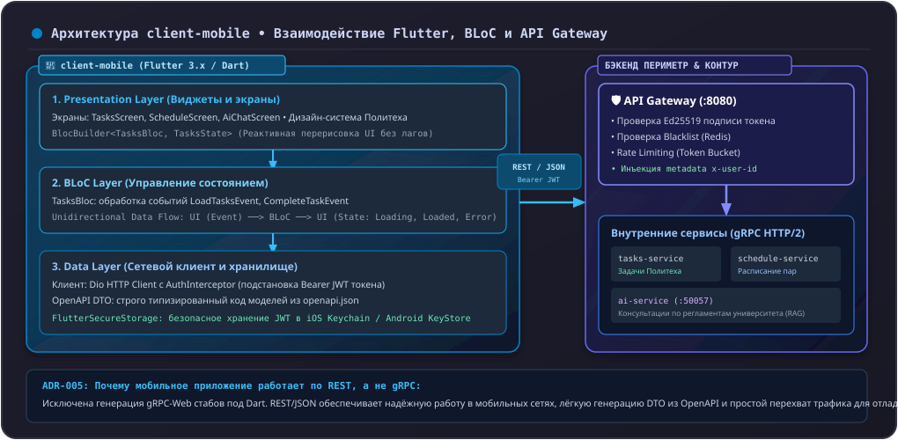

# 01. Введение во Flutter & Dart (Архитектура client-mobile)

Мобильное приложение **`client-mobile`** — основной пользовательский интерфейс экосистемы Orbit AI для студентов Московского Политеха. Оно предоставляет доступ к расписанию занятий, списку учебных задач и консультациям с AI-ассистентом.

Приложение разрабатывается на фреймворке **Flutter 3.x** с языком **Dart 3.x** и следует принципам **Clean Architecture** в сочетании с подходом **Feature-First**.

---

## 1. Архитектурное позиционирование в системе

В соответствии с решением **ADR-005**, мобильное приложение общается с бэкендом **исключительно через внешний API Gateway по протоколу REST/JSON**:



### Почему в мобильном приложении нет gRPC:
- В репозитории контрактов `contracts` генерация кода под Dart исключена (ADR-005).
- Использование gRPC на мобильных устройствах потребовало бы проксирования gRPC-Web и усложнило бы отладку сетевого трафика.
- Клиентский код для обращения к Gateway автоматически генерируется из открытой спецификации **OpenAPI** (`openapi.json`).

---

## 2. Структура проекта: подход Feature-First

Вместо разбиения всего проекта на глобальные технические слои используется модульная структура по бизнес-фичам (**Feature-First**):

```text
lib/
├── core/                         # Общие компоненты приложения
│   ├── network/                  # Dio клиент, AuthInterceptor, перехват ошибок
│   ├── storage/                  # Безопасное хранилище токенов (SecureStorage)
│   ├── theme/                    # Дизайн-система (цвета Политеха, шрифты, темы)
│   └── utils/                    # Логгеры, расширения типов
├── features/                     # Бизнес-модули
│   ├── tasks/                    # Модуль учебных задач
│   │   ├── domain/               # Сущности и интерфейсы репозиториев
│   │   │   ├── entities/         # TaskEntity, TaskPriority, TaskStatus
│   │   │   └── repositories/     # TasksRepository (интерфейс)
│   │   ├── data/                 # Реализация источников данных и DTO
│   │   │   ├── datasources/      # TasksRemoteDataSource (вызовы REST API)
│   │   │   ├── models/           # TaskModel (сериализация fromJson/toJson)
│   │   │   └── repositories/     # TasksRepositoryImpl
│   │   └── presentation/         # Пользовательский интерфейс и состояние
│   │       ├── bloc/             # TasksBloc, TasksEvent, TasksState
│   │       ├── screens/          # TasksListScreen, CreateTaskScreen
│   │       └── widgets/          # TaskCardWidget, PriorityBadgeWidget
│   ├── schedule/                 # Модуль расписания занятий
│   └── ai_chat/                  # Модуль диалога с AI-ассистентом
└── main.dart                     # Composition Root мобильного приложения
```

---

## 3. Возможности Dart 3 для чистого кода

Dart 3 ввел мощные инструменты для надежного описания моделей и состояний:

### 3.1 Запечатанные классы (`sealed classes`)
Вместо использования внешних библиотек генерации кода (`freezed`) состояния и события описываются нативными `sealed` классами:

```dart
// features/tasks/presentation/bloc/tasks_state.dart
import '../../domain/entities/task_entity.dart';

sealed class TasksState {
  const TasksState();
}

final class TasksInitialState extends TasksState {
  const TasksInitialState();
}

final class TasksLoadingState extends TasksState {
  const TasksLoadingState();
}

final class TasksLoadedState extends TasksState {
  final List<TaskEntity> tasks;
  const TasksLoadedState({required this.tasks});
}

final class TasksErrorState extends TasksState {
  final String errorMessage;
  const TasksErrorState({required this.errorMessage});
}
```

### 3.2 Исчерпывающее сопоставление с образцом (Pattern Matching)
Компилятор Dart проверяет, что в блоке `switch` обработаны абсолютно все состояния. Если разработчик добавит новое состояние и забудет его обработать, код не скомпилируется:

```dart
Widget build(BuildContext context) {
  return BlocBuilder<TasksBloc, TasksState>(
    builder: (context, state) {
      return switch (state) {
        TasksInitialState() => const SizedBox.shrink(),
        TasksLoadingState() => const Center(child: CircularProgressIndicator()),
        TasksLoadedState(:final tasks) => TasksListView(tasks: tasks),
        TasksErrorState(:final errorMessage) => ErrorPlaceholder(message: errorMessage),
      };
    },
  );
}
```

---

## 4. Антипаттерны: как нельзя и как правильно

### ❌ Как нельзя:
```dart
// ОШИБКА 1: Сетевые запросы прямо внутри StatefulWidget
class _BadScreenState extends State<BadScreen> {
  void initState() {
    super.initState();
    http.get(Uri.parse('https://api/tasks')); // Нарушение: UI напрямую лезет в сеть!
  }
}

// ОШИБКА 2: Хранение паролей и JWT в SharedPreferences
final prefs = await SharedPreferences.getInstance();
prefs.setString('jwt_token', token); // Уязвимость: SharedPreferences хранит открытый XML на диске!

// ОШИБКА 3: Попытка подключить gRPC клиент напрямую к внутреннему бэкенду
final channel = ClientChannel('10.0.4.15'); // Нарушение: мобилка не имеет прямого доступа к внутренним подам
```

### ✅ Как правильно:
```dart
// Разделение слоев: Виджет отправляет событие в BLoC
context.read<TasksBloc>().add(const LoadTasksEvent());

// Токены сохраняются в защищенном KeyStore/Keychain:
await secureStorage.write(key: 'access_token', value: token);

// Все вызовы идут через единый REST API Gateway:
final response = await dioClient.get('/api/v1/tasks');
```

---

## Резюме

1. Мобильное приложение построено на Flutter 3 и Dart 3 по схеме Feature-First.
2. Взаимодействие с системой идет строго через REST API Gateway.
3. Состояния и события описываются через нативные `sealed classes` и `pattern matching`.
4. Токены авторизации хранятся в защищенном хранилище ОС.
