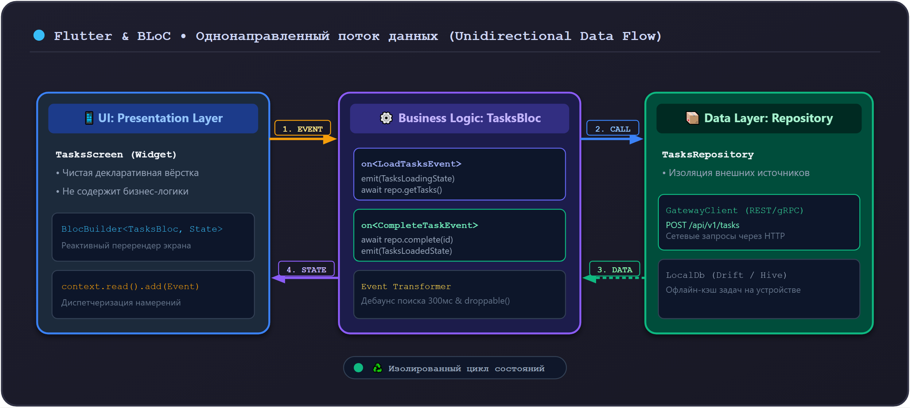

# 02. Слой Presentation и управление состоянием BLoC

В проекте Orbit AI управление состоянием мобильного приложения построено на библиотеке **`flutter_bloc`** — признанном индустриальном стандарте для масштабируемых Flutter-приложений.

Паттерн BLoC (Business Logic Component) обеспечивает однонаправленный поток данных (**Unidirectional Data Flow**), полностью изолируя верстку виджетов от бизнес-логики.

---

## 1. Поток данных в BLoC




---

## 2. Реализация `TasksBloc`: События, Состояния и Логика

### 2.1 События (`tasks_event.dart`)
События описывают намерения пользователя или системы:

```dart
// features/tasks/presentation/bloc/tasks_event.dart
sealed class TasksEvent {
  const TasksEvent();
}

final class LoadTasksEvent extends TasksEvent {
  const LoadTasksEvent();
}

final class CompleteTaskEvent extends TasksEvent {
  final String taskId;
  const CompleteTaskEvent({required this.taskId});
}

final class CreateTaskEvent extends TasksEvent {
  final String title;
  final String description;
  final DateTime deadline;
  final String priority;

  const CreateTaskEvent({
    required this.title,
    required this.description,
    required this.deadline,
    required this.priority,
  });
}
```

### 2.2 Состояния (`tasks_state.dart`)
Состояния отражают текущий снимок пользовательского интерфейса:

```dart
// features/tasks/presentation/bloc/tasks_state.dart
import '../../domain/entities/task_entity.dart';

sealed class TasksState {
  const TasksState();
}

final class TasksInitial extends TasksState {
  const TasksInitial();
}

final class TasksLoading extends TasksState {
  const TasksLoading();
}

final class TasksLoaded extends TasksState {
  final List<TaskEntity> tasks;
  const TasksLoaded({required this.tasks});
}

final class TasksError extends TasksState {
  final String message;
  const TasksError({required this.message});
}
```

### 2.3 Логика BLoC (`tasks_bloc.dart`)

```dart
// features/tasks/presentation/bloc/tasks_bloc.dart
import 'package:flutter_bloc/flutter_bloc.dart';
import '../../domain/repositories/tasks_repository.dart';
import 'tasks_event.dart';
import 'tasks_state.dart';

class TasksBloc extends Bloc<TasksEvent, TasksState> {
  final TasksRepository _repository;

  TasksBloc({required TasksRepository repository})
      : _repository = repository,
        super(const TasksInitial()) {
    on<LoadTasksEvent>(_onLoadTasks);
    on<CompleteTaskEvent>(_onCompleteTask);
  }

  Future<void> _onLoadTasks(
    LoadTasksEvent event,
    Emitter<TasksState> emit,
  ) async {
    emit(const TasksLoading());
    try {
      final tasks = await _repository.getTasks();
      emit(TasksLoaded(tasks: tasks));
    } catch (e) {
      emit(TasksError(message: 'Не удалось загрузить задачи: ${e.toString()}'));
    }
  }

  Future<void> _onCompleteTask(
    CompleteTaskEvent event,
    Emitter<TasksState> emit,
  ) async {
    try {
      await _repository.completeTask(event.taskId);
      // После успешного обновления перезапрашиваем актуальный список
      add(const LoadTasksEvent());
    } catch (e) {
      emit(TasksError(message: 'Не удалось завершить задачу'));
    }
  }
}
```

---

## 3. Интеграция с UI: `BlocBuilder` vs `BlocListener`

В Flutter виджеты не должны содержать логику реакции на однократные события (Side Effects), такие как показ всплывающих уведомлений (`SnackBar`) или переход на другой экран (`Navigator`).

Для этого используется разделение:
- **`BlocBuilder`**: отвечает строго за отрисовку и возвращает дерево виджетов.
- **`BlocListener`**: вызывается один раз на каждое изменение состояния для выполнения побочных эффектов.
- **`BlocConsumer`**: объединяет оба механизма.

```dart
// features/tasks/presentation/screens/tasks_screen.dart
import 'package:flutter/material.dart';
import 'package:flutter_bloc/flutter_bloc.dart';
import '../bloc/tasks_bloc.dart';
import '../bloc/tasks_event.dart';
import '../bloc/tasks_state.dart';

class TasksScreen extends StatelessWidget {
  const TasksScreen({super.key});

  @override
  Widget build(BuildContext context) {
    return Scaffold(
      appBar: AppBar(title: const Text('Мои задачи')),
      body: BlocConsumer<TasksBloc, TasksState>(
        listener: (context, state) {
          // Однократная реакция на ошибку:
          if (state is TasksError) {
            ScaffoldMessenger.of(context).showSnackBar(
              SnackBar(content: Text(state.message), backgroundColor: Colors.red),
            );
          }
        },
        builder: (context, state) {
          return switch (state) {
            TasksInitial() => const Center(child: Text('Нажмите обновить')),
            TasksLoading() => const Center(child: CircularProgressIndicator()),
            TasksLoaded(:final tasks) => ListView.builder(
                itemCount: tasks.length,
                itemBuilder: (context, index) {
                  final task = tasks[index];
                  return ListTile(
                    title: Text(task.title),
                    subtitle: Text('Дедлайн: ${task.deadline}'),
                    trailing: IconButton(
                      icon: const Icon(Icons.check_circle_outline),
                      onPressed: () {
                        context.read<TasksBloc>().add(CompleteTaskEvent(taskId: task.id));
                      },
                    ),
                  );
                },
              ),
            TasksError() => const Center(child: Text('Ошибка загрузки')),
          };
        },
      ),
      floatingActionButton: FloatingActionButton(
        onPressed: () => context.read<TasksBloc>().add(const LoadTasksEvent()),
        child: const Icon(Icons.refresh),
      ),
    );
  }
}
```

---

## 4. Модульное тестирование BLoC (`bloc_test`)

BLoC легко тестируется детерминированными тестами с помощью библиотеки `bloc_test`:

```dart
// test/features/tasks/tasks_bloc_test.dart
import 'package:bloc_test/bloc_test.dart';
import 'package:flutter_test/flutter_test.dart';
import 'package:mocktail/mocktail.dart';

class MockTasksRepository extends Mock implements TasksRepository {}

void main() {
  late MockTasksRepository mockRepo;

  setUp(() {
    mockRepo = MockTasksRepository();
  });

  blocTest<TasksBloc, TasksState>(
    'эмитит [TasksLoading, TasksLoaded] при успешной загрузке задач',
    build: () {
      when(() => mockRepo.getTasks()).thenAnswer((_) async => [testTask]);
      return TasksBloc(repository: mockRepo);
    },
    act: (bloc) => bloc.add(const LoadTasksEvent()),
    expect: () => [
      const TasksLoading(),
      TasksLoaded(tasks: [testTask]),
    ],
  );
}
```

---

## 5. Антипаттерны: как нельзя и как правильно

### ❌ Как нельзя:
```dart
// ОШИБКА 1: Вызов навигации или SnackBar внутри BlocBuilder
BlocBuilder<TasksBloc, TasksState>(
  builder: (context, state) {
    if (state is TasksError) {
      // КАТАСТРОФА: SnackBar будет вызываться сотни раз при каждой перерисовке экрана!
      ScaffoldMessenger.of(context).showSnackBar(...);
    }
    return Container();
  },
)

// ОШИБКА 2: Мутация внутреннего списка вместо создания нового состояния
state.tasks.add(newTask); // Flutter не увидит изменение ссылки и не перерисует экран!
emit(state);
```

### ✅ Как правильно:
```dart
// Побочные эффекты (SnackBar, Navigation) живут только в BlocListener:
BlocListener<TasksBloc, TasksState>(
  listener: (context, state) {
    if (state is TasksError) {
      ScaffoldMessenger.of(context).showSnackBar(...);
    }
  },
)

// Выпуск нового неизменяемого состояния:
emit(TasksLoaded(tasks: List.unmodifiable([...state.tasks, newTask])));
```

---

## Резюме

1. Паттерн BLoC гарантирует строгий однонаправленный поток данных.
2. Состояния и события типизируются через нативные `sealed classes`.
3. Отрисовка UI (`BlocBuilder`) строго отделена от побочных эффектов (`BlocListener`).
4. BLoC покрывается надежными тестами через `bloc_test`.
